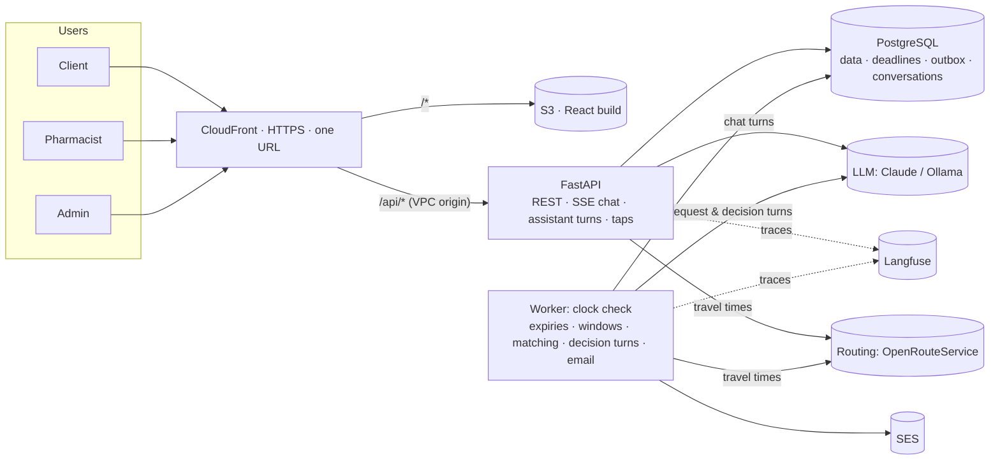
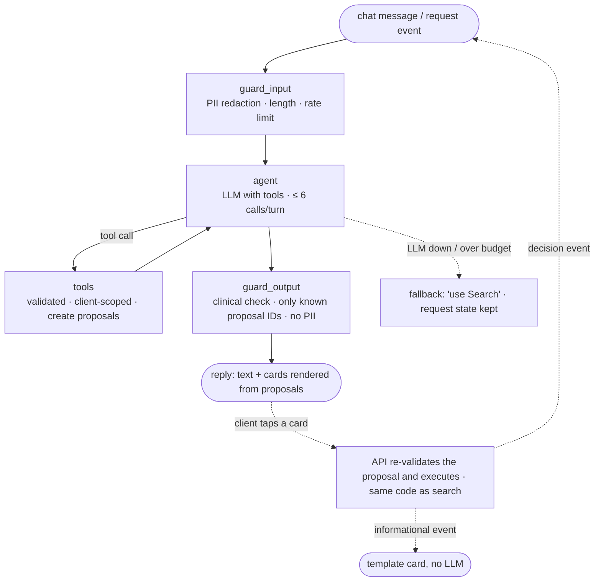

# DawaLink: Architecture and Tech Stack

**Version:** v3.0 · **Date:** 2026-10-20
**Builds on:** `01` v5.0 · `03` v4.0 · `04` v4.0 · `05` v3.0 · ADR-001–ADR-004 · [design review #2](reviews/design_review_02.md) · the professor's guidance (decision log §S)
**Repository:** https://github.com/Mohammed-Farhat/Dawa_Link (public)
**Status:** ✅ Stack validated. **v3.0 applies the professor's guidance** (decision log §S, ADR-004):
- a **routing service** (OpenRouteService, OpenStreetMap data) for travel times and routes, with a straight-line fallback and a cache;
- **maps** in the browser (Leaflet + OpenStreetMap tiles) for the pharmacy pin and the listing detail;
- location data kept **out of the LLM context**.

**v2.0 applied design review #2** (decision log §N):
- a **clock check** loop instead of a jobs table;
- **server-side sessions**;
- **cards only from tools** (proposals);
- a turn lease;
- polling for new cards;
- networking: **public-subnet tasks** + a **CloudFront VPC origin** to an internal ALB;
- regular Fargate (no Spot);
- a demo clock.

**Still open:** which LLM model, and who pays for it (§10).

This is the high-level view. The details live in their own documents:
- database: `05_database.md`
- API: `06_api.md`
- agent: `07_agent.md`
- evaluation: `08_evaluation.md`

---

## 1. Decisions and why

The team's strongest language is Python, and the team must be able to read, review and defend every line. So **the backend, agent, evaluation and infrastructure are Python**; only the browser UI is TypeScript.

| Layer | Choice | Why | Rejected |
|---|---|---|---|
| Backend | **Python 3.12, FastAPI, Pydantic v2** | Team language; typed schemas are the API contract; OpenAPI generated automatically | NestJS (new to the team), Django (heavier) |
| Env and packages | **uv** + lockfile | Reproducible installs | pip without a lockfile |
| Database | **PostgreSQL 16, SQLAlchemy 2.0 (sync, psycopg 3), Alembic** | Row locks for stock; advisory locks for matching; versioned migrations | Async SQLAlchemy, MongoDB |
| LLM by stage | **Tests/CI:** fake, scripted LLM. **Development:** **Ollama** `qwen2.5:7b` (local). **Evaluation and demo:** the real model, chosen by measurement. The provider and model are config values. | $0 while building; deterministic CI; the local model is also one evaluation candidate | Paying for tokens from day one |
| Agent | **LangGraph, stateless per turn** + `langchain-anthropic` / `langchain-ollama` | An explicit, traceable graph (guards, tool loop, fallback). Conversations live in our tables (ADR-001). **One agent, two modes:** assistant and sourcing (ADR-002). | Strands; LangChain alone; no framework (ADR-001 option C) |
| Background work | **Worker** running one **clock check** loop (every few seconds) that reads the deadlines stored on the rows | Offer and reservation expiry, search windows, matching, agent turns for decision events, email. **No jobs table:** nothing can get stuck, and the simulation just advances the clock (`04` R-T10). | Jobs table; Celery + Redis |
| Email | **AWS SES** via an outbox table | Retries; templates | Sending email directly from the app |
| Frontend | **React + TypeScript (Vite), Mantine, TanStack Query, React Router**, types from OpenAPI | Role portals + a chat that renders cards + request pages | Streamlit, Next.js |
| Chat transport | **SSE** for streaming a reply (15 s heartbeat) + **polling every few seconds** for new messages and cards posted by the worker | Fast-feeling replies; simple, reliable updates | WebSockets |
| Auth | **Server-side sessions:** a random token in an httpOnly, Secure, SameSite=Strict cookie; its hash in a `sessions` table; argon2id passwords; role and ownership checks; slowapi rate limits; email verification | Less code than JWT + refresh tokens; logout and suspension take effect instantly; same origin through one CloudFront, so no CORS. *(Admin 2FA and password reset postponed.)* | JWT + refresh rotation; tokens in localStorage |
| Files | **No file storage.** Uploads are processed in memory and discarded. | Smaller attack surface | A private S3 bucket |
| **Routing** | **OpenRouteService** (free tier, API key; built on OpenStreetMap data, attribution shown): road travel time **by car and on foot**, and the best visiting order for plans. Cached 24 h; **straight-line fallback** when it fails (`04` R-RT). | Real routes, as the professor asked; open data; no cost at our scale | Google Maps (paid), straight-line only (not a real route) |
| **Maps (browser)** | **Leaflet + OpenStreetMap tiles**: the pharmacy pins itself at registration; clients see the pharmacy on a map | Free and open; drawn in the browser, so nothing goes to the AI | Google Maps |
| LLM tracing | **Langfuse Cloud** (free tier) | Traces, tokens, cost, prompt versions | LangSmith |
| Logs | **structlog** JSON → CloudWatch | One request and trace ID across API, worker and agent | none |
| Quality | **ruff, mypy, pytest** + coverage; ESLint, Vitest | Standard | none |
| CI/CD | **GitHub Actions** (OIDC), CodeQL, Dependabot, secret scanning, Trivy, SonarCloud, Codecov | Free on a public repo; bonus credit | Jenkins |
| Infrastructure | **AWS CDK (Python)** | Same language; one-command create and destroy | Terraform |
| Hosting | **ECS Fargate (regular, no Spot) + internal ALB + one CloudFront (VPC origin) + S3 (frontend only) + RDS + SES** | Team has Fargate experience; production-like; no unencrypted hop over the internet | EC2 + Compose |
| Local dev | **Docker Compose** (postgres, api, worker, web) + Ollama on the host | One command | none |

---

## 2. System overview



**Where agent turns run (ADR-001, ADR-002):**

| Trigger | Runs in | LLM? |
|---|---|---|
| Client chat message | API (streamed over SSE) | ✅ |
| Request submitted; client message in a request thread | Worker (the conversation is marked `pending_turn_at`; the page updates by polling) | ✅ |
| **Decision event:** a reservation marked not available, early release unfulfilled, the 1-hour-left window check, unticked items after a group reserve | Worker | ✅ |
| **Informational event:** reserved, picked up, expired, cancelled, offer, admin reply, closed | API or worker posts a **template card** | ❌ |

- **One turn at a time per conversation** (a turn lease on the conversation row).
- **Allocation of scarce stock** (matching) is **pure code**, first come, first served (R-PRI, ADR-003).
- **Search-page reservations never trigger agent turns** (keeps the baseline agent-free, R-AG5).

**Domain core (pure Python, no I/O):** state machines, pickup deadlines, pricing, zones, request hours, the allocator, and the `plan_basket` optimizer. All are unit-tested without a database or LLM, using an injected clock.

---

## 3. The agent (high level; full spec in `07`)

### 3.1 Graph (the same for both modes)



### 3.2 Tools (full contracts in [`07`](07_agent.md) §4)

| Tool | Does | Guarantees (code) |
|---|---|---|
| `search_catalog(text)` | Candidate products | No controlled products |
| `get_equivalents(product_id)` | Same-composition products | Exact equivalence group only |
| `find_options(product_ids, qty, days_of_use, pickup, max_price, sort)` | Visible listings **whose box lasts the days of use**, with travel time by car and on foot from the client's location | Visible stock only; **never returns coordinates** |
| **`plan_basket(items, constraints, preference)`** | Candidate plans for several medicines, each with its **route** (visiting order, total travel time); quantities may be split across pharmacies | Deterministic; only boxes that last |
| `propose_reservation(listing_id, qty)` / **`propose_plan(plan_id)`** | A **proposal** for a [Reserve] or [Reserve these] card, or the reason it isn't allowed (limits) | Creates a stored proposal only; the tap reserves |
| `propose_cancellation(order_id)` | A [Cancel] proposal | Only the tap cancels |
| **`prepare_request_summary(items, district, budget)`** | A request summary proposal with [Start sourcing] | Creates nothing else; the tap creates the request (request hours checked) |
| **`get_request_status(request_id)`** | Items, statuses, timeline | Own requests only |
| `get_reservations(view)` | The client's own reservations | Own only |
| **`propose_constraint_change(request_id, change)`** | A proposal: allow alternatives, or raise an item's max price | Applied only on tap |
| **`propose_remove_item(request_id, item_id)`** | A proposal to stop sourcing one item | Applied only on tap |
| **`open_claim(request_item_id)`** / `create_watch(product_id, district, max_price, qty)` | Waits for stock for 6 hours; matching decides first come, first served | Idempotent; limits; request hours |
| `request_early_release(claim_id)` | Asks up to 3 open pharmacies | Returns only "asked N"; anti-spam; idempotent |
| `schedule_followup(in_minutes)` | One later check-in, inside the window (`04` N-39) | Bounded; one pending per request |
| `escalate(reason, summary)` | Hands off to an admin (including `emergency_claim`) | Admin-only visibility; no priority power |

- **There is no tool to create, accept or cancel orders or requests, or to change priority, prices or stock** (INV-11, INV-17).
- **Tool results contain codes, numbers and IDs only**: never text typed by pharmacies (R-AG8).

### 3.3 Memory

| Kind | Scope and lifetime | Content |
|---|---|---|
| **Conversations** (`kind` = chat or request) | Our tables (ADR-001); kept 30 days after last activity or close | Messages (PII-redacted, including decision events as system messages) + **case state** (items in focus, constraints, options and plans shown, pending proposals) |
| **Proposals** | Per conversation; expire (e.g. 2 h) and are used once | The exact content of each card the agent showed |
| **Request record** | Sourcing request + items + claims + orders (system of record) | The agent reads it through tools and changes it only through tools or taps |
| **Client preferences** | Profile fields | Default district, alternatives OK |
| **Location** | Per chat, request or claim; rounded to ~100 m | Stored **outside the case state**, so it's never in the LLM context; the agent sees travel times only |

### 3.4 Guardrails, limits, baselines
- **Input:** PII redaction (known account identifiers + patterns), length cap, rate limit.
- **Output:** clinical check, only proposal IDs that this turn's tools created, no PII.
- **Limits:** 6 tool calls per turn, 20 turns per request, a daily token budget per client.
- **Degraded mode:** chat → "use Search". Requests keep their state; turns resume later.
- **Baselines (evaluation, `08`):**
  - search page + [Notify me], driven by a scripted user;
  - a **scripted sourcing policy with no AI**, using the same tools.

---

## 4. Main data entities (full design in `05`)

| Area | Entities |
|---|---|
| Identity | users, sessions, email-verification tokens, pharmacies (weekly opening hours, pickup time, **map pin**), districts (governorate, reference point) |
| Catalog | products (flags, `units_per_pack`), equivalence groups. Loaded by script from the MoPH list + team overrides and OTC files. |
| Inventory | inventory_uploads + staging rows (until Apply), inventory_items (private; a listing is an item's publication state) |
| Marketplace | orders (offer → reservation → pickup; units; order number) |
| **Agent** | **sourcing_requests**, **request_items**, **claims** (the single need: watches + waiting request items), early_release_requests + asks, conversations (case state, turn lease), chat_messages, **proposals**, answer_reports |
| Admin | escalations, abuse_flags |
| Operations | notifications + email outbox, audit_events, agent_runs + agent_tool_calls, app_state, **travel_time_cache** |

---

## 5. API areas (full contract in [`06`](06_api.md))

| Area | Examples | Role |
|---|---|---|
| Auth | register (client / pharmacy), login, logout, me, verify email | public / any |
| Catalog | search products, equivalents | logged-in |
| Client | search listings; reserve (single, group, from a proposal); accept or decline offers; cancel; watches; notifications; preferences | client (own) |
| **Requests** | create (tap on a proposal or the form), get, list, cancel, apply a proposed change (tap), post a message | client (own) |
| Conversations | `POST /api/v1/conversations/{id}/messages` (chat: SSE; request thread: 202), `GET …/messages?after_seq=` (polling), new chat, report a message (👎) | client (own) |
| **Proposals** | `POST /api/v1/proposals/{id}/execute`: the only way an agent card's button acts | client (own) |
| Pharmacy | profile, hours, pickup time; template download; upload → validate → apply; inventory edits; listings (override, pause); **reservations (picked up, not available)**; early-release asks | pharmacist (own, approved) |
| Admin | approvals; pharmacies (edit, suspend); clients; escalations (reply, resolve); abuse flags; reported answers (→ regression); catalog (read-only); health; audit log; **demo clock (demo mode only)** | admin |
| Health | `GET /api/health` | public |

---

## 6. Repository structure

```
dawalink/
├── README.md · docker-compose.yml · .env.example · .github/workflows/
├── backend/
│   ├── pyproject.toml · uv.lock · Dockerfile · alembic.ini
│   ├── src/dawalink/
│   │   ├── config.py
│   │   ├── domain/        # pure: state machines, rules, deadlines, pricing, zones, allocator, plan_basket
│   │   ├── db/            # models, session, repositories
│   │   ├── services/      # use cases (reservations, requests, matching, uploads…)
│   │   ├── api/           # routers, auth (sessions), SSE, errors
│   │   ├── agent/         # graph, tools, proposals, guards, prompts/
│   │   ├── worker/        # the clock check loop, email outbox
│   │   └── observability/
│   ├── scripts/           # catalog import, create admin, seed data
│   ├── data/              # districts.csv, catalog_overrides.yaml
│   ├── migrations/
│   └── tests/
├── frontend/              # client (search, assistant, requests), pharmacy, admin
├── sim/  ·  eval/  ·  infra/  ·  docs/
```

---

## 7. Deployment (AWS, CDK)

```
CloudFront (HTTPS on *.cloudfront.net)
├── /*      → S3 (React build), private, Origin Access Control
└── /api/*  → VPC origin → internal ALB → ECS "api" (Fargate) · ECS "worker" (Fargate)
RDS PostgreSQL db.t4g.micro (isolated subnet) · SES · Secrets Manager (DB, LLM key, Langfuse keys, routing key)
```

- **Networking:**
  - **The ALB is internal.** CloudFront reaches it through a **VPC origin**, so traffic between CloudFront and our servers never crosses the public internet unencrypted, and no secret header is needed.
  - **ECS tasks run in public subnets with public IPs** for outbound access (Claude API, Langfuse, ECR, Secrets Manager). Their security group accepts inbound traffic **only from the ALB**.
  - There is no NAT gateway.
- **Regular Fargate** for the API and the worker (no Spot), one task each.
- Migrations run as a one-off task before each deploy.
- **SES:** the sandbox only sends to verified addresses. Prepare demo accounts, or request production access well before the demo.
- **Cost:**
  - budget alerts at $50 / $80;
  - about $55–65 per month while deployed;
  - **short test deploys, then `cdk destroy`**; the final stack is deployed close to the demo and destroyed after it.

---

## 8. Bonus engineering practices
| Practice | How |
|---|---|
| Workflow | GitHub Projects, reviewed PRs, branch protection |
| CI/CD | Lint → types → tests + coverage → offline evaluation gate → build → deploy |
| Code quality automation | SonarCloud, Codecov, ruff, mypy |
| Agent evaluation automation | Evaluation gate in CI (understanding, safety, and offline request-simulation metrics must not regress) |
| Advanced AgentOps | Langfuse (model, prompt version, tokens, cost, latency, mode) |
| DevSecOps | CodeQL, Dependabot, secret scanning, Trivy, OIDC |
| Reproducible deployment | Docker Compose, CDK, Alembic, uv lockfile |
| Controlled evolution | Versioned prompts; model as config; ablations, baselines and model comparison recorded |

---

## 9. Who does what
Claude writes the code. **Every change goes through a PR that a teammate reviews and can explain.** The team:
- writes and labels the client-request set (Arabizi, Arabic, English);
- creates realistic inventory files in the template;
- owns the AWS account and checks deployments;
- tests and red-teams by hand;
- writes the report and runs the demo.

**Build order:** the agent and its evaluation first (the graded core), then the platform screens.

---

## 10. Still open
1. **The LLM model**, chosen by measurement: the cheapest model that meets the quality bar. Candidates:
   - local `qwen2.5:7b`;
   - Claude Haiku 5.5 (`claude-haiku-5-5`, $0.10 / $0.50 per 1M tokens);
   - Claude Sonnet 5.5 (`claude-sonnet-5-5`, $2 / $10);
   - Claude Opus 5.5 (`claude-opus-5-5`, $4 / $20), as an upper reference on a small sample.
2. **Who pays for the real LLM:** needed only for the evaluation runs and the demo.
