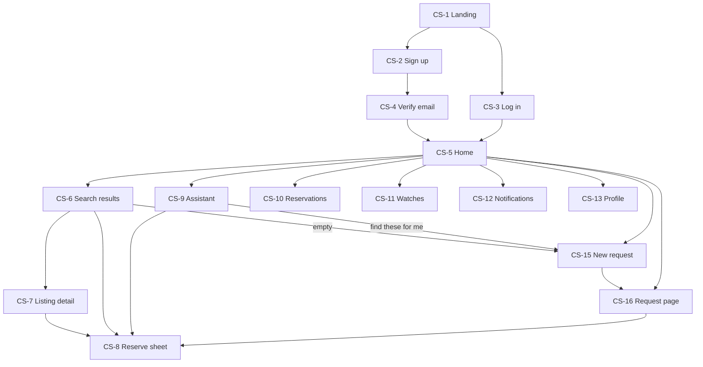

# DawaLink: User Flows and Screens

**Version:** v4.3 · **Date:** 2026-10-23
**Builds on:** `01` v5.1 · `04` v4.1 · ADR-004 · `10`
**Status:** ✅ validated by the team (2026-10-20). **v4.3 applies the v2 design** (`11` v1.1, decision log UI-D13): the tabs are Home · Medicines · Ask · Me; "My medicines" shows one tracker per medicine (requests, reservations and watches together); search shows the medicine once, then one row per pharmacy.

**v4.2 applies the UI design** (`11`, decision log §U): the first tab is "Home", which holds the search; detail pages hide the bottom bar; the agent's alternatives are folded under "See N other options"; a stale zone label is removed.

**v4.1 applies the threat model** (`10`, decision log §T): registration always answers "check your email" (CS-2, PS-1, CN-18); admin two-factor login (AS-1); random order numbers; agent text shown as plain text (CS-9).

**v4.0 applies the professor's guidance** (decision log §S):
- **the agent decides where the client should go** and recommends one pharmacy (or route) with a reason;
- **real locations:** "Use my location" or a district; pharmacies pin themselves on a map; travel times by car and on foot;
- **days of use and pickup day:** a box is offered only if it lasts the client's days of use.

**v3.0 applied design review #2** (decision log §N):
- **urgent needs:** requests and watches search for 6 hours and can only be started 08:00–20:00;
- **instant reservations:** the pharmacy presses [Picked up] or [Not available]. There is no confirmation step and no pickup code;
- a prescription is a **notice**;
- first come, first served;
- ~~district only~~ (replaced in v4.0).

**Numbers:** `04` §5 is the source of truth.

> **What, not how it looks.** This document defines what each user can do and see. The ASCII sketches only show *which information appears where*; visual design is step 11. Prices are in LBP with ≈ USD. Location is the client's shared location or a district; the AI never sees coordinates.

**Parts:**
1. Client
2. Pharmacy
3. Admin

**Notification IDs:** `CN-` client · `PN-` pharmacy.

---

## 1. Client

> **In short:** a mobile-first portal with **three ways in**:
> - **Search** (structured);
> - the **Assistant** (chat with cards);
> - a **sourcing request**: "find these medicines for me now". **The agent owns the request for 6 hours**, and the client only taps to approve.
>
> Every reservation goes through the same **Reserve sheet** and is **reserved instantly**. Pickup is by showing the **order number**; payment is at the counter. 15 screens, 26 assistant flows, 9 request flows.

### 1.1 Principles

| Principle | In practice |
|---|---|
| **Mobile-first** | Layouts start at 360 px; bottom navigation; low-end phones on slow data |
| **Three ways in, one system** | Search, chat and requests share the same listings, reservations and rules |
| **Urgent by design** | Near-expiry medicine is for needs **now**: a request or a watch searches for **6 hours**, and can be started only during the day (08:00–20:00). Pickup is within the pharmacy's pickup time (1 day by default). |
| **The agent proposes, the client taps** | Reserving, accepting an offer, starting or cancelling a request and changing its constraints always need a button tap. Typing "yes" never acts. **Cards are made by DawaLink's tools; the agent only chooses which to show** (`04` R-AG7). |
| **Plain language** | "Reserved: pick up by Tuesday 21:00", not `RESERVED` |
| **No medical content** | Only what's printed on a box. A prescription is a notice: "bring it to the pharmacy". |
| **Privacy** | The location is shared only when the client taps **"Use my location"** (or picks a district), is stored rounded, and **is never sent to the AI**: the agent only sees "8 min by car, Hamra" |
| **The agent decides where to go** | It **recommends one** pharmacy (or one route for several medicines) with a short reason: travel time, opening hours, price, the expiry fit, and what the client said. Up to 2 alternatives are shown. The client taps to reserve. |
| **The box must last** | The client says (or is asked) **how many days** they'll use the medicine and **when** they'll pick it up. Only boxes that last that long are offered. |
| **Fair and transparent** | When stock is scarce, a **fixed rule** decides who gets offered it: **first come, first served**. Nobody can change it, not the agent and not an admin. |

### 1.2 Screen map



**Navigation:**
- **Mobile** bottom menu: **Home** (with the search) · **Medicines** (one tracker per medicine: requests, reservations and watches together) · **Ask** (the assistant) · **Me**. Detail pages (search results, a pharmacy, a reservation, a request) open full screen with a back button (`11` §3.1).
- **Desktop:** a top bar, with the assistant as a side panel.

### 1.3 Screens

#### CS-1 Landing (public)
- Headline, plus three steps: "Search, ask, or request → Reserve instantly → Pick up and pay at the pharmacy".
- A note on near-expiry: "Safe and in date. Cheaper because the expiry date is close".
- [Sign up] · [Log in] · "Are you a pharmacy? Register".
- **No stock is shown publicly** (D1).

#### CS-2 Sign up
| Field | Rules |
|---|---|
| Full name | 2–80 chars; **never sent to the LLM** |
| Email | Valid, unique |
| Password | ≥ 10 chars; not a common password |
| Phone | Optional (for WhatsApp later) |
| District | Dropdown; used for travel times when the client doesn't share their location (`04` R-S2) |
| Terms and privacy notice | Required |

**After [Sign up]:** always "Check your email to continue", **whether or not the email already has an account**, so nobody can find out who uses DawaLink (`04` R-AU7). A new email gets the verification link (CN-1). An email that already has an account gets "You already have a DawaLink account: just log in" (CN-18).

**Errors:**
- Too many sign-ups from this network → "Please try again later".

#### CS-3 Log in
- One generic error for wrong credentials.
- 5 failures → locked 15 min.
- *(Password reset is postponed.)*

#### CS-4 Verify email
- "We sent a link to r***@gmail.com." [Resend], at most once per minute and 5 times a day. **The link also logs the client in.**
- **Before verification: search only.** No assistant, requests, reservations or watches. A banner explains this.

#### CS-5 Home
```
┌──────────────────────────────────┐
│ DawaLink                  🔔2  👤 │
├──────────────────────────────────┤
│ 🔍 Search a medicine…            │
│ 📝 Find several medicines for me → (new request)
│ 💬 Ask the Assistant →           │
│ My requests                      │
│ ┌──────────────────────────────┐ │
│ │ Q-6BN2RA · 3 medicines · until 15:30 │
│ │ ✅2 reserved · ⏳1 asking pharmacies│
│ └──────────────────────────────┘ │
│ My reservations                  │
│ │ Augmentin 1g ×1 · R-7K3Q2F · pick up by Tue 21:00 │
├──────────────────────────────────┤
│ 🏠Home 💊Medicines 💬Ask 👤Me    │
└──────────────────────────────────┘
```
- **Paused banner:** "Reservations paused until 20 Oct (2 missed pickups)."
- **At night (outside 08:00–20:00):** "New requests and watches open at 08:00. Search and reserving work now."

#### CS-6 Search results
- Search box with catalog autocomplete and fuzzy matching ("Did you mean Augmentin?").
- **Location:** [📍 Use my location], or the profile's district.
- **Filters:** max price, "include same-composition alternatives", **days of use** (optional) and **pickup: today / tomorrow**.
- **Sort:** best match (lasts your days of use → nearest by travel time → price → expiry soonest), nearest, cheapest, latest expiry.
- **Layout (`11` v1.1):** the medicine (product, pack, prescription notice) is shown once at the top, then one compact row per pharmacy, with what the client saves.
- **Each pharmacy row:**
  - product and pack (in the header above);
  - pharmacy, area and **travel time** ("8 min by car · 20 min walk");
  - **price in LBP ≈ USD**, public price, discount %;
  - expiry and days left, with ✓ "lasts your 12 days", or a ⚠ warning when days of use weren't given;
  - 📄 "Prescription needed";
  - availability (exact up to 5, then "5+");
  - "alternative" badge;
  - [Reserve].
- **Empty results:** "No discounted stock for *Augmentin 1g* right now."
  - **[Notify me]** → a mini-form (max price) → a **watch for the next 6 hours**;
  - **[Ask DawaLink to find it]** → **CS-15 pre-filled**. The agent then sources it, including asking open pharmacies for unlisted stock.
  - Outside 08:00–20:00, both buttons say "Available from 08:00".
- **Boxes exist but none fit:** "No match: the available boxes expire too early for 12 days of use (the latest expires 28 Oct)." + the same two buttons.

#### CS-7 Listing detail
- Product (ingredients, strength, form, pack, prescription notice).
- Pharmacy (name, address, district, **a map with its pin**, travel time by car and on foot, opening hours with an Open/Closed badge, **pickup time**: "holds reservations 1 day").
- Offer (price LBP ≈ USD, discount, expiry, availability).
- "3 other offers (same composition)" link.
- [Reserve].

#### CS-8 Reserve sheet (search, chat and requests)
```
┌──────────────────────────────────┐
│ Reserve                          │
│ Augmentin 1g · 14 tablets        │
│ Pharmacy A · Hamra, Beirut       │
│ Quantity  [ − ] 1 [ + ]  (max 3) │
│ At the counter: 716,000 LBP (≈ $8)│
│ Expires: 12 Jan 2027             │
│ 📄 Prescription needed: bring it  │
│    to the pharmacy.              │
│ Pick up: (•) Today ( ) Tomorrow  │
│ Days of use: [ 12 ] (optional)   │
│ ✓ Lasts your 12 days             │
│ ✅ Reserved immediately.          │
│    Pick up by today 21:00        │
│ 💵 You pay at the pharmacy.        │
│ [ Cancel ]  [ Reserve ]          │
└──────────────────────────────────┘
```
- **Group version** (from a plan): lists the card's items with **checkboxes (all ticked)** and the total. **[Reserve these]** reserves the ticked items **all or none**. Unticked items stay with the agent, which keeps looking for them.
- **On tap:** the order is created and the stock locked at once → "Reserved ✅ R-7K3Q2F: show this number at the counter" → the chat or request thread gets a status card, and the pharmacy is notified.
- **Failures:**

| Cause | Message |
|---|---|
| Item just taken | "Someone reserved this a moment ago." + next options |
| Doesn't fit | "This box expires on 28 Oct, before your 12 days end." + [See boxes that fit] |
| Only part available | "Only 1 left now." (adjust, reserve again) |
| Group: one item failed | "Aspirin was just taken at Pharmacy A, so nothing was reserved yet." The agent immediately offers **a new card with the remaining items** ("Reserve Concor ×2 alone?") and keeps looking for Aspirin. |
| Limit | "You have 5 open reservations (the maximum)." / "Max 3 of the same medicine." |
| Paused / unverified | Explanation + link |
| Pharmacy closed now | Allowed: "Pick up by closing time on their next open day: Tue 21:00." |

#### CS-9 Assistant (chat)
- **Blocks the agent can show** (every card is produced by a tool; the agent chooses which):

| Block | Purpose |
|---|---|
| Text | In the client's language and style (Arabizi in → Arabizi out). **Shown as plain text:** no links, images or formatting (`10` TM-D5). |
| Choice chips | Disambiguation, quick replies |
| Option card | One listing + travel time + [Reserve]. The agent's pick is marked **Recommended**, with its reason. Its alternatives (up to 2) are folded under "See N other options" (`11` §6). |
| **Plan card** | One pharmacy's group for several medicines + total + [Reserve these]. A plan with several pharmacies shows the **route** ("A → C, 22 min by car"). |
| **Request summary card** | "Find Concor ×2, Glucophage ×1 in Saida" + [Start sourcing] |
| Status card | Reserved (order number, pick up by) / picked up / not available / expired / cancelled |
| Offer card | Matching or early-release offer + [Accept] / [No thanks], valid 2 h |
| Cancel card | [Cancel reservation] |
| Progress line | "Searching…", "Planning…", "Asking pharmacies…" |

- **Starter chips:** [Find a medicine] [Find several medicines] [My requests] [How does pickup work?].
- **👎 on any reply** → reason + comment → admin review (AS-8) → regression tests.
- **[New chat]** archives the conversation (kept 30 days). Requests and reservations are unaffected.
- **Input** ≤ 1,000 chars; RTL for Arabic.
- **Busy:** if the agent is already working on this conversation, "One moment…" and the message is sent automatically right after.
- **Errors:** [Retry] on failure; "Assistant unavailable, [Use Search]" when the LLM is down. **Cards keep working.**

#### CS-10 Reservations
- Shown inside **My medicines** (`11` §3.1). The reserved detail is the **pickup ticket**.
- **Active** (reserved) and **History**.
- **Reserved detail:**
  - the **order number `R-7K3Q2F`**, large, with "Show this at the counter";
  - product, pharmacy, address, hours;
  - **pick up by**;
  - the prescription notice;
  - "pay 716,000 LBP (≈ $8) at the counter";
  - [Cancel];
  - the timeline.
- **Statuses:** reserved · picked up · not available (the pharmacy didn't have it) · expired ("missed pickups: 1 of 2") · cancelled.
- **Expired by mistake?** An expired reservation shows **[I picked it up]**. If the pharmacy forgot to press [Picked up], this sends the case to an admin, who can remove the missed pickup (`04` R-N3).

#### CS-11 Watches
- Shown inside **My medicines** (`11` §3.1).
- Product, district, max price, **ends at** (6 hours after creation), status.
- [Stop watching]. Watches can be created only 08:00–20:00.
- An offer arrives as a card + email and is held **2 h**. [Accept] reserves it at once.

#### CS-12 Notifications
In-app list (see §1.7).

#### CS-13 Profile
- Name, email (verified), phone, change password.
- Default district; "alternatives OK by default".
- "Missed pickups: 0 of 2".
- *(Account deletion postponed.)*

#### CS-15 New sourcing request
```
┌──────────────────────────────────┐
│ Find medicines for me            │
│ 1 [Concor 5mg · 30 tabs  ▾] ×[2] │
│ 2 [Glucophage 850 · 30   ▾] ×[1] │
│ 3 [Aspirin Cardio 100    ▾] ×[1] │
│ [ + Add medicine ]   (max 5)     │
│ From: [📍 My location] or [Saida ▾]│
│ Max price per medicine (optional)│
│ [✓] Same-composition alternatives OK │
│ DawaLink searches for up to 6 hours │
│ and asks open pharmacies for you. │
│ [ Start sourcing ]               │
└──────────────────────────────────┘
```
- **Validation:** 1–5 medicines from the catalog (controlled substances can't be chosen); quantity 1–3; ≤ 2 open requests; **only 08:00–20:00** (otherwise: "DawaLink searches during the day. Please come back tomorrow from 08:00.").
- Items that need a prescription show the notice.
- Each medicine has an optional **days of use** (if empty: 1 day, with the expiry warning).
- [Start sourcing] → CS-16. The agent starts immediately.

#### CS-16 Request page
```
┌──────────────────────────────────┐
│ Q-6BN2RA · searching until 15:30 · Saida │
│ ✅ Concor 5mg ×2 · reserved · A   │
│ ✅ Aspirin Cardio ×1 · reserved · A│
│ ⏳ Glucophage 850 ×1 · asking 2   │
│    pharmacies (answers by 11:40) │
│ ── What DawaLink did ──          │
│ 09:32 Found Concor + Aspirin at A│
│       (1 trip, 1,060,000 LBP)    │
│ 09:35 You reserved both (R-7K3Q2F, R-9PDW4C) │
│ 09:36 Glucophage not listed →    │
│       asked 2 open pharmacies    │
│ ── Talk to DawaLink ──           │
│ [ message… ]                     │
│ [ Cancel request ]               │
└──────────────────────────────────┘
```
- **Item statuses (plain words):**
  - searching;
  - **plan ready: tap to reserve**;
  - reserved ✅ (or "1 of 2 reserved, looking for 1 more");
  - asking pharmacies;
  - watching for new stock;
  - not found in time.
- **Cards appear in the thread:**
  - plan cards [Reserve these];
  - offer cards [Accept];
  - constraint-change proposals ("Allow same-composition alternatives?" [Yes] · "Raise the max price to 800,000 LBP?" [Yes]).
- **Timeline:** every agent action in plain language. It never shows private inventory details or other clients.
- **Closing:** after 6 hours, or earlier when every item is resolved → a summary ("2 of 3 reserved"). An offer that arrived before the end stays valid for its 2 hours.

### 1.4 Search flows (no agent)
| ID | Flow |
|---|---|
| CF-1 | Search → [Reserve] → CS-8 → **reserved at once** (in-app + email with the order number) → the client shows the number at the counter, brings the prescription if needed, and pays. |
| CF-2 | Empty results → [Notify me] (a 6-hour watch) **or** [Ask DawaLink to find it] (CS-15 pre-filled). |
| CF-3 | The pharmacy marks the reservation **not available** → notification → [See other options] re-runs the search, excluding that pharmacy. **No agent turn** for search reservations (this keeps the baseline agent-free). |
| CF-4 | No-show: reminder 4 h before the deadline → deadline passes → expired ("1 of 2") → a second miss in 30 days → 7-day pause. |

### 1.5 Assistant flows (AF)
| ID | Situation | What happens |
|---|---|---|
| AF-1 | Clear request | Catalog search → options that fit, with travel times → the agent **recommends one** pharmacy with a short reason ("closest, open until 23:00, lasts your 12 days") + up to 2 alternatives → [Reserve] → CS-8. |
| AF-2 | Ambiguous ("augmentin") | Chips [1g] [625mg] [457mg syrup]. It never guesses. |
| AF-3 | Unknown name | Asks for the spelling or the ingredient on the box; after 2 tries, suggests the Search page. |
| AF-4 | **Several medicines** ("baddi concor 5 w glucophage 850") | Calls `plan_basket` → **plan cards per pharmacy**, with the route ("Pharmacy C has both: 1 trip, 9 min by car, total …") → [Reserve these]. If the client prefers cheapest over fewest trips, it re-plans and explains. |
| AF-5 | Missing info | Asks only what's needed: **days of use** and **pickup day** when they matter, and the location ("Share your location, or tell me your area"); otherwise the profile's district is used. |
| AF-6 | Option taken at tap time | Offers the next option. |
| AF-7 | **Pharmacy marks a reservation not available** | **Decision event** → the agent re-plans with the next options. |
| AF-8 | Nothing fits | Explains what exists outside the constraints, then decides: early release (asks up to 3 **open** pharmacies) and/or a 6-hour watch, **or suggests a sourcing request** if there are several items. |
| AF-9 | Early-release offer | Offer card (price, valid 2 h) → [Accept] → reserved. |
| AF-10 | Early release failed | "The pharmacies I asked can't release it now." Offers a watch or a request. |
| AF-11 | Watch hit | Offer card → [Accept] → reserved. |
| AF-12 | "wen sar l order?" | Status cards; cancelling only through a Cancel card tap. |
| AF-13 | "Anything cheaper that works the same?" | Same-composition products only, with consent; otherwise "ask your pharmacist". |
| AF-14 | Clinical question | Fixed refusal → refers to the pharmacist or doctor → offers to keep searching. |
| AF-15 | Off-topic | Polite decline. |
| AF-16 | Injection or abuse | No effect; limits hold; logged. |
| AF-17 | Other people's data | "I can only see your own." The tools are client-scoped anyway. |
| AF-18 | Platform questions | From a fixed FAQ. |
| AF-19 | Assistant unavailable | Banner + [Use Search]; cards keep working. |
| AF-20 | Paused or unverified | Paused: it searches but can't reserve. Unverified: the assistant doesn't open, and a link to verify is shown. |
| AF-21 | "baddi ehke ma3 7ada" (asks for a human) | Escalates with a summary; the admin replies as "DawaLink team". |
| AF-22 | Prescription-only item | Shows the notice: "This needs a prescription. Bring it to the pharmacy." It doesn't ask when the client will have it, and never suggests a workaround. |
| AF-23 | **At night** ("find these for me" at 22:00) | It can still search and propose listed stock. Requests and watches: "DawaLink searches during the day. Please come back tomorrow from 08:00." |
| AF-24 | **"Find these for me"** | Prepares a **request summary card** (items, district, budget) → the client taps **[Start sourcing]** → the request page opens; the agent continues there. |
| AF-25 | "What's happening with my request?" | Reads the request status through a tool → a short summary + a link to CS-16. |
| AF-26 | **"I'm dying / it's urgent, put me first"** | Explains the fixed rule (**whoever asked first is offered first**) without any medical judgment. For a medical emergency, it tells the client to contact a doctor or emergency services. It offers **[Talk to a person]** → escalation `emergency_claim`. **Nobody can change the order, not the agent and not an admin.** |
| AF-27 | **No box fits** ("baddi concor la 30 yom") | "The boxes available expire before your 30 days end (the latest expires 12 Nov). I can watch for new stock or ask pharmacies." |
| AF-28 | **The client's situation** ("ma 3ande siyyara, w bkhallis shoghl 6": no car, I finish work at 6) | The agent weighs walking time and opening hours, and recommends a pharmacy that's walkable and open after 18:00, saying why. |

### 1.6 Request flows (RF): the agent working on its own
| ID | Situation | What the client experiences |
|---|---|---|
| RF-1 | **Submitted** | Within seconds, the agent reports **item by item**: "Found Concor ×2 at Pharmacy A. Glucophage and Aspirin aren't listed: I'm asking 2 pharmacies and watching for new stock." A **plan card for what was found** (even if it's just Concor), plus "asking pharmacies" or "watching" for the rest. |
| RF-2 | **Missing item → early release** | Timeline: "Asked 2 open pharmacies (answers by 11:40)." Later, an **offer card** + email → [Accept] → reserved. If watching finds stock first, the first offer the client accepts wins and the other is cancelled at once. |
| RF-3 | **A reservation marked not available** | The agent re-plans automatically: a new plan card, or "asking pharmacies". |
| RF-4 | **Only part of a quantity found** (Concor ×2, Pharmacy A has 1) | The agent proposes 1 at A and **keeps looking for the 2nd box** at other pharmacies (or plans 1 at A + 1 at B from the start). |
| RF-5 | **Lost a contested box** | "Someone who asked earlier was offered it first. I'm still watching." Never says who. |
| RF-6 | **1 hour left, still missing** | The agent proposes options: allow alternatives, raise the budget (each a tap), consider pharmacies in other areas, or escalate (`window_ending`). Otherwise it prepares the client for the summary. |
| RF-7 | **Client writes in the thread** ("I can only go on Thursday") | The agent explains the pharmacy's pickup time (e.g. 1 day) and suggests reserving when the client can go, or choosing a pharmacy that holds longer. It can't change a reservation's deadline. |
| RF-8 | **LLM down** | The page still shows statuses; offers and claims continue in code; "DawaLink will continue planning shortly". |
| RF-9 | **Closed** (6 hours, or everything resolved) | Summary card + email: reserved items with order numbers, items not found with suggestions. |

### 1.7 Client notifications
| # | Event | In-app | Email |
|---|---|---|---|
| CN-1 | Verify your email | none | ✅ |
| CN-3 | **Reserved** (order number, pharmacy, address, hours, pick up by, price, prescription notice) | ✅ | ✅ |
| CN-5 | **Not available** (the pharmacy didn't have it) | ✅ | ✅ |
| CN-6 | Pickup reminder (4 h before the deadline) | ✅ | ✅ |
| CN-7 | Expired (no-show), with [I picked it up] to contest | ✅ | ✅ |
| CN-8 | Reservations paused | ✅ | ✅ |
| CN-9 | Early-release offer (valid 2 h) | ✅ | ✅ |
| CN-10 | Matching offer: watch or request item (valid 2 h) | ✅ | ✅ |
| CN-11 | Watch ended without stock | ✅ | ✅ |
| CN-12 | Cancelled by the system | ✅ | ✅ |
| CN-14 | Admin replied | ✅ | ✅ |
| CN-15 | **Request: plan ready, your tap needed** | ✅ | ✅ |
| CN-16 | **Request: 1 hour left** (items still missing) | ✅ | ✅ |
| CN-17 | **Request closed** (summary) | ✅ | ✅ |
| CN-18 | **You already have an account** (someone registered with this email; at most 1 per day, `04` R-AU7) | none | ✅ |

All are templates; the LLM never writes notifications. *(CN-2, CN-4 and CN-13 were removed in v3.0.)*

### 1.8 Edge cases
| Case | Behavior |
|---|---|
| Two tabs reserve the same box | First wins; the second gets "just taken" |
| Group reserve: one item gone | Nothing reserved; the agent re-plans |
| Two offers for the same medicine | The first one accepted wins; the other is cancelled at once |
| Listing paused while viewing | "No longer available" + alternatives |
| Pharmacy suspended | Pending offers cancelled (CN-12); request items go back to searching; existing reservations kept |
| Client cancels a reservation | Allowed until the deadline; no penalty; the request item becomes cancelled |
| Client came without a prescription | The pharmacist doesn't hand it over; the client can come back before the deadline, or cancel without penalty |
| Session expires mid-flow | Log in → back to the same screen; an unsent message is kept |
| Request or watch at night | "Please come back tomorrow from 08:00" |
| Location not shared | The profile's district is used (times shown as "about"); the client can share it at any time |
| Routing service down | Straight-line distance, labeled "about" (`04` R-RT1) |
| Third open request | "You have 2 open requests (the maximum)." |

### 1.9 Metric events
`search_performed`, `search_empty`, `order_reserved{source}`, `order_failed{reason}`, `group_reserve{items, ok}`, `order_not_available`, `reservation_picked_up/expired/cancelled`, `watch_created`, `claim_offered`, `offer_accepted/declined/expired/withdrawn`, `early_release_requested/accepted`, **`request_created{items}`**, **`request_replanned{trigger}`**, **`request_closed{outcome, items_secured, minutes_to_secure}`**, `assistant_turn{latency, tokens, cost, mode}`, `guardrail_triggered{type}`, `escalation{reason}`.

### 1.10 Client decisions
| ID | Decision | Status |
|---|---|---|
| D1 | Login required to search | ✅ |
| D2 | Verified email for the assistant, requests, reserving and watches | ✅ (extended by DR-7) |
| D3 | Password reset | **postponed** (§K) |
| D4 | Delete my account | **postponed** (§K) |
| D5 | No pickup extension: the pharmacy's pickup time applies | ✅ (updated by review #2) |
| D6 | [Notify me] on the search page (baseline) | ✅ (6-hour watch) |
| D7 | Availability exact up to 5 | ✅ |
| D8 | The agent mirrors the client's language; English UI | ✅ |
| D9 | One active chat + [New chat]; requests have their own threads | ✅ |
| D10 | Mobile-first | ✅ |
| D11 | Requests and watches only 08:00–20:00 | ✅ (review #2) |
| D12 | Location shared per search, chat or request (or a district); stored rounded; never sent to the AI | ✅ (§S) |
| D13 | Days of use (default 1) and pickup day; only boxes that last are offered | ✅ (§S) |

---

## 2. Pharmacy

> **In short:**
> - after admin approval, the pharmacy **uploads its inventory with the DawaLink template** and **keeps quantities up to date** (e.g. after a sale in the shop);
> - near-expiry items are **published automatically** at the system discount (overridable per item);
> - **reservations arrive instantly**: the pharmacy puts the box aside, then presses **[Picked up]** when the client collects it, or **[Not available]** if it isn't there;
> - it answers **early-release asks** from the agent;
> - it never sees who the client is.
>
> 9 screens.

### 2.1 Principles
- **Minimum effort:** one template, automatic publishing, one-tap answers.
- **Desktop-first,** with reservations also working on phones.
- **Their data stays theirs:** the full inventory is private; the agent can only *ask*.
- **No client identity:** an order number only.
- **Nothing changes silently:** a summary before every [Apply].
- **Their rules at the counter:** the pharmacist checks prescriptions and decides on the handover.

### 2.2 Screens
`PS-1 Register → PS-2 Pending → PS-3 Dashboard → PS-4 Reservations · PS-6 Inventory · PS-7 Listings · PS-9 Early release · PS-10 Settings · PS-11 Notifications`
*(PS-5 "Pickups" was merged into PS-4; PS-8 "Discount policy" was removed because tiers are system-wide.)*

#### PS-1 Register pharmacy
- **Account:** email, password.
- **Pharmacy:** name, **license number** (format, unique), phone, address, district, and a **pin on the map** (required; checked by the admin).
- **Weekly opening hours:** 0–2 ranges per day.
- **Pickup time:** how long reservations are held: **1, 2 or 3 days** (default 1).
- **Terms:** sealed, in-date packs only; price ≤ public price; keep quantities up to date; check reservations daily.
- *(License document upload postponed.)*
- **After [Register]:** "Check your email". The pharmacy enters the approval queue once it confirms its email (`04` R-AU7).

#### PS-2 Pending approval
- "Under review." Only the registration details can be edited.
- If rejected: the reason + [Edit and resubmit].

#### PS-3 Dashboard
- **Urgent first:** new reservations (put the boxes aside), early-release asks (with time left to answer), pickups due today.
- Live listings and units reserved.
- "Inventory last updated 9 days ago ⚠ [Update now]".

#### PS-4 Reservations
```
┌────────────────────────────────────────────────────┐
│ 🔍 Order number [ R-____ ]                          │
│ NEW · R-7K3Q2F · Augmentin 1g · 14 tablets · ×2      │
│ Batch A123 · exp 12 Jan 2027 · 716,000 LBP each    │
│ 📄 Prescription needed (check it at the counter)    │
│ Pick up by: Tue 21 Oct, 21:00                      │
│ [ Picked up ]   [ Not available ▾ ]                │
└────────────────────────────────────────────────────┘
```
- **New reservations** appear at once (and by email): put the boxes aside.
- **At the counter:** the client shows the order number → search it → **[Picked up]**.
- **[Not available ▾]:** all units, or only some ("only 1 of 2 here"). The units are removed from stock, the client is told, and the agent looks elsewhere. No penalty for anyone.
- If the client has no prescription when one is needed, don't hand it over; the reservation stays until its deadline.
- **Not picked up by the deadline** → expires automatically; the boxes go back into available stock.

#### PS-6 Inventory
1. **[Download template]**: `product, strength (optional), batch, expiry (YYYY-MM or YYYY-MM-DD), quantity`.
2. **Upload CSV/XLSX** (≤ 5 MB, ≤ 10,000 rows; values only, formulas ignored).
3. **Summary before applying:**
   ```
   Rows: 1,204 · OK: 1,191 · Errors: 13 [Download errors]
   + 25 new · ~ 3 changed · − 12 set to 0 · ⚠ 1 reserved item kept (file says 0, 1 reserved for R-7K3Q2F)
   [ Apply ]  [ Discard ]
   ```
   - Row errors include **"did you mean…"** suggestions for unmatched product names.
   - Controlled products are rejected with a reason.
4. **Inventory table** (private): product, batch, expiry, quantity, reserved, zone (*listed · early-release window · private · expired*).
5. **Quick edit** of a quantity (e.g. after a sale in the shop), and a manual add form with catalog autocomplete. Reserved units can't be removed here; use [Not available] on the reservation.

#### PS-7 Listings
- Live items: product, batch, days left, available and reserved, price (system tier or override), discount.
- **[Override price]** (≤ public price, ≥ 0; 0 = donation) · [Back to system price] · **[Pause] / [Resume]**.
- The system tiers are shown read-only: 25% / 40% / 60%.

#### PS-9 Early-release asks
```
┌────────────────────────────────────────────────────┐
│ A client needs 2 × Concor 5mg · 30 tabs today      │
│ You have (private): 5 · batch X9 · exp 03 Jun 2027 │
│ Release [ 2 ▾ ] at [ 436,000 LBP ] (suggested −25%; public 581,750) │
│ Answer within 1h 42m                               │
│ [ Accept & reserve ]   [ Decline ▾ ]               │
└────────────────────────────────────────────────────┘
```
- Asks are sent **only while the pharmacy is open**.
- **Accept:** the client gets an offer valid 2 h. If the client accepts, it appears in Reservations. If not, the item **returns to private**. If the client's need was already met, the pharmacy sees "Thank you, this need was just met" and nothing is reserved.
- **Decline:** a reason from a list, no penalty. **No answer within 2 h** → expired.

#### PS-10 Settings
Weekly opening hours, **pickup time (1–3 days)**, phone, change password. Name, license, address and map pin are changed only by an admin.

#### PS-11 Notifications
In-app list (§2.4).

### 2.3 Main flows
| ID | Flow |
|---|---|
| PF-1 | Register → pending → approved (PN-2) → download the template → upload → summary → [Apply] → eligible items go live. |
| PF-2 | Keep stock current: quick-edit quantities after shop sales, or re-upload → summary → [Apply]; reserved stock protected. |
| PF-3 | New reservation (PN-4) → put the box aside → the client comes and shows the number → [Picked up]; or [Not available]. |
| PF-4 | Early-release ask (PN-7) → Accept (quantity, price) or Decline. |
| PF-5 | Override a price or pause a listing. |
| PF-6 | Rejected → edit → resubmit. Suspended → banner, listings hidden, pending offers cancelled, existing reservations kept. |

### 2.4 Pharmacy notifications
| # | Event | In-app | Email |
|---|---|---|---|
| PN-1 | Registration received | ✅ | ✅ |
| PN-2 | Approved | ✅ | ✅ |
| PN-3 | Rejected (reason) | ✅ | ✅ |
| PN-4 | **New reservation** (put the box aside) | ✅ | ✅ |
| PN-7 | **Early-release ask** | ✅ | ✅ |
| PN-8 | Client cancelled ("put the box back") | ✅ | ✅ |
| PN-10 | Inventory not updated for 7 days | ✅ | ✅ |
| PN-12 | Suspended / reinstated | ✅ | ✅ |

### 2.5 What the pharmacy sees about a client
| Sees | Never sees |
|---|---|
| Order number, product, units, price, times, pick up by, "prescription needed" | Name, email, phone, district, location, chats, requests, other orders |

### 2.6 Edge cases
| Case | Behavior |
|---|---|
| Wrong template or columns | FAILED with a clear message + template link |
| Same product and batch on several rows | Summed |
| Upload or edit lowers an item below its reserved quantity | Reserved kept; warning; use [Not available] on the reservation instead |
| Two tabs press [Picked up] | First wins; the second sees "already picked up" |
| Reservation while closed | Pick up by closing time on the next open day (per the pickup time); email sent immediately |
| Override above public price | Rejected |
| Formulas or macros in the file | Values only; never executed |

### 2.7 Pharmacy decisions
| ID | Decision | Status |
|---|---|---|
| P-D1 | License document upload | **postponed** (§K) |
| P-D2 | Inventory only after approval | ✅ |
| P-D3 | ~~Partial confirmation~~ → partial **[Not available]** | ✅ (review #2) |
| P-D4 | Auto-publish | ✅ **always on** (§K) |
| P-D5 | One account per pharmacy | ✅ |
| P-D6 | No client identity | ✅ |
| P-D7 | Free listings (price 0) | ✅ |
| P-D8 | ~~Countdown in opening time~~ | **removed** (no confirmation step, review #2) |
| P-D9 | ~~Refuse handover rules~~ | **removed**: the pharmacist's own process at the counter (review #2) |
| P-D10 | Desktop-first, phone-friendly | ✅ |
| P-D11 | **Pickup time set by each pharmacy** (1–3 days, default 1) | ✅ (review #2) |
| P-D12 | **Map pin at registration**, checked by the admin; only an admin moves it after approval | ✅ (§S) |

---

## 3. Admin

> **In short:** a small operations console focused on the agent:
> - **escalations**, including **emergency claims** (human help; **nobody can change priority**);
> - **reported answers** that become regression tests;
> - **agent and system health**.
>
> Plus pharmacy approvals, agent-related abuse flags, a read-only catalog, the audit log and, in demo mode only, the demo clock. Admins can't touch stock or prices. 11 screens.

### 3.1 Principles
- **Least privilege:** approve, suspend, moderate, reply. No stock or price edits, **no priority changes**.
- **Privacy:** chats are visible only for escalated or reported cases, redacted. Views of personal data are audited.
- **Everything audited, with reasons.**
- **Close the loop:** reported answers → regression tests.

### 3.2 Screens

#### AS-1 Admin login
- Email + password.
- Accounts are created from the command line only (A-D1).
- 5 failures → 15-min lock + alert.
- **Then a 6-digit code from an authenticator app** (TOTP, `04` R-AU6). It's set up when `create_admin.py` creates the admin; a lost phone means re-running the script.

#### AS-2 Overview
```
Needs attention: 3 pharmacy approvals · 2 escalations (1 emergency claim) · 4 reported answers · 1 high flag
Agent (7 days): requests 64 · fulfilled within 6 h 71% · early release 21 asked / 9 accepted
                turns 2,310 · p95 4.2 s · errors 0.8% · cost $3.10 · per fulfilled request $0.07
Marketplace (7 days): reservations 142 · picked up 83% · not available 4% · no-shows 6% · units saved 131
```

#### AS-3 Pharmacy approvals
- **Queue with automatic checks:** license format; duplicate license, phone, email or address; **a map to check that the pin matches the address**; **the name is checked too**: the agent shows it to clients, so it must be the pharmacy's real name (`04` R-AG8).
- [Approve] · [Reject] (reason) · [Ask for more information].

#### AS-4 Pharmacies
- Status, live listings, last inventory update, [Not available] rate.
- [Edit name/license/address] (audited) · [Suspend] (reason) · [Reinstate].

#### AS-5 Clients
- Status (active, paused, suspended), reservations, no-shows, open requests.
- [Lift pause] / [Suspend] / [Reinstate] (reason). Suspending ends the client's sessions at once.
- **[Clear no-show]** on a contested reservation (reason; audited; `04` R-N3).
- Viewing contact details is audited, and limited to 30 clients per hour per admin (`04` N-47).

#### AS-6 Escalations
```
┌──────────────────────────────────────────────────────────────┐
│ ESC-81 · emergency_claim · Request Q-6BN2RA · opened 20 min ago  │
│ Agent summary: "Client says the need is urgent; Glucophage   │
│ 850 ×1 still missing; 2 pharmacies declined; 2 h left."      │
│ Conversation (redacted) [Show] · Trace [Open in Langfuse]    │
│ Reply: [ text ≤ 500 chars ]  [ Send ]  [ Resolve with note ] │
└──────────────────────────────────────────────────────────────┘
```
- **Reasons:** client asked for a human · **emergency claim** · can't resolve · window ending · suspicious · complaint.
- **Priority can't be changed here or anywhere** (`04` R-PRI4). For an emergency claim, the admin replies with human help (e.g. point to emergency services, or suggest calling pharmacies directly).
- The reply appears as "DawaLink team" (CN-14).
- A new escalation for a client who already has one open is added to it.

#### AS-7 Abuse flags (reduced)
- No-show pause.
- Repeated injection or cross-user attempts (high at ≥ 3 in 24 h).

Actions: dismiss · warn · suspend (reason).

#### AS-8 Reported answers
- 👎 reports with the reply, reason, redacted context and trace.
- [Not a problem] · [Confirmed] + category → **[Add to regression tests]**.

#### AS-9 Catalog (read-only)
- Search products, flags (prescription, controlled), equivalence groups, source file and date.
- Changes come from the **import script** and the team's overrides and OTC files.

#### AS-10 Agent and system health
- **Agent:**
  - turns, latency p50/p95, errors, fallbacks, tokens, cost;
  - **requests: fulfilled within 6 h, re-plans per request, early-release success, escalations by reason**;
  - guardrail triggers;
  - model and prompt version (read-only).
- **System:** clock-check delay, agent turns waiting, email failures, [Not available] rate.
- **Alerts:** error rate > 5% / 15 min · LLM spend > 80% of budget · > 10 dead emails / h · clock check > 2 min late · an agent turn failed 4 times.
- A Langfuse link.

#### AS-11 Audit log
Read-only, searchable: actor, action, entity, before → after, reason. Includes personal-data views and demo-clock changes.

#### AS-12 Demo clock (demo mode only)
- Shows the app's current time. [+30 min] · [+2 h] · [+6 h] · [+1 day].
- Used in the live demo to show offers expiring, the 1-hour-left check, a window ending and a no-show.
- Every change is audited. Hidden and disabled outside demo mode (`04` R-DEMO).

### 3.3 Admin flows
| ID | Flow |
|---|---|
| ADF-1 | Approve or reject a pharmacy (with checks). |
| ADF-2 | **Emergency claim:** read the summary → reply with human help → resolve. Priority isn't changed. |
| ADF-3 | Other escalations: reply and/or resolve. |
| ADF-4 | Reported answer → confirm → add to regression tests. |
| ADF-5 | Suspend a pharmacy or client (reason) → the system effects follow `04`. |
| ADF-6 | Alert → check traces and metrics → act. |
| ADF-7 | Live demo: advance the demo clock to show time-based behavior. |

### 3.4 Admin notifications
New registration (in-app + daily email) · **escalation** (immediate; emergency claims flagged) · high abuse flag · system alert · admin lockout.

### 3.5 Admin decisions
| ID | Decision | Status |
|---|---|---|
| A-D1 | Admins created from the command line only | ✅ |
| A-D2 | 2FA for admins | ✅ **restored** (§T, TM-D8): TOTP |
| A-D3 | Contact details viewable, audited | ✅ |
| A-D4 | Chats only for escalated or reported cases, redacted | ✅ |
| A-D5 | Clients can ask for a human | ✅ |
| A-D6 | Reported answers → regression tests | ✅ |
| A-D7 | No stock or price edits | ✅ |
| A-D8 | Rules, model and prompts change only through deploys | ✅ |
| A-D9 | Catalog maintained by **import script**; read-only UI | ✅ **changed** (§K) |
| A-D10 | Short free-text replies to clients (audited) | ✅ |
| A-D11 | ~~Priority overrides by admins~~ → **nobody can change priority** | ✅ **changed** (review #2) |
| A-D12 | Demo clock, demo mode only, audited | ✅ (review #2) |
