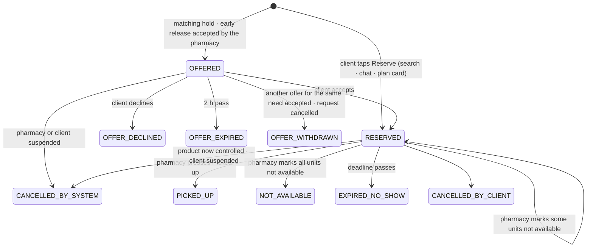

# DawaLink: Domain Rules and State Machines

**Version:** v3.0 · **Date:** 2026-10-13
**Builds on:** `01` v4.0 · `03` v3.0 · `adr/ADR-001`, `ADR-002`, `ADR-003` (as amended) · [design review #2](reviews/design_review_02.md)
**Status:** ✅ validated by the team (2026-10-13). **v3.0 applies design review #2** (decision log §N):
- **needs are urgent:** a request or a watch searches for **6 hours**, and can only be started during request hours (08:00–20:00);
- **instant reservations:** no pharmacy confirmation step. The pharmacy presses **[Picked up]** or **[Not available]**;
- each pharmacy sets its **pickup time** (1–3 days);
- a prescription is a **notice** only;
- priority is **first come, first served**, and nobody can override it;
- location is **district only**;
- one **clock check** loop replaces the jobs table;
- the **claim** is the single "need" object.

**Purpose:** every agreed behavior as an **exact, testable rule**. This document is the source of truth for:
- the database (`05`);
- the API guards and errors (`06`);
- the agent tools (`07`);
- the tests and the Failure Matrix (`09`).

**All numbers live in §5.**

**Conventions:**
- **Actors:** `CLIENT` · `PHARMACY` · `ADMIN` · `AGENT` (through its tools) · `SYSTEM` (the clock check and automatic rules).
- **IDs:** `SM-` state machine · `R-` rule · `N-` number · `INV-` invariant · `R-D` decision (§8). IDs of removed rules aren't reused.
- **Notifications** are `CN-` (client) and `PN-` (pharmacy), defined in `03`.

---

## 1. Time and calendar

| ID | Rule |
|---|---|
| R-T1 | All business logic uses **Asia/Beirut** time (DST handled by the time-zone database). Timestamps are **stored in UTC**. |
| R-T2 | **Opening hours:** a weekly schedule, 0–2 ranges per day `[open, close)`; `close` may be 24:00. They're used for: "open now" (early-release asks), the pickup deadline, and the Open/Closed badge. *(Closures, holidays and vacation mode are postponed.)* |
| R-T3 | **Request hours (N-5):** sourcing requests and watches can only be **created** during request hours. Outside them the client sees: "DawaLink searches during the day. Please come back tomorrow from 08:00." Searching and reserving listed stock work at any time. |
| R-T4 | **Pickup deadline** = the closing time on the pharmacy's *k*-th open day after the day of the reservation, where *k* is the pharmacy's **pickup time** setting (N-6). *Example:* reserved Mon 10:00, *k* = 1, the pharmacy is open Tue 08:00–21:00 → Tue 21:00. If the pharmacy has no opening hours in the next 14 days, the deadline is reservation + *k* × 24 h. **The deadline is never later than the end of the day (expiry − 14 days)** (N-2), so the client always gets at least 14 days of shelf life. |
| R-T5 | **A reservation's deadline never changes once set.** Editing the opening hours or the pickup time setting doesn't affect existing reservations. |
| R-T6 | **Offers use real time** (N-12), and notifications are sent immediately. |
| R-T7 | **Expiry dates:** month/year only (e.g. `11/26`) means the **last day of that month**. **Days to expiry** `d` = expiry date − today (Beirut), in whole days. |
| R-T8 | **Search window (N-11):** the **first search runs immediately** when a request is created, so what's listed is reported and proposed within seconds. The window (`ends_at`) is how long DawaLink **keeps trying in the background for the items not yet found**: waiting for new stock and asking pharmacies. The client doesn't wait on the screen and can cancel at any time. The **window check** (N-24) runs once, shortly before the end. |
| R-T9 | **Derive, don't store:** the eligibility zone and the policy price are **pure functions of `expiry_date` and today**, computed whenever they're read. |
| R-T10 | **The clock check.** One worker loop runs every few seconds (N-26) with `now` from the app clock. It finds overdue rows using the deadlines **stored on the rows themselves**, and acts on them:<br>• expire offers;<br>• expire reservations (no-show);<br>• end search windows;<br>• expire early-release asks;<br>• run the window check;<br>• run the matching sweep over active claims (R-PRI1);<br>• run pending agent turns (R-AG4);<br>• send the email outbox;<br>• once a day: retention purges and stale-inventory reminders.<br>**There is no jobs table.** Each action re-checks the row's state in its own transaction, so running it twice does nothing. If the worker stops, the next pass catches up. |
| R-T11 | **One clock:** every time limit (deadlines, offer expiry, search windows, answer times) is computed from the app clock (`now`, `today`), never the database clock. `created_at` may use real time, because it only orders "who came first". |

---

## 2. Catalog, units, money

*Source: the MoPH "Lebanon National Drugs Database" price list (public .xls). Columns: ATC, Name, B/G, Ingredients with strengths, Dosage, Form, Price in LBP. It has no pack size, no prescription/OTC flag and no controlled flag; R-C4 to R-C7 fill those gaps.*

| ID | Rule |
|---|---|
| R-C1 | **Import by script** (command line), not by an admin screen. Every product stores the **source file name and date**. Admins get a **read-only** catalog view. |
| R-C2 | **Product** = one MoPH row: name, brand/generic, ingredients with strengths, dosage, form, ATC code, public price (LBP), plus `units_per_pack` (R-C4). |
| R-C3 | **Currency:** stored in **LBP (integers)**; **always displayed in LBP and ≈ USD**. The display rate is set in config; it defaults to the rate stated on the imported list, with its date shown. Clients may give budgets in either currency; the assistant and filters convert them. Ceiling checks are always done in LBP. |
| R-C4 | **Units:** every stock and order quantity is an integer number of **units**. `units_per_pack = 1` by default, so **units = packs** and the UI says "packs". Each inventory item has `splittable = false` in the core. Prices are **per pack**. (R-D20) |
| R-C5 | **Equivalence key** = normalized set of (ingredient, strength, unit) + **form group**. Only coating variants merge (tablet / film-coated / coated → *tablet*). **Modified-release never merges with immediate-release**; different routes never merge. A product with no readable strength has **no equivalents**. Manual corrections live in a team-maintained **overrides file** used by the import script. |
| R-C6 | **Controlled substances are removed from DawaLink entirely.** They are flagged from the MoPH narcotic and psychotropic lists, plus the overrides file, and can't be uploaded, listed, searched, reserved, watched or requested. |
| R-C7 | **Prescription required by default.** FALSE only for products on the **OTC list** (a seed file curated by the team). The flag is used **only to show a notice** (R-P1). |
| R-C8 | **A new price-list import** caps any price override above the new public price; order price snapshots never change. |
| R-C9 | **An upload row that doesn't match a product** becomes a **row error with "did you mean…" suggestions**; it's fixed in the file or added through the manual form. |

---

## 3. State machines

Every transition below runs in **one database transaction**, with row locks on the rows it changes (lock order in `05` §6). Each one writes an **audit event** (actor, before, after, reason). The clock check re-checks the state before acting (a stale deadline does nothing). Every client-initiated creation carries an **idempotency key**, one per order.

### SM-1 Pharmacy account

| From | To | Trigger | Actor | Guards | Effects |
|---|---|---|---|---|---|
| (new) | PENDING | Registration | PHARMACY | Unique license, email, phone; valid fields | PN-1; admin notified; duplicate check (same license, email, phone or address → flag) |
| PENDING | PENDING (`info_requested`) | Ask for more information | ADMIN | Message | Pharmacy notified |
| PENDING | APPROVED | Approve | ADMIN | none | PN-2; inventory and listings unlock |
| PENDING | REJECTED | Reject | ADMIN | Reason | PN-3 |
| REJECTED | PENDING | Edit and resubmit | PHARMACY | none | Back in the queue |
| APPROVED | SUSPENDED | Suspend | ADMIN | Reason | Pharmacy notified. Listings hidden. **OFFERED orders → CANCELLED_BY_SYSTEM**. Open early-release asks → WITHDRAWN. **RESERVED orders are kept** and can still be picked up. |
| SUSPENDED | APPROVED | Reinstate | ADMIN | Reason | Listings visible again; matching runs (R-PRI1) |

Name, license and address can only be changed by an **admin** after approval (edited directly, audited). Pharmacies edit their hours, **pickup time** (N-6), phone and password.

| Capability | PENDING / REJECTED | APPROVED | SUSPENDED |
|---|---|---|---|
| Upload or edit inventory, manage listings | ❌ | ✅ | ❌ |
| Receive reservations and early-release asks | ❌ | ✅ | ❌ |
| Mark existing reservations picked up or not available | n/a | ✅ | ✅ |

### SM-2 Client account

| From | To | Trigger | Actor | Effects |
|---|---|---|---|---|
| (new) | UNVERIFIED | Sign up | CLIENT | CN-1 verification email (sign-ups rate-limited per IP, R-AU5) |
| UNVERIFIED | ACTIVE | Valid verification link | CLIENT | none |
| ACTIVE | PAUSED | 2nd counted no-show in a rolling 30 days | SYSTEM | `paused_until = now + 7 days`; CN-8 |
| PAUSED | ACTIVE | `paused_until` reached, or an admin lifts the pause (reason) | SYSTEM / ADMIN | none |
| ACTIVE / PAUSED | SUSPENDED | Suspend (reason) | ADMIN | Sessions revoked at once (R-AU3). Every open order → CANCELLED_BY_SYSTEM; requests, watches and early-release requests cancelled |
| SUSPENDED | ACTIVE | Reinstate (reason) | ADMIN | none |

*(Account deletion is postponed, decision log §K.)*

| Capability | UNVERIFIED | ACTIVE | PAUSED | SUSPENDED |
|---|---|---|---|---|
| Search | ✅ | ✅ | ✅ | ❌ |
| Use the assistant (chat) | ❌ | ✅ | ✅ (can't reserve) | ❌ |
| Reserve, accept offers, create requests or watches | ❌ | ✅ | ❌ | ❌ |
| Included in matching (R-PRI) | ❌ | ✅ | ❌ (skipped) | ❌ |
| Cancel own reservations or requests | n/a | ✅ | ✅ | n/a |

### SM-3 Inventory item, zone, listing

**Inventory item** = (pharmacy, product, batch, expiry), with:
- `qty_on_hand`;
- `qty_reserved`;
- `qty_available = qty_on_hand − qty_reserved` (all in units);
- `splittable` (false in the core).

**Zone** (derived from `d` at read time, R-T9):

| Zone | Condition | Meaning |
|---|---|---|
| NOT_ELIGIBLE | Controlled, or not matched | Never published or asked about |
| EXPIRED | d < 0 | Hidden |
| BELOW_MIN | 0 ≤ d < 17 | Hidden. 17 = 14 days guaranteed at pickup + up to 3 pickup days. |
| **NEAR_EXPIRY** | **17 ≤ d ≤ 180** | **Published automatically** |
| EARLY_RELEASE | 180 < d ≤ 270 | Private; the agent may ask about it (SM-6) |
| PRIVATE | d > 270 | Private |

**Listing control:** `LIVE ⇄ PAUSED`, set by the pharmacy. Auto-publish is always on.

**Visible to clients if and only if:**
```
zone = NEAR_EXPIRY ∧ control = LIVE ∧ pharmacy = APPROVED ∧ qty_available ≥ 1 ∧ product not controlled
```

**Effective price** = the pharmacy's override if set, otherwise the **system policy price**: public price × (1 − tier discount for `d`) (tiers in N-4, the same for all pharmacies), rounded **down** to 1,000 LBP, never below 0.

**Keeping quantities current:** the pharmacy **edits quantities whenever stock changes** (e.g. after a sale in the shop), through the manual form or an upload. Every edit, upload, resume or reinstatement triggers matching (R-PRI1).

**Upload sync and manual edits:**

| ID | Rule |
|---|---|
| R-U1 | Row key = (matched product, batch, expiry); duplicate keys are summed. |
| R-U2 | New key → new item. Existing key → `qty_on_hand` = file quantity. Key missing from the file → `qty_on_hand = 0` (the row is kept). |
| R-U3 | **Reserved stock is protected** (uploads and manual edits): `qty_on_hand = max(new value, qty_reserved)`, with a warning when the new value is lower. To give up reserved units, the pharmacy presses **[Not available]** on the reservation (O3). |
| R-U4 | The file is the source of truth, but price overrides and PAUSED states survive. |
| R-U5 | Row errors (bad date, quantity not a number or negative, past expiry, product not matched, controlled) are reported and never block other rows. |

### SM-4 Inventory upload

`UPLOADED → VALIDATED → APPLIED | DISCARDED`, plus `FAILED`.
- **FAILED** covers: not CSV/XLSX, > 5 MB, > 10,000 rows, missing template columns, formulas or macros.
- **Fixed template columns:** `product` (name as in the MoPH list), `strength` (optional, helps matching), `batch`, `expiry` (`YYYY-MM` or `YYYY-MM-DD`), `quantity`.
- **VALIDATED** shows the change summary (new, changed, set to 0, warnings, row errors).
- **[Apply]** runs R-U1–R-U5 in one transaction, then triggers matching (R-PRI1).
- **One VALIDATED upload at a time per pharmacy:** a new upload discards the previous one.

### SM-5 Order (covers the reservation)

There is **no pharmacy confirmation step**: a client's tap **reserves immediately**. The pharmacy is notified, puts the box aside, and later presses **[Picked up]** or **[Not available]**.

**Key fields:**
- `source` ∈ {search, assistant, request, watch, early_release};
- `claim_id`, `request_item_id` (optional);
- `group_id` (one group reserve);
- `qty_requested`, `qty_locked` (units currently held), `qty_picked_up`;
- `price_snapshot` per pack;
- `offer_expires_at` (OFFERED), `deadline` (RESERVED);
- `counts_as_no_show`.



**Terminal states:** PICKED_UP, NOT_AVAILABLE, EXPIRED_NO_SHOW, CANCELLED_BY_CLIENT, CANCELLED_BY_SYSTEM, OFFER_DECLINED, OFFER_EXPIRED, OFFER_WITHDRAWN.

**Open orders** = OFFERED + RESERVED.

| # | Transition | Actor | Guards | Effects |
|---|---|---|---|---|
| O1 | **Create** → RESERVED | CLIENT (tap) | Client ACTIVE · open orders + new ≤ 5 (R-L1) · units per equivalence group ≤ 3 (R-L2) · listing visible · qty ≤ qty_available (row lock) · idempotency key unused. A **group reserve** (R-RQ6) creates several orders **all or none**, each with its own key. | Price snapshot; `qty_reserved += qty`; deadline (R-T4); PN-4 to the pharmacy (in-app + email); CN-3 to the client. If linked to a need → R-RQ7 / R-W3 (the need's other offers and asks are withdrawn when it's covered). |
| O2 | RESERVED → **PICKED_UP** | PHARMACY (own) | Before the deadline (no late pickup) | `qty_on_hand −= qty_locked`; `qty_reserved −= qty_locked`; `qty_picked_up = qty_locked`; `qty_locked = 0`; units-saved metric |
| O3 | RESERVED → **not available** (*k* units) | PHARMACY (own) | 1 ≤ *k* ≤ `qty_locked` | The units aren't there: `qty_on_hand −= k`; `qty_reserved −= k`; `qty_locked −= k`. If `qty_locked` reaches 0 → **NOT_AVAILABLE**. CN-5 to the client. The linked need gets *k* units back → **decision event** (R-AG4) if its window is still open. Never a penalty for the client. |
| O4 | RESERVED → **EXPIRED_NO_SHOW** | SYSTEM (clock check) | Deadline reached, still RESERVED | Release; `counts_as_no_show = true`; CN-7; R-N1. A closed request's outcome doesn't change (R-RQ9). |
| O5 | RESERVED → **CANCELLED_BY_CLIENT** | CLIENT (tap) | Own order, before the deadline | Release; PN-8; a linked request item → CANCELLED if its request is still open; no penalty |
| O6 | open → **CANCELLED_BY_SYSTEM** | SYSTEM | Pharmacy suspended (OFFERED only) · product became controlled · client suspended | Release; notify the affected parties; the linked need → decision event, unless the client was suspended |
| O7 | (matching hold) → **OFFERED** | SYSTEM | R-PRI allocation | Lock up to the claim's missing units; `offer_expires_at = now + 2 h`; CN-10 + an offer card in the claim's thread |
| O8 | (early-release accept) → **OFFERED** | PHARMACY | SM-6 | Lock at the accepted price; `offer_expires_at = now + 2 h`; CN-9 + an offer card |
| O9 | OFFERED → **RESERVED** | CLIENT (tap) | Client ACTIVE · O1 limit guards (the lock is already held; the claim's offers count once, R-W3) | As O1 (deadline, PN-4, CN-3). **The claim's other offers → OFFER_WITHDRAWN at once**; its open asks are withdrawn if the need is now covered. |
| O10 | OFFERED → **OFFER_DECLINED / OFFER_EXPIRED** | CLIENT / SYSTEM | none | Release. Matching hold → the unit goes to the next claim (R-PRI); this claim skips this item for 24 h. Early release → the item **returns to private**. |
| O11 | OFFERED → **OFFER_WITHDRAWN** | SYSTEM | Another offer for the same claim accepted · the request or watch cancelled by the client | Release (as O10) |

**At the counter:** the client shows the **order number** (e.g. `R-1042`). The pharmacist finds the reservation and presses **[Picked up]**. There is no pickup code, and no late pickup. The pharmacist checks the prescription when one is needed (R-P1).

### SM-6 Early-release request

**Request** (one per claim): `OPEN → FULFILLED | UNFULFILLED | CANCELLED`.
**Ask** (one per pharmacy): `ASKED → ACCEPTED | DECLINED | EXPIRED | WITHDRAWN`.

| ID | Rule |
|---|---|
| R-E1 | **Created by the AGENT only**, for a **claim** (a watch or a waiting request item; R-W3). Needs an ACTIVE client and an ACTIVE claim; product (plus equivalents if allowed); quantity = the claim's missing units. |
| R-E2 | **Candidates:** inventory items in the **EARLY_RELEASE** zone at APPROVED pharmacies that are **open now** (R-T2); product or allowed equivalent; `qty_available ≥ 1`; in the claim's district or governorate (N-23). |
| R-E3 | **Anti-spam:** skip pharmacies that already got 10 asks today, or that declined the same product in the last 7 days. |
| R-E4 | **Selection:** same district first, then soonest expiry (less waste), then the fewest [Not available] marks in the last 30 days. **Top 3**, asked at once. |
| R-E5 | **Client limits:** ≤ 5 OPEN early-release requests; the same product can't be asked again within 24 h after UNFULFILLED. |
| R-E6 | **Pharmacy answer** within the answer time (N-13): **Accept** (qty ≤ min(missing units, private available); price ≤ public price; the suggested price is the public price − 25%, R-PR3) → O8. **Decline** (reason code). No answer in time → EXPIRED. **No penalties.** If the need was **already covered** when the pharmacy answers: "Thank you, this need was just met"; the ask → WITHDRAWN and nothing is locked. |
| R-E7 | **Resolution:** the client accepts the offer → FULFILLED, and the other asks are withdrawn. All asks ended without an accepted offer → **UNFULFILLED** (a decision event if the claim's window is open). When the claim's window ends, open asks → WITHDRAWN. |
| R-E8 | **Privacy:** the client and the agent only learn "asked N pharmacies" until one accepts. Pharmacies never see who the client is. |

### SM-7 Claim: the single "need" object (watch or waiting request item)

A **claim** is one need for one medicine: a client **watch** ([Notify me]) or a **waiting request item**. Matching **and** early release both work for the same claim.

`ACTIVE ⇄ OFFER_PENDING → FULFILLED`
- `FULFILLED → ACTIVE` when a reservation for it is marked not available while the window is still open.
- `ACTIVE / OFFER_PENDING → EXPIRED` when the window ends with no offer pending.
- `→ CANCELLED` by the client (or when its request is cancelled).

| ID | Rule |
|---|---|
| R-W1 | **Created by** the CLIENT ([Notify me], a tap) or the AGENT (`create_watch` in chat, `open_claim` in a request), **only during request hours** (R-T3). Fields: product (plus equivalents if allowed), district, optional max price, quantity (1–3 units), `ends_at` = creation + the search window (N-11). A request item's claim uses the request's `ends_at`. |
| R-W2 | ≤ 5 live client watches; one per product. Request-item claims don't count toward this limit. |
| R-W3 | **One need, two paths (DR2-A7).** Each path (matching, early release) holds **at most one offer** for the claim at a time. **When the client accepts any offer, the claim's other offers are withdrawn at once**, and its open asks are withdrawn if the need is now covered. For the client limits (R-L1, R-L2), a claim's simultaneous offers **count once**. |
| R-W4 | **Partial coverage:** a claim tracks `qty_missing`. A reservation for fewer units leaves it ACTIVE for the rest (e.g. 1 of 2 found → keep searching for 1). FULFILLED when `qty_missing = 0`. |
| R-W5 | A watch that ends without stock → CN-11 "Watch ended without stock". |

### SM-8 Sourcing request (the agent's autonomous mode)

A **sourcing request** asks DawaLink to find one or more medicines **now**. The **agent owns it** for the search window (ADR-002).

**Request:** `OPEN → CLOSED(outcome)`. Outcome ∈ {FULFILLED, PARTIAL, UNFULFILLED, CANCELLED}. Flag: `escalated`.

**Item** (one per medicine; it tracks `qty` and `qty_secured` = units in its RESERVED or PICKED_UP orders):
```
SEARCHING ──► PROPOSED (plan card waiting for a tap) ──► SECURED (qty_secured = qty)
    ▲  │                                                     │
    │  ▼                                                     │ a reservation marked not available
  WAITING (claim active: matching and/or early release) ◄────┘ while the window is open
any non-final → UNAVAILABLE (window ended) · CANCELLED (client)
```
A partly secured item ("1 of 2 secured") stays SEARCHING or WAITING for the missing units.

| ID | Rule |
|---|---|
| R-RQ1 | **Creation** always needs a **client tap**: [Start sourcing] on the request form, on the agent's summary card in chat, or from the search empty state (pre-filled form). It requires an ACTIVE client, **request hours** (R-T3), **1–5 items** (product + quantity 1–3) and a district, plus optionally a max price per item and "alternatives OK". `ends_at` = creation + the search window (N-11). |
| R-RQ2 | **Limits:** ≤ 2 open requests per client. Their orders count toward R-L1/R-L2. |
| R-RQ3 | **The agent runs a turn on a request when** (decision events):<br>• it is submitted;<br>• the client writes in the request thread;<br>• a reservation for an item is marked not available, or cancelled by the system;<br>• an early-release request ends UNFULFILLED;<br>• the **window check** finds items not secured (N-24);<br>• a group reserve left some items unticked (R-RQ6). |
| R-RQ4 | **Autonomy boundary.**<br>• **The agent may, without asking:** search; plan; open claims (matching); send early-release asks (R-E rules); schedule follow-up checks inside the window; escalate.<br>• **It must get a client tap for:** reserving; accepting an offer; changing constraints (budget, alternatives); removing an item; cancelling.<br>• **It never ranks clients** (R-PRI), and it never gives up on an item by itself: items become UNAVAILABLE only when the window ends. |
| R-RQ5 | **Multi-medicine planning:** the agent calls the deterministic tool `plan_basket(items, constraints)`. It returns candidate plans: sets of visible listings covering the items, where **one medicine's quantity may be split across pharmacies** (Concor ×2 = 1 at A + 1 at B). Plans are ranked by **area** (all in the client's district → same governorate → rest of Lebanon), then **number of pharmacies**, then **total price**. The agent picks a plan in light of the client's stated preferences, explains it, and proposes it. Items with no listing go to a claim and/or early release. |
| R-RQ6 | **Per-item reporting and plan cards.**<br>• The agent **always tells the client, item by item, what it found and what it didn't**. Example: "Found Concor at Pharmacy A. Glucophage and Aspirin aren't listed: I'm asking 2 pharmacies and watching for new stock."<br>• Plan cards are grouped **per pharmacy** and can hold **any subset** of the items (one card with only Concor is normal).<br>• The group sheet lists the card's items with **checkboxes, all ticked by default**. **[Reserve these]** reserves the ticked items **all or none**.<br>• If an item fails at tap time (just taken, limit reached), **nothing in that card is reserved**. The agent says which item failed, offers a new card with the remaining items, and keeps sourcing the failed one.<br>• **Unticked items** go back to SEARCHING, and the agent gets a turn. |
| R-RQ7 | **A covered need:** when all of an item's units are reserved, the item is SECURED, its claim is FULFILLED, and its open offers and asks are withdrawn (R-W3). |
| R-RQ8 | **Thread:** each request has its own conversation (`kind = request`). Informational events post template cards there. The chat assistant can read a request's status through a tool. |
| R-RQ9 | **Closing:** when every item is final (SECURED, UNAVAILABLE, CANCELLED), **or** when `ends_at` has passed **and no offer is pending**. Offers made before the end stay valid for their 2 hours. At closing:<br>• open claims and asks are withdrawn;<br>• non-final items → UNAVAILABLE;<br>• outcome: every item SECURED → FULFILLED; at least one unit secured → PARTIAL; none → UNFULFILLED;<br>• the summary is sent (CN-17).<br>Client cancel → CANCELLED, and non-final items are cancelled. **After closing, the outcome never changes:** later pickups or no-shows are recorded on the orders only. |
| R-RQ10 | **Per-request agent limit:** ≤ 20 agent turns per request (N-17). Above that → escalate (reason `cannot_resolve`). |

### SM-9 Escalation · SM-10 Answer report · SM-11 Abuse flag

| Object | States | Created by | Rules |
|---|---|---|---|
| Escalation | `OPEN → IN_PROGRESS → RESOLVED` | AGENT (`escalate`) | Reason ∈ {client_asked_human, emergency_claim, cannot_resolve, window_ending, suspicious, complaint}. Summary ≤ 300 chars. Admin actions: **reply** (≤ 500 chars → CN-14 + a "DawaLink team" message) and **resolve**. **No priority changes** (R-PRI4). One OPEN escalation per client: a new escalation while one is open is **appended** to it (new reason + summary). |
| Answer report (👎) | `NEW → DISMISSED \| CONFIRMED` | CLIENT (tap) | CONFIRMED needs a category; [Add to regression tests] exports the case (redacted). |
| Abuse flag | `OPEN → DISMISSED \| ACTIONED` | SYSTEM (R-AB) | Action ∈ {warn, suspend}. Duplicates merge while OPEN. |

### SM-12 Clock check, agent turns and email

- **Clock check (R-T10):** there's no queue to manage. The deadlines live on the rows (`offer_expires_at`, `deadline`, `ends_at`, `respond_by`). Each due row is handled in its own transaction, with a state re-check.
- **Pending agent turns:** a conversation with `pending_turn_at ≤ now` and no active turn lease (R-AG2) gets a turn. A failed turn is retried after 1 m, 5 m and 15 m. After 4 failures → escalate (`cannot_resolve`) + alert.
- **Email outbox:** `QUEUED → SENT | FAILED → retry (1 m, 5 m, 30 m) → DEAD` (alert).

---

## 4. Business rules

### R-P1 Prescription notice
For products with `prescription_required = TRUE`, the following show **"📄 Prescription needed: bring it to the pharmacy"**:
- the search card;
- the reserve sheet;
- the agent;
- the reservation email.

DawaLink **doesn't ask when the client will have it**, and it doesn't change the pickup time. **The pharmacist checks the prescription at the counter**, and may refuse to hand over without one. The client can then come back before the deadline, or cancel without penalty.

### R-PRI Allocation priority: first come, first served (ADR-003, amended)
| ID | Rule |
|---|---|
| R-PRI1 | **When matching runs:**<br>• newly available stock (an item enters the window, an upload or manual edit, a lock released, a listing resumed, a pharmacy reinstated, a price dropping below a claim's max);<br>• when a claim is **created**;<br>• in the clock check's **sweep of all active claims** (R-T10), so stock that's already visible is never missed. |
| R-PRI2 | **Order: first come, first served** = the earliest claim (`created_at`, then `id`). Computed by code, with the reason logged (e.g. "allocated to claim C-12: waiting since 10:02"). Each winning claim gets an OFFERED hold for its missing units while stock remains. **Reach:** the claim's district or governorate (N-23). |
| R-PRI3 | **Eligibility:** claims whose client is not ACTIVE, or would exceed R-L1/R-L2, are **skipped** for this round, with the reason logged. The next claim gets the unit. |
| R-PRI4 | **Nobody can change the order:** not the agent, not an admin. If a client claims an emergency, the agent:<br>• explains the rule;<br>• for a medical emergency, tells the client to contact a doctor or emergency services;<br>• offers human help (escalation `emergency_claim`).<br>The human can help and reply, but can't change the order. |
| R-PRI5 | **Direct reservations** (a client tapping a visible listing) are first come, first served at the tap. R-PRI governs only holds created by matching. |
| R-PRI6 | A client who misses out is told only "someone who asked earlier was offered it first", never who. |

### R-S Search and ranking
| ID | Rule |
|---|---|
| R-S1 | Login required; only visible listings; page size 20. |
| R-S2 | **Location = district only** (no maps, GPS, coordinates or distances). Each district belongs to a **governorate**. **Area order:** same district → same governorate → rest of Lebanon. Cards say "same district" or name the district. *Known limitation:* inside one district, ranking falls back to price. |
| R-S3 | **Best match:** area order → price ascending → expiry soonest. Other sorts: cheapest, latest expiry. |
| R-S4 | Alternatives (same equivalence group) only if toggled, and labeled. |
| R-S5 | Availability shown exactly up to 5, then "5+". |

### R-L Client limits
| ID | Rule |
|---|---|
| R-L1 | ≤ **5 open orders** per client (OFFERED + RESERVED; a claim's simultaneous offers count once, R-W3). |
| R-L2 | ≤ **3 units per equivalence group** across open orders (same counting). Anti-hoarding. |
| R-L3 | ≤ 2 open requests (≤ 5 items each) · ≤ 5 live watches · ≤ 5 open early-release requests. |
| R-L4 | Requests and watches are created only during request hours (R-T3). |

### R-N No-shows
| ID | Rule |
|---|---|
| R-N1 | Counted no-shows in a rolling 30 days: at **2** → PAUSED for 7 days; each later no-show while ≥ 2 → paused 7 more days. |
| R-N2 | Cancellations and [Not available] marks never penalize the client. |

### R-PR Pricing
| ID | Rule |
|---|---|
| R-PR1 | **System-wide tiers** (N-4), the same for every pharmacy, not editable by pharmacies. Pharmacies can **override the price per item**: ≤ public price, ≥ 0, and 0 (a donation) allowed. |
| R-PR2 | Policy price rounded down to 1,000 LBP; snapshots on orders never change. |
| R-PR3 | **Early-release suggested price** = public price − 25% (the mildest tier), rounded down to 1,000 LBP. The pharmacy can change it (≤ public price). |

### R-AG Agent turns and events (ADR-001 and ADR-002, as amended)
| ID | Rule |
|---|---|
| R-AG1 | **Conversations live in our tables** (`kind` ∈ {chat, request}), with a structured **case state**. LangGraph is stateless per turn. |
| R-AG2 | **One turn at a time per conversation**, through a **turn lease** on the conversation row (`turn_lease_until`, N-27, renewed during a long turn). No database connection is held while the LLM thinks. A chat message that arrives during a turn shows "one moment…" and is retried automatically. An event that arrives during a turn waits for the next clock check. |
| R-AG3 | **Informational events post a template card, with no LLM call:**<br>• reserved, picked up, expired or cancelled;<br>• a matching or early-release offer;<br>• an admin reply;<br>• request closed. |
| R-AG4 | **Decision events run an agent turn:** R-RQ3 for requests; in chat, a reservation marked not available, and early release unfulfilled. The event is written as a **system message** in the conversation, and the conversation gets `pending_turn_at = now`; the clock check runs the turn. |
| R-AG5 | **Event routing:**<br>• orders from the **search page** → notifications only, **never an agent turn** (this keeps the evaluation baseline agent-free);<br>• assistant orders and agent-created watches → the client's active chat;<br>• request orders and claims → the request thread. |
| R-AG6 | Write tools (`create_watch`, `request_early_release`, `open_claim`, `escalate`) take an **idempotency key**. A failed turn is retried whole. |
| R-AG7 | **Cards come only from tools (DR2-B1).** Tools create **proposals**, stored server-side with their exact content, and return their IDs. The LLM chooses which proposal IDs to show; the server renders the cards. A tap sends the proposal ID, and the API checks the owner and expiry and **re-validates everything**. What the client sees is exactly what the button does. |
| R-AG8 | **Text typed by pharmacies never reaches the LLM.** Tools return codes, numbers and IDs only (e.g. reason = `not_available`). |

### R-AS Assistant limits
- Message ≤ 1,000 chars.
- ≤ 20 messages per minute and ≤ 100 per day per client.
- ≤ 6 tool calls per turn.
- ≤ 20 agent turns per request.
- A daily token budget per client (value set after measuring; placeholder 200k). Over budget → degraded mode for that client until midnight.
- Conversations are kept 30 days after their last activity, or after the request closes.

### R-AU Accounts and security
| ID | Rule |
|---|---|
| R-AU1 | Password ≥ 10 chars, not in the top-10k list, argon2id. |
| R-AU2 | 5 failed logins in 15 min → locked 15 min (admins: other admins are alerted). |
| R-AU3 | **Server-side sessions (DR2-B4):** login creates a session. The browser holds only a random token in an httpOnly, Secure, SameSite=Strict cookie; the server stores its hash. Valid 7 days (admins 12 h). **Logout, a password change or a suspension revokes it immediately.** *(Admin 2FA postponed.)* |
| R-AU4 | Email verification link 24 h, single use, stored hashed. *(Password reset postponed.)* |
| R-AU5 | ≤ 5 sign-ups per IP per hour. The assistant and requests need a verified email. |

### R-NT Notifications (essential set)
- **Clients:**
  - verification;
  - **reserved** (order number, pharmacy, address, hours, pick up by, price, prescription notice);
  - not available;
  - pickup reminder;
  - expired;
  - paused;
  - offers (matching or early release);
  - watch ended without stock;
  - request updates (plan ready, window ending, closed summary);
  - admin reply.
- **Pharmacies:**
  - registration result;
  - **new reservation** (put the box aside);
  - early-release ask;
  - client cancelled;
  - suspension;
  - stale inventory (7 days).
- One notification per event per recipient. Templates only.

### R-AB Abuse flags (agent-related only, plus no-shows)
- No-show pause (R-N1).
- Guardrail triggers (injection or cross-user): low; **high at ≥ 3 in 24 h**.

### R-AL Alerts
- Assistant error rate > 5% over 15 min.
- LLM spend > 80% of the monthly budget.
- > 10 dead emails in 1 h.
- The clock check is more than 2 min late.
- An agent turn failed 4 times.

### R-RET Retention
| Data | Kept |
|---|---|
| Conversations (chat and request threads) | 30 days after last activity or close |
| Proposals | With their conversation |
| Notifications | 90 days |
| Sessions | Deleted after expiry or revocation |
| Audit log | 1 year |
| LLM traces | Provider retention (30 days, free tier); evidence exported to the repo |
| Uploaded files | **Not stored** (processed and discarded) |

### R-DEMO Demo clock
In **demo mode only** (a config flag that is off in production), an admin can **advance the app clock**. This shows time-based behavior live: an offer expiring, the window check, a window ending, a no-show. Every advance is audited. Because every rule reads the app clock (R-T11), nothing else changes.

---

## 5. Numbers (source of truth)

| ID | Number | Value | Status |
|---|---|---|---|
| N-1 | Publishable window | 17–180 days to expiry | validated |
| N-2 | Minimum shelf life at pickup | 14 days | validated |
| N-3 | Early-release window | 181–270 days | validated |
| N-4 | Discount tiers (system-wide) | 91–180 days 25% · 31–90 days 40% · 17–30 days 60% | validated |
| N-5 | **Request hours** (creating requests and watches) | 08:00–20:00 Beirut time | **new** (review #2) |
| N-6 | **Pickup time** | Pharmacy setting: 1–3 open days, **default 1**; until closing time; never after expiry − 14 days | **changed** (review #2) |
| N-7 | ~~Max prescription wait~~ | removed: the prescription is a notice | removed |
| N-8 | Pickup reminder | 4 h before the deadline | changed |
| N-9 | No-shows | 2 in 30 days → 7-day pause | validated |
| N-10 | Client limits | 5 open orders · 3 units per group · 2 requests × 5 items · 5 watches · 5 early-release requests (a claim's offers count once) | changed |
| N-11 | **Search window** (requests and watches) | **6 hours** | **changed** (was need-by ≤ 60 days) |
| N-12 | Offer and hold validity | 2 h, real time | validated |
| N-13 | Early release | 3 pharmacies open now · answer within 2 h · ≤ 10 asks per pharmacy per day · 7-day decline memory | changed |
| N-14 | ~~Pickup code~~ | removed: [Picked up] button | removed |
| N-15 | Upload | CSV/XLSX fixed template · 5 MB · 10,000 rows | validated |
| N-16 | Stale-inventory reminder | 7 days without an upload or edit | validated |
| N-17 | Assistant | 1,000 chars · 20/min · 100/day · 6 tools per turn · 20 turns per request · daily token budget | changed |
| N-18 | Auth | lockout 5 / 15 min · sessions 7 days (admin 12 h) · verification 24 h · ≤ 5 sign-ups per IP per hour | changed (sessions) |
| N-19 | Retention | see R-RET | validated |
| N-20 | Duplicate pharmacy check | same license, email, phone or address | validated |
| N-21 | Alerts | see R-AL | changed |
| N-23 | Automatic reach (matching offers, early-release asks) | the claim's district or governorate | changed (was 20 km) |
| N-24 | Window check | 1 h before the search window ends | changed |
| N-25 | ~~Admin priority override~~ | removed | removed |
| N-26 | Clock check interval | every 5 s | new |
| N-27 | Agent turn lease | 2 min, renewed during a turn | new |
| N-28 | Page polling for new messages and cards | every 3 s while a chat or request page is open | new (`06` API-D7) |
| N-29 | General API rate limit | 120 requests per minute per session | new (`06` §4) |
| N-30 | Proposal (agent card) validity | 2 h, single use | new (`06` API-D3) |
| N-31 | Maximum page size | 50 (default 20, R-S1) | new (`06` §1) |

---

## 6. Invariants (each becomes an automated test)

| ID | Invariant |
|---|---|
| INV-1 | `0 ≤ qty_reserved ≤ qty_on_hand` (units). |
| INV-2 | `qty_reserved` = sum of `qty_locked` in the item's open orders. |
| INV-3 | No client exceeds 5 open orders, or 3 units per equivalence group in open orders (a claim's simultaneous offers count once). |
| INV-4 | Terminal orders never change, and every order ends in exactly one terminal state. |
| INV-5 | `0 ≤ effective price ≤ public price`; `price_snapshot` never changes. |
| INV-6 | Controlled products never appear in listings, orders, claims, requests or early release. |
| INV-7 | An order is picked up at most once, only by its own pharmacy, only while RESERVED and before its deadline. |
| INV-8 | Clients and the agent never receive private inventory, or which pharmacy holds it, except through an accepted early-release offer. |
| INV-9 | Pharmacies never receive client name, email, phone, district or chat content. |
| INV-10 | No LLM prompt, response or trace contains the client's account name, email or phone. |
| INV-11 | **No agent tool creates, accepts or cancels an order, or creates or cancels a request.** Only client taps, pharmacy actions or SYSTEM rules do. |
| INV-12 | A unit is held for at most one claim at a time. |
| INV-13 | Every state change has exactly one audit event naming its actor. |
| INV-14 | Every timed open state has its deadline set: OFFERED → `offer_expires_at`; RESERVED → `deadline`; open requests and live claims → `ends_at`; ASKED → `respond_by`. |
| INV-15 | A reservation's deadline never changes. |
| INV-16 | A listing is visible if and only if the SM-3 predicate holds. |
| INV-17 | **Allocation is deterministic** (first come, first served): the same claims and stock always give the same allocation, and no agent or admin can influence it. |
| INV-18 | A request item is SECURED if and only if its units in RESERVED or PICKED_UP orders ≥ its quantity. |
| INV-19 | `units_per_pack ≥ 1`; with `splittable = false`, quantities are whole packs. |
| INV-20 | A claim has at most one OFFERED order per path (matching, early release); once one is accepted, none of the claim's other offers stays open. |
| INV-21 | Every card button refers to a server-stored proposal created by a tool. |
| INV-22 | Requests and watches are created only during request hours. |
| INV-23 | No text typed by a pharmacy appears in an LLM prompt. |

---

## 7. Who can trigger what

| Action | CLIENT | PHARMACY | ADMIN | AGENT | SYSTEM |
|---|---|---|---|---|---|
| Reserve, accept offers, cancel own reservations; group reserve | ✅ tap | none | none | ❌ proposes only | none |
| Create or cancel a sourcing request; change constraints; remove an item | ✅ tap | none | none | ❌ prepares or proposes a card | closes the request when its window ends |
| Work a request: search, plan, claims, early-release asks, follow-ups | none | none | none | ✅ within R-RQ4 | matching (R-PRI) |
| Mark a reservation picked up or not available | none | ✅ own | none | ❌ | none |
| Expiries (offers, reservations, windows, asks), system cancellations | none | none | none | ❌ | ✅ clock check |
| Create a watch | ✅ tap | none | none | ✅ (chat) | none |
| Answer an early-release ask | none | ✅ own | none | ❌ | none |
| Escalate | via the agent | none | none | ✅ | none |
| **Change priority** | ❌ | ❌ | ❌ | ❌ | the fixed rule only |
| Approve, reject or suspend pharmacies; suspend clients; lift pauses | none | none | ✅ | ❌ | pause by R-N1 |
| Upload or edit inventory; override prices; pause listings; set pickup time | none | ✅ own (APPROVED) | ❌ | ❌ | none |
| Catalog | none | none | read-only | ❌ | import script |
| Advance the demo clock | none | none | ✅ demo mode only | ❌ | none |

---

## 8. Decisions

**R-D1–R-D19 (validated 2026-10-13)** keep their meaning, **except where v3.0 changed them** (time, prescription, pickup and confirmation rules).

| ID | Decision | Status |
|---|---|---|
| R-D20 | **Units:** quantities in units; `units_per_pack = 1` by default; `splittable = false`; box splitting is add-on A3 | ✅ validated |
| R-D21 | ~~Priority: override → need-by → creation time~~ → **first come, first served; no override** (review #2) | ✅ superseded |
| R-D22 | **Sourcing requests:** lifecycle SM-8; autonomy boundary R-RQ4; a tap to create, reserve, accept or change constraints. *Updated by review #2: a 6-hour window instead of a need-by date.* | ✅ validated (updated) |
| R-D23 | **Group reserve:** per-item reporting; any subset per card; ticked items all or none; on failure, the agent names the item and offers the rest | ✅ validated |
| R-D24 | **Limits raised for requests:** 5 open orders; 2 requests × 5 items; 5 early-release requests | ✅ validated |
| R-D25 | **Multi-medicine planning** by `plan_basket`. *Updated by review #2: quantities can be split across pharmacies; area first.* | ✅ validated (updated) |
| R-D26 | **Agent-first simplifications** (decision log §K) | ✅ validated |
| R-D27–R-D38 | **Design review #2:** urgent needs (6-hour window, request hours), instant reservations, pickup time per pharmacy, the prescription notice, first come first served, district-only, the clock check, the claim as the single need, cards from tools, server-side sessions, evaluation and deployment changes. See decision log §N. | ✅ validated |
