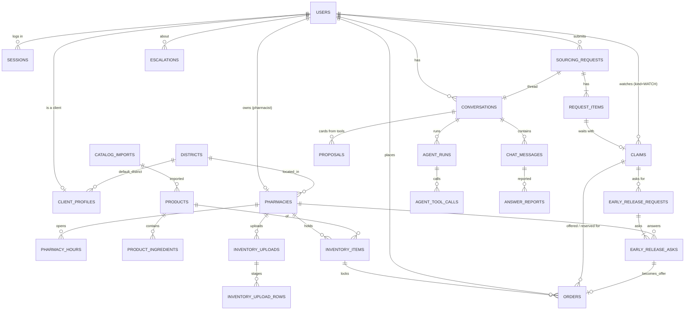

# DawaLink: Database Design

**Version:** v3.0 · **Date:** 2026-10-20
**Builds on:** `04_domain_rules.md` v4.0 (every rule ID referenced here is defined there) · `02` v3.0 · ADR-001–004 · [design review #2](reviews/design_review_02.md) · the professor's guidance (decision log §S)
**Database:** PostgreSQL 16 · SQLAlchemy 2.0 · Alembic
**Status:** ✅ v1.0 validated (DB-D1–DB-D10). **v3.0 applies the professor's guidance** (decision log §S):
- **locations:** a map pin on pharmacies, a reference point on districts, and the client's rounded location on conversations, requests and claims (kept out of the LLM context);
- **expiry fit:** `pickup_day` and `days_of_use` on orders, `days_of_use` on request items and claims, and a `fits()` function;
- a **travel-time cache**;
- no fixed minimum before expiry in `visible_listings`.

**v2.0 applied design review #2** (decision log §N):
- **no jobs table:** one clock check loop reads the deadlines on the rows;
- instant reservations, with no pickup code;
- the claim is the single "need";
- server-side **sessions** instead of refresh tokens;
- a **proposals** table so that cards come only from tools;
- a turn lease on conversations;
- ~~districts without coordinates~~ (reference points added back in v3.0).

---

## In short

- **34 tables in 7 areas:**
  - identity;
  - catalog;
  - inventory;
  - orders;
  - **agent** (requests, claims, early release, conversations, proposals, agent metrics);
  - admin;
  - operations (outbox, notifications, audit, app state).
- **Rules live in three layers.**
  1. **Database constraints and triggers** guard what must never break: no negative stock, terminal orders never change, a deadline never changes, one offer per path per claim, the audit log is append-only.
  2. **Services** enforce cross-row rules inside one transaction.
  3. **Tests** check everything, including reconciliation queries.
- **Time comes from the app clock.**
  - The zone and the policy price are computed from `expiry_date` and a **`today` passed in by the app**, never `CURRENT_DATE`.
  - Every deadline is computed from the app's `now` and **stored on its row**.
  - The clock check finds overdue rows with `WHERE deadline <= :now`.
- **Concurrency:**
  - row locks in a fixed order;
  - an advisory lock per medicine group for matching;
  - a **lease** for agent turns;
  - `SKIP LOCKED` in the clock check;
  - one idempotency key per order.
- **Privacy:**
  - PII lives in 3 user columns (`users.email`, `full_name`, `phone`), plus the client's **rounded location** on conversations, requests and claims, which is never sent to the LLM;
  - chats are stored redacted;
  - the audit log stores IDs, never PII values;
  - three database roles with least privilege.

---

## 1. Conventions

| Topic | Convention | Why |
|---|---|---|
| Primary keys | `uuid` (`gen_random_uuid()`) for business entities; `bigint identity` for high-volume logs (audit, messages, notifications, tool calls, outbox); `smallint` for districts | IDs can't be guessed in URLs; logs stay compact |
| Human references | `orders.ref` = `R-000123`, `sourcing_requests.ref` = `Q-000045` (from sequences) | Readable codes; the order number is what the client shows at the counter |
| Time | `timestamptz` stored in UTC; dates as `date`. **Business times are written from the app clock**; `created_at` may default to the database time, because it only orders "who came first" (`04` R-T11) | The simulated and demo clocks work |
| Money | `bigint` LBP (integers) | `04` R-C3 |
| Quantities | `int` units (`04` R-C4) | Box splitting needs no migration later |
| Enumerations | `text` + `CHECK (col IN (...))` | Easier to evolve than native enums in Alembic |
| Deletes | No hard deletes in normal flows (states instead). FKs are `ON DELETE RESTRICT` unless noted. Only retention jobs delete. | History and audit stay intact |
| Extensions | `pg_trgm` (fuzzy search), `citext` (case-insensitive email) | Search and unique emails |
| Open orders | `state IN ('OFFERED','RESERVED')`, used everywhere as "open" | `04` SM-5 |

---

## 2. Entity-relationship diagram (main relations)



*Operations tables (`email_outbox`, `notifications`, `audit_events`, `abuse_flags`, `app_state`, verification tokens) reference users and entities by ID and are left out of the diagram for readability.*

---

## 3. Tables

Notation: **PK** primary key · **FK** foreign key · **U** unique · **NN** not null · *PII* personal data.

### 3.1 Identity and access

**`users`**
| Column | Type | Rules |
|---|---|---|
| id | uuid | PK |
| email | citext | NN, U · *PII* |
| password_hash | text | NN (argon2id, `04` R-AU1) |
| role | text | NN · `IN ('client','pharmacist','admin')` |
| full_name | text | NN · length 2–80 · *PII* · **never sent to the LLM** |
| phone | text | nullable · *PII* |
| email_verified_at | timestamptz | nullable |
| failed_logins / locked_until | smallint / timestamptz | `04` R-AU2 |
| signup_ip_hash | bytea | HMAC of the sign-up IP (not reversible), for `04` R-AU5 |
| created_at / updated_at | timestamptz | NN |

**`client_profiles`** (1:1 with client users)
| Column | Type | Rules |
|---|---|---|
| user_id | uuid | PK, FK users |
| status | text | `IN ('UNVERIFIED','ACTIVE','PAUSED','SUSPENDED')` (`04` SM-2) |
| paused_until | timestamptz | `CHECK (status <> 'PAUSED' OR paused_until IS NOT NULL)` |
| district_id | smallint | FK districts |
| alternatives_ok_default | boolean | default false |
| status_reason | text | admin reason for suspend or lift |

**`sessions`** (`04` R-AU3): id uuid PK · user_id FK · `token_hash` bytea U (the browser holds only the random token) · created_at · expires_at (7 days; admins 12 h) · last_seen_at · revoked_at.
- Index `(user_id) WHERE revoked_at IS NULL`, so logout, a password change or a suspension can revoke all of a user's sessions at once.
- Every API request looks up the session by hash: one indexed query.

**`email_verification_tokens`**: id uuid PK · user_id FK · `token_hash` bytea U · expires_at (24 h) · used_at.

**`districts`**: id smallint PK · name U · `governorate` text NN · `ref_lat`, `ref_lon` numeric(8,5): the point used when a client picks a district instead of sharing their location (`04` R-S2).

**`pharmacies`**
| Column | Type | Rules |
|---|---|---|
| id | uuid | PK |
| owner_user_id | uuid | FK users, U (one account per pharmacy, P-D5) |
| name / address | text | NN |
| license_number | text | NN, U |
| phone | text | NN, U |
| district_id | smallint | FK |
| **lat / lon** | numeric(8,5) | NN: the **map pin** set at registration (`04` R-S2) |
| location_checked_at / _by | timestamptz / uuid | set by the admin at approval; only an admin can move the pin afterwards |
| **pickup_days** | smallint | NN, default 1, `CHECK (pickup_days BETWEEN 1 AND 3)` (`04` N-6) |
| status | text | `IN ('PENDING','APPROVED','REJECTED','SUSPENDED')` (`04` SM-1) |
| info_requested | boolean | default false |
| status_reason | text | reject or suspend reason |
| approved_at, created_at, updated_at | timestamptz | |

**`pharmacy_hours`**: PK (pharmacy_id, weekday, seq).
- `weekday` 0–6 (0 = Monday); `seq` 1–2.
- `open_minute` 0–1439, `close_minute` 1–1440 (1440 = 24:00).
- `CHECK (open_minute < close_minute)`. Overlaps are checked in the service.

### 3.2 Catalog

**`catalog_imports`**: id uuid PK · file_name · `source_date` date · `lbp_per_usd` numeric(12,2) (the rate stated on the list, `04` R-C3) · rows_total · rows_imported · imported_at.

**`products`**
| Column | Type | Rules |
|---|---|---|
| id | uuid | PK |
| import_id | uuid | FK catalog_imports (provenance, `04` R-C1) |
| moph_name | text | NN |
| search_name | text | NN, normalized (lowercase, no punctuation) · **GIN trigram index** |
| brand_generic | char(1) | `IN ('B','G')` |
| ingredients_raw, dosage_text, form_text | text | As in the source |
| form_group | text | e.g. `tablet`, `capsule`, `tablet_mr` (`04` R-C5) |
| atc_code | text | indexed |
| public_price_lbp | bigint | NN, ≥ 0 |
| units_per_pack | int | NN, default 1, ≥ 1 (INV-19) |
| prescription_required | boolean | NN, default **true** (`04` R-C7; drives the notice R-P1 only) |
| controlled | boolean | NN, default false (`04` R-C6) |
| equivalence_key | text | nullable (null = no equivalents); indexed |

**`product_ingredients`**: PK (product_id, position) · name · `name_normalized` (**GIN trigram**, so clients can search by ingredient) · strength_value numeric · strength_unit text.

**`pricing_tiers`**: min_days · max_days · discount_pct. Seeded from config (`04` N-4); read by the price function. This keeps a single source for the tiers.

### 3.3 Inventory

**`inventory_uploads`**
| Column | Type | Rules |
|---|---|---|
| id | uuid | PK |
| pharmacy_id | uuid | FK |
| status | text | `IN ('VALIDATED','APPLIED','DISCARDED','FAILED')` (`04` SM-4) |
| file_name | text | the file itself is **not stored** |
| rows_total / rows_ok / rows_error | int | |
| summary | jsonb | counts: new, changed, zeroed, warnings |
| errors | jsonb | first 500 row errors with "did you mean…" suggestions |
| created_by, created_at, applied_at | | |

**Partial unique index:** one VALIDATED upload per pharmacy:
`UNIQUE (pharmacy_id) WHERE status = 'VALIDATED'`.

**`inventory_upload_rows`** (staging): PK (upload_id, row_no) · product_id FK · batch · expiry_date · quantity int ≥ 0. Rows are kept only between VALIDATED and APPLIED/DISCARDED, then deleted (`ON DELETE CASCADE` from the upload).

**`inventory_items`**
| Column | Type | Rules |
|---|---|---|
| id | uuid | PK |
| pharmacy_id, product_id | uuid | FK, NN |
| batch | text | NN |
| expiry_date | date | NN |
| qty_on_hand | int | NN, ≥ 0 |
| qty_reserved | int | NN, ≥ 0, **`CHECK (qty_reserved <= qty_on_hand)`** (INV-1) |
| splittable | boolean | default false (`04` R-C4) |
| listing_control | text | `IN ('LIVE','PAUSED')`, default `'LIVE'` |
| price_override_lbp | bigint | nullable, ≥ 0; ≤ public price enforced by a **trigger** (INV-5) |
| last_edited_at | timestamptz | the last upload or manual edit (stale-inventory reminder, N-16) |
| created_at / updated_at | | |

**Unique:** (pharmacy_id, product_id, batch, expiry_date) (`04` R-U1).
**Indexes:** (product_id, expiry_date) for search; (pharmacy_id, expiry_date) for the pharmacy views.
**Zone and price are never stored** (R-T9); see §5.

### 3.4 Orders (the order covers the reservation)

**`orders`**
| Column | Type | Rules |
|---|---|---|
| id | uuid | PK |
| ref | text | U (`R-000123`): the order number the client shows at the counter |
| client_id | uuid | FK users |
| pharmacy_id, inventory_item_id, product_id | uuid | FK. product_id is copied in for limit queries. |
| equivalence_key | text | Copied at creation, for the per-group cap (R-L2) |
| source | text | `IN ('search','assistant','request','watch','early_release')` |
| claim_id / request_item_id / early_release_ask_id | uuid | nullable FKs |
| group_id | uuid | nullable; shared by the orders of one **group reserve** (R-RQ6) |
| state | text | the 10 states of `04` SM-5 |
| qty_requested | int | > 0 |
| qty_locked | int | NN, ≥ 0. **`CHECK (state IN ('OFFERED','RESERVED') OR qty_locked = 0)`**: terminal orders hold no stock. |
| qty_picked_up | int | nullable; set at PICKED_UP |
| **pickup_day / days_of_use** | date / smallint | chosen by the client (`04` R-F3, R-F2); the box fits them (INV-25) |
| price_snapshot_lbp | bigint | NN, ≥ 0; **can't change (trigger)** (INV-5) |
| offer_expires_at | timestamptz | **`CHECK (state <> 'OFFERED' OR offer_expires_at IS NOT NULL)`** |
| deadline | timestamptz | **`CHECK (state <> 'RESERVED' OR deadline IS NOT NULL)`**; **never changes once set (trigger)** (INV-15) |
| counts_as_no_show | boolean | set at O4; an admin may clear it after a contest (`04` R-N3) |
| contested_at | timestamptz | when the client pressed [I picked it up] (one contest per order) |
| close_reason | text | `IN ('not_available','client_cancel','declined','expired','withdrawn','system')` |
| idempotency_key | text | NN; **`UNIQUE (client_id, idempotency_key)`**: one key per order: the client sends one `Idempotency-Key` per tap, and a group reserve stores `<key>:<position>` for each of its orders (DR2-A12, `06` API-D5) |
| created_at, reserved_at, closed_at, updated_at | timestamptz | |

**Indexes and constraints:**
- **`UNIQUE (claim_id, source) WHERE state = 'OFFERED'`**: at most one offer per path per claim (INV-20). The path is `source`: `watch` or `request` for matching, `early_release` for early release.
- `(client_id) WHERE state IN open`, for the 5-open-orders limit (R-L1).
- `(pharmacy_id, state)`, for the pharmacy's reservations list.
- `(inventory_item_id) WHERE state IN open`, for reconciliation (INV-2).
- **Clock check:** `(deadline) WHERE state = 'RESERVED'` and `(offer_expires_at) WHERE state = 'OFFERED'`.
- `(request_item_id)`, `(claim_id)` and `(group_id)`.

**Trigger `orders_guard`** (BEFORE UPDATE): rejects any change to a **terminal** order (INV-4), any change to `price_snapshot_lbp`, and any change to a `deadline` that is already set. **The one exception** on an `EXPIRED_NO_SHOW` order: setting `contested_at` once, and changing `counts_as_no_show` from true to false (`04` R-N3).

### 3.5 Agent: sourcing requests, claims, early release

**`sourcing_requests`** (`04` SM-8)
| Column | Type | Rules |
|---|---|---|
| id | uuid | PK |
| ref | text | U (`Q-000045`) |
| client_id | uuid | FK |
| state | text | `IN ('OPEN','CLOSED')` |
| outcome | text | `IN ('FULFILLED','PARTIAL','UNFULFILLED','CANCELLED')`; `CHECK ((state='CLOSED') = (outcome IS NOT NULL))` |
| district_id | smallint | FK (the client's district, for display) |
| **loc_lat / loc_lon / loc_source** | numeric(7,3) ×2 / text | the client's location for this request, **rounded to ~100 m** (N-43); `loc_source IN ('shared','district')`; never sent to the LLM; purged with the request |
| alternatives_ok | boolean | NN |
| **ends_at** | timestamptz | NN: creation + the search window (`04` N-11), from the app clock |
| window_checked_at | timestamptz | set when the window check (N-24) has run, so it runs once |
| escalated | boolean | default false |
| idempotency_key | text | `UNIQUE (client_id, idempotency_key)` |
| created_at / closed_at | timestamptz | |

**Indexes:**
- `(client_id) WHERE state = 'OPEN'`, for the 2-open-requests limit;
- `(ends_at) WHERE state = 'OPEN'`, for the clock check.

**`request_items`**: id uuid PK · request_id FK · `position` 1–5 (U with request_id) · product_id FK · `qty` 1–3 · **`qty_secured`** 0–qty (units in its RESERVED or PICKED_UP orders; checked by reconciliation, INV-18) · **`days_of_use`** smallint NN default 1 (`04` R-F2) · max_price_lbp nullable · `state IN ('SEARCHING','PROPOSED','WAITING','SECURED','UNAVAILABLE','CANCELLED')` · updated_at.

**`claims`**: the **single "need" object**, one table for **watches** and **waiting request items** (`04` SM-7, R-PRI)
| Column | Type | Rules |
|---|---|---|
| id | uuid | PK |
| kind | text | `IN ('WATCH','REQUEST_ITEM')` |
| client_id | uuid | FK |
| request_item_id | uuid | U, nullable; `CHECK ((kind='REQUEST_ITEM') = (request_item_id IS NOT NULL))` |
| product_id | uuid | FK |
| include_equivalents | boolean | |
| equivalence_key | text | copied in, used for matching |
| district_id | smallint | for display |
| **loc_lat / loc_lon** | numeric(7,3) | the client's rounded location; the reach is travel time from here (N-23) |
| **days_of_use** | smallint | NN, default 1; only boxes that fit are offered (`04` R-F1) |
| max_price_lbp | bigint | nullable |
| qty / qty_missing | int / int | qty 1–3; `qty_missing` 0–qty (R-W4) |
| ends_at | timestamptz | NN (the search window) |
| state | text | `IN ('ACTIVE','OFFER_PENDING','FULFILLED','EXPIRED','CANCELLED')` |
| created_at / closed_at | timestamptz | **`created_at` + `id` is the priority order** (first come, first served) |

**Constraints and indexes:**
- `UNIQUE (client_id, product_id) WHERE kind='WATCH' AND state IN ('ACTIVE','OFFER_PENDING')`: one live watch per product (R-W2).
- **Matching:** `(equivalence_key, created_at, id) WHERE state = 'ACTIVE'`.
- **Clock check:** `(ends_at) WHERE state IN ('ACTIVE','OFFER_PENDING')`.

**`claim_skips`**: PK (claim_id, inventory_item_id) · skip_until. A claim that declined an offer or let it expire skips that item for 24 h (`04` O10).

**`early_release_requests`**: id uuid PK · client_id · **claim_id FK NN** (the need; DR2-A7) · product_id · include_equivalents · qty · `state IN ('OPEN','FULFILLED','UNFULFILLED','CANCELLED')` · idempotency_key (U with client) · created_at · closed_at. Index `(client_id) WHERE state='OPEN'` (≤ 5).

**`early_release_asks`**
| Column | Type | Rules |
|---|---|---|
| id | uuid | PK |
| er_request_id | uuid | FK; `UNIQUE (er_request_id, pharmacy_id)` |
| pharmacy_id | uuid | FK |
| inventory_item_id | uuid | FK: the **private** item. **Never returned to the client or agent** (INV-8). |
| product_id | uuid | copied in, for the 7-day decline memory |
| state | text | `IN ('ASKED','ACCEPTED','DECLINED','EXPIRED','WITHDRAWN')` |
| respond_by | timestamptz | NN: now + the answer time (N-13), from the app clock |
| accepted_qty / accepted_price_lbp | int / bigint | set on ACCEPTED; price ≤ public price |
| decline_reason | text | a code (no free text reaches the agent, R-AG8) |
| created_at / answered_at | | |

**Indexes:**
- `(pharmacy_id, created_at)`, for the 10-asks-per-day limit (R-E3);
- `(pharmacy_id, product_id, answered_at) WHERE state='DECLINED'`, for the 7-day decline memory;
- `(respond_by) WHERE state='ASKED'`, for the clock check.

### 3.6 Conversations and agent operations

**`conversations`** (ADR-001)
| Column | Type | Rules |
|---|---|---|
| id | uuid | PK |
| client_id | uuid | FK |
| kind | text | `IN ('chat','request')` |
| request_id | uuid | U, nullable; `CHECK ((kind='request') = (request_id IS NOT NULL))` |
| status | text | `IN ('ACTIVE','ARCHIVED')` |
| case_state | jsonb | NN, default `{}`: the agent's working memory (items in focus, constraints, plans shown, pending proposals) |
| **loc_lat / loc_lon / loc_source / loc_set_at** | numeric(7,3) ×2 / text / timestamptz | the location shared in this chat, rounded. **Kept out of `case_state`**, so it's never loaded into the LLM context (INV-24). |
| **turn_lease_until / turn_owner** | timestamptz / text | the turn lease (`04` R-AG2, N-27) |
| **pending_turn_at / turn_attempts** | timestamptz / smallint | a decision event waiting for a turn (`04` R-AG4); retries (SM-12) |
| **followup_at** | timestamptz | one follow-up scheduled by the agent (`07` AG-D11, `04` N-39); cleared when the turn runs |
| last_activity_at / created_at | timestamptz | |

- `UNIQUE (client_id) WHERE kind='chat' AND status='ACTIVE'` gives one active chat per client (D9).
- Indexes `(pending_turn_at) WHERE pending_turn_at IS NOT NULL` and `(followup_at) WHERE followup_at IS NOT NULL`, for the clock check.

**`chat_messages`**: id bigint PK · conversation_id FK (`ON DELETE CASCADE`) · `seq` (U with conversation) · `author IN ('client','agent','system','admin')` · `kind IN ('text','card','timeline','event')` · `text_redacted` (**PII removed before insert**, INV-10) · `cards` jsonb (**proposal IDs** for agent cards; template data for system cards) · agent_run_id FK nullable · created_at.
- Decision events are stored as `kind='event'` system messages, so the next turn reads them from the history (R-AG4).

**`proposals`**: cards come only from tools (`04` R-AG7, INV-21)
| Column | Type | Rules |
|---|---|---|
| id | uuid | PK (sent by the tap) |
| conversation_id | uuid | FK (`ON DELETE CASCADE`) |
| client_id | uuid | FK: only this client can use it |
| kind | text | `IN ('reserve','reserve_group','accept_offer','cancel','request_summary','constraint_change','remove_item')` |
| payload | jsonb | NN: the exact content shown (items, quantities, prices, pharmacy); the card is rendered from it |
| agent_run_id | uuid | FK: which turn created it (traceability) |
| expires_at | timestamptz | NN: 2 h (`04` N-30), or the offer's own expiry for `accept_offer` |
| used_at | timestamptz | one use |
| created_at | timestamptz | |

When a tap arrives, the API checks the owner, `used_at IS NULL`, `expires_at > now` and that the tap matches the payload (a group tap may untick items, but never add any), then **re-validates the action** as if it were new.

**`agent_runs`**: one row per agent turn. It holds **no PII** and is **kept after the conversation is purged** (metrics).
| Column | Type |
|---|---|
| id | uuid PK |
| conversation_id | uuid FK `ON DELETE SET NULL` |
| request_id | uuid FK nullable |
| mode | `IN ('assistant','sourcing')` |
| trigger | `IN ('client_message','request_submitted','decision_event','followup','window_check')` |
| model, prompt_version | text |
| started_at, ended_at, latency_ms | |
| tokens_in, tokens_out, cost_usd numeric(10,6) | |
| tool_calls, tool_errors, retries | smallint |
| outcome | `IN ('ok','fallback','error','guardrail_blocked','budget_exceeded')` |
| langfuse_trace_id | text |

**`agent_tool_calls`**: id bigint · agent_run_id FK · tool · ok · error_code · latency_ms · created_at. **This gives tool failure rates without depending on Langfuse retention.**

**`answer_reports`** (👎): id uuid · message_id FK `ON DELETE SET NULL` · client_id · reason · comment (≤ 500) · **`snapshot` jsonb**: a redacted copy of the reported reply and its context, so a regression case survives the 30-day chat purge · `state IN ('NEW','DISMISSED','CONFIRMED')` · category · reviewed_by · exported_at · created_at.

### 3.7 Admin

**`escalations`**: id uuid · client_id · conversation_id · request_id nullable · `reason IN ('client_asked_human','emergency_claim','cannot_resolve','window_ending','suspicious','complaint')` · `summary` (≤ 300) · `notes` jsonb (later escalations appended while this one is open) · `state IN ('OPEN','IN_PROGRESS','RESOLVED')` · resolution_note · resolved_by · created_at · resolved_at.
- `UNIQUE (client_id) WHERE state <> 'RESOLVED'` gives one open escalation per client; a new one is **appended** to `notes` (`04` SM-9).
- Admin replies are stored as `chat_messages` with `author='admin'`.
- **There is no priority column anywhere:** priority can't be changed (`04` R-PRI4).

**`abuse_flags`**: id uuid · `subject_type IN ('client','pharmacy')` · subject_id · `rule IN ('no_show_pause','guardrail_repeat')` · `severity IN ('low','high')` · evidence jsonb (IDs only) · `state IN ('OPEN','DISMISSED','ACTIONED')` · action · resolved_by · created_at · resolved_at.
`UNIQUE (subject_type, subject_id, rule) WHERE state='OPEN'` merges duplicate open flags.

### 3.8 Operations

**There is no jobs table** (DR2-A10). The clock check (§6) reads the deadlines on the rows: `orders.offer_expires_at`, `orders.deadline`, `sourcing_requests.ends_at`, `claims.ends_at`, `early_release_asks.respond_by`, `conversations.pending_turn_at`, `conversations.followup_at`, `email_outbox.next_attempt_at`.

**`email_outbox`**: id bigint · user_id FK · template · params jsonb (**no email address stored**; it's resolved at send time) · `dedupe_key` U · `state IN ('QUEUED','SENT','FAILED','DEAD')` · attempts · next_attempt_at · last_error · created_at · sent_at.
Index `(next_attempt_at) WHERE state IN ('QUEUED','FAILED')`.

**`notifications`**: id bigint · user_id · type · payload jsonb · `dedupe_key` U (one per event per recipient, R-NT) · read_at · created_at. Index `(user_id, created_at DESC)`.

**`audit_events`** (append-only)
| Column | Type |
|---|---|
| id | bigint PK |
| occurred_at | timestamptz |
| actor_type | `IN ('client','pharmacy','admin','agent','system')` |
| actor_id | uuid nullable |
| entity_type, entity_id | text, uuid |
| action | text (e.g. `order.reserve`, `order.not_available`, `claim.allocate`, `pii.view`, `clock.advance`) |
| before / after | jsonb (**IDs and states only, never PII values**) |
| reason | text |

Indexes: (entity_type, entity_id, occurred_at) and (occurred_at).
**Append-only:** the app role has `INSERT, SELECT` only, plus a trigger that rejects UPDATE and DELETE (only the retention role may delete rows older than 1 year).

**`travel_time_cache`**: PK (pharmacy_id, origin_cell, mode) · `origin_cell` text (the client's rounded location) · `mode IN ('car','walk')` · minutes int · km numeric(6,2) · `source IN ('road','straight')` · computed_at. Entries older than 24 h (N-43) are ignored and purged daily (`04` R-RT1).

**`app_state`**: key text PK · value jsonb · updated_at. Small system values:
- `daily_tasks_last_run`, so the once-a-day tasks run once even across restarts;
- `demo_clock_offset_seconds`, read only in demo mode (`04` R-DEMO).

---

## 4. Where each invariant is enforced

| Invariant (`04` §6) | Database | Service | Test |
|---|---|---|---|
| INV-1 `0 ≤ reserved ≤ on_hand` | **CHECK** | | constraint test |
| INV-2 `reserved` = sum of open locks | | Same transaction as every lock change | **Reconciliation query** (below) + race tests |
| INV-3 client limits (offers of one claim count once) | | Under a client row lock (§6) | concurrent-create tests |
| INV-4 terminal orders frozen | **Trigger** `orders_guard` | | trigger test |
| INV-5 price bounds, snapshot frozen | CHECK ≥ 0 + **triggers** | | |
| INV-6 controlled never listed | | Filtered in every query; rejected at creation | property test |
| INV-7 picked up once, own pharmacy, before the deadline | State CHECKs + terminal trigger | Ownership + deadline check | API test |
| INV-8/9 privacy | | API and tool schemas never expose those columns | contract tests |
| INV-10 no PII in LLM traffic | | Redaction before insert and before every LLM call | trace scan test |
| INV-11 agent never creates orders | | No code path from tools to order creation | architecture test |
| INV-12 one hold per unit | `qty_locked` accounting | Matching under an advisory lock | |
| INV-13 audit for every change | | Written in the same transaction | |
| INV-14 timed states have deadlines | **CHECKs** on `offer_expires_at`, `deadline`; NN on `ends_at`, `respond_by` | | constraint test |
| INV-15 deadline never changes | **Trigger** | | |
| INV-16 visibility | **One SQL function** (§5) used everywhere | | |
| INV-17 deterministic allocation (first come, first served) | `ORDER BY created_at, id` | Advisory lock per equivalence key | repeat-run test |
| INV-18 secured ⇔ units reserved or picked up | | Same transaction as O1/O2/O3/O9 | reconciliation query |
| INV-19 units | **CHECK** | | |
| INV-20 one offer per path per claim | **Partial unique** `(claim_id, source) WHERE OFFERED` | Withdraw the others on accept (O9) | race test: accept two offers at once |
| INV-21 cards from proposals | FK from the tap to `proposals` | Owner, expiry, one use, re-validation | API test with a forged payload |
| INV-22 request hours | | Checked at creation with the app clock | boundary tests (07:59, 08:00, 20:00) |
| INV-23 no pharmacy text to the LLM | | Tool output schemas carry codes only | schema test |
| INV-24 no coordinates to the LLM | Location columns live outside `case_state` | Tools return minutes, km and area names only | trace scan test |
| INV-25 only boxes that fit | `fits()` function | Checked in search, tools, taps, matching and offer acceptance | boundary tests |

**Example reconciliation query (INV-2):** run in tests and once a day by the clock check, which raises an alert on any row.
```sql
SELECT ii.id, ii.qty_reserved, COALESCE(SUM(o.qty_locked), 0) AS locked
FROM inventory_items ii
LEFT JOIN orders o ON o.inventory_item_id = ii.id
     AND o.state IN ('OFFERED','RESERVED')
GROUP BY ii.id
HAVING ii.qty_reserved <> COALESCE(SUM(o.qty_locked), 0);
```

---

## 5. Derived values: visibility, price, area (never stored)

`today` is **always a parameter supplied by the app clock**, never `CURRENT_DATE`. The evaluation's simulated clock, the demo clock and the tests can then control time.

```sql
-- Policy price (04 SM-3), tiers from the pricing_tiers table (04 N-4)
CREATE FUNCTION effective_price_lbp(public_price bigint, override bigint, days_left int)
RETURNS bigint LANGUAGE sql STABLE AS $$
  SELECT COALESCE(override,
         (floor(public_price * (1 - t.discount_pct / 100.0) / 1000) * 1000)::bigint)
  FROM pricing_tiers t
  WHERE days_left BETWEEN t.min_days AND t.max_days
$$;

-- The only definition of "visible to clients" (INV-16)
CREATE FUNCTION visible_listings(p_today date) RETURNS TABLE (...) LANGUAGE sql STABLE AS $$
  SELECT ii.id, ii.pharmacy_id, ii.product_id, ii.expiry_date,
         ii.qty_on_hand - ii.qty_reserved AS qty_available,
         effective_price_lbp(p.public_price_lbp, ii.price_override_lbp, ii.expiry_date - p_today) AS price_lbp
  FROM inventory_items ii
  JOIN products p    ON p.id = ii.product_id
  JOIN pharmacies ph ON ph.id = ii.pharmacy_id
  WHERE ph.status = 'APPROVED'
    AND ii.listing_control = 'LIVE'
    AND NOT p.controlled
    AND ii.qty_on_hand - ii.qty_reserved >= 1
    AND ii.expiry_date BETWEEN p_today AND p_today + 180        -- NEAR_EXPIRY (04 N-1): no fixed minimum
$$;

-- Expiry fit (04 R-F1): the box is still valid on the last day of use
CREATE FUNCTION fits(expiry date, pickup_day date, days_of_use int)
RETURNS boolean LANGUAGE sql IMMUTABLE AS $$
  SELECT expiry >= pickup_day + (days_of_use - 1)
$$;

-- Area label (district / governorate), for display only; ranking uses travel time (04 R-S3)
CREATE FUNCTION area_rank(client_district smallint, pharmacy_district smallint)
RETURNS smallint LANGUAGE sql STABLE AS $$
  SELECT CASE WHEN client_district = pharmacy_district THEN 0
              WHEN c.governorate = p.governorate THEN 1 ELSE 2 END
  FROM districts c, districts p
  WHERE c.id = client_district AND p.id = pharmacy_district
$$;
```

Travel times aren't computed in SQL: the routing service is called from Python (`04` R-RT1). The window bounds (0, 180) and the early-release zone (181–270) come from config, in a later revision of these functions. They're shown as literals here for clarity.

---

## 6. Concurrency and the clock check

**Global lock order** (prevents deadlocks): `client_profiles` → `inventory_items` (sorted by id) → `orders` → request rows (`sourcing_requests`, `request_items`, `claims`, `early_release_*`) → `conversations`.

| Operation | Pattern |
|---|---|
| **Reserve / group reserve** (O1, R-RQ6) | 1. `SELECT … FROM client_profiles WHERE user_id = :client FOR UPDATE`. This serializes one client's creations, so the limits (R-L1, R-L2) can't be raced.<br>2. `SELECT … FROM inventory_items WHERE id = ANY(:ids) ORDER BY id FOR UPDATE`.<br>3. Check availability for **every** ticked item. If any fails → roll back (**all or none**).<br>4. `UPDATE qty_reserved`; `INSERT orders` (state RESERVED, deadline from the app clock, shared `group_id`, one idempotency key each); update linked items and claims; `INSERT audit_events`; queue PN-4 and CN-3.<br>5. `COMMIT`.<br>A duplicate `idempotency_key` → return the existing order. |
| **Accept an offer** (O9) | Lock the client → the items held by **all** of the claim's open offers (sorted) → those orders → the claim. Reserve the accepted one; withdraw the others (INV-20); commit. |
| **Pharmacy [Picked up] / [Not available]** (O2, O3) | Lock the item, then the order; re-check that the state is RESERVED and the pharmacy is the owner; update both; update the linked item and claim; for a decision event, add an `event` message and set `pending_turn_at` on the conversation; audit; commit. Two clicks at once → the second finds a terminal order and returns "already done". |
| **Matching / allocation** (R-PRI) | 1. `pg_advisory_xact_lock(hashtext('match:' || equivalence_key))`: one allocator per medicine group.<br>2. Load the candidate ACTIVE claims `ORDER BY created_at, id` (deterministic, INV-17) and the available items within reach.<br>3. Lock the candidates' `client_profiles` (sorted by id), then the items (sorted by id), following the global order.<br>4. Allocate in order: **skip** clients who aren't ACTIVE or are at a limit (R-PRI3); create OFFERED orders while stock remains; update the claims; audit with the reason. |
| **Agent turn** (R-AG2) | **Lease:** `UPDATE conversations SET turn_lease_until = :now + interval '2 min', turn_owner = :me WHERE id = :id AND (turn_lease_until IS NULL OR turn_lease_until < :now) RETURNING id`. No row → busy. The lease is renewed during long turns and cleared at the end. **No database connection is held while the LLM thinks.** After a crash, the lease simply expires. |
| **Clock check** (`04` R-T10) | Every pass (N-26) runs a few small queries, each selecting due rows, for example `SELECT id FROM orders WHERE state='OFFERED' AND offer_expires_at <= :now ORDER BY offer_expires_at LIMIT 50 FOR UPDATE SKIP LOCKED`. Each row is handled in **its own transaction** with a state re-check, so two workers or a restart never process a row twice. The steps, in order:<br>1. expire offers;<br>2. expire reservations;<br>3. expire asks;<br>4. the window check;<br>5. end windows;<br>6. matching sweep;<br>7. pending agent turns;<br>8. emails;<br>9. the daily tasks (via `app_state`). |
| **Upload apply / manual edit** (SM-4, R-U3) | Lock the upload and every affected item (sorted); apply R-U1–R-U5; delete the staging rows; commit; run matching for the affected equivalence keys. |

---

## 7. Privacy and security

| Topic | Design |
|---|---|
| **Where PII lives** | `users.email`, `users.full_name`, `users.phone`, plus the client's **location**: rounded to ~100 m, stored only on conversations, requests and claims, purged with them, and **never sent to the LLM** (INV-24). Pharmacy pins are business addresses, not PII. |
| Chats | Stored **redacted** (`text_redacted`): known account identifiers and phone/email patterns removed before insert and before any LLM call |
| Pharmacy text | Decline reasons are codes; nothing typed by a pharmacy is passed to the agent (`04` R-AG8) |
| Audit log | IDs and states only. Admin views of personal data are logged as `pii.view` events. |
| Email | The address is resolved at send time, not copied into the outbox |
| Secrets | Password hashes (argon2id), session and token hashes. No plain-text secrets in tables. |
| **Database roles** | `dawalink_migrator`: DDL, used only by migrations. `dawalink_app`: DML on app tables, **INSERT/SELECT only on `audit_events`**, no DDL. `dawalink_retention`: deletes for retention only. |
| At rest / in transit | RDS encryption at rest; TLS required for connections; credentials in Secrets Manager |

---

## 8. Retention (run by the clock check's daily tasks, `04` R-RET)

| Data | Rule |
|---|---|
| Conversations, messages, proposals | Delete 30 days after `last_activity_at` (chat) or the request's `closed_at` |
| `agent_runs`, `agent_tool_calls` | Kept (no PII); `conversation_id` set to NULL when the conversation is deleted |
| `answer_reports.snapshot` | Kept while the report is open or exported to regression (redacted) |
| Notifications | 90 days |
| Sessions and verification tokens | Deleted after expiry or revocation |
| Client location | Deleted with its conversation, request or claim |
| `travel_time_cache` | Rows older than 24 h (N-43) |
| Audit events | 1 year (retention role) |
| Upload staging rows | Deleted at apply or discard (inline) |

---

## 9. Seeding, import and migrations

| What | How |
|---|---|
| **Catalog** | `backend/scripts/import_catalog.py --file <MoPH .xls> --date <list date> --rate <LBP per USD>` creates a `catalog_imports` row and upserts products and ingredients. It then applies the team file `backend/data/catalog_overrides.yaml` (controlled, OTC list, equivalence fixes, `units_per_pack`). |
| Districts | `backend/data/districts.csv` (district, governorate; source cited in the file) |
| Pricing tiers | Seeded from config (`04` N-4) |
| Admins | `backend/scripts/create_admin.py` (the only way to create an admin, A-D1) |
| **Demo and simulation data** | `backend/scripts/seed_demo.py --seed 42`: synthetic pharmacies (with hours and pickup days), inventory and clients. **Same seed → same data** (reproducibility). |
| **Migrations** | Alembic; one reviewed revision per PR that changes the schema; functions and triggers live in migrations. CI runs `upgrade` and `downgrade` on a real Postgres. Production runs `upgrade head` as a one-off ECS task before each deploy. |

---

## 10. Database tests

- **Constraints and triggers:** each CHECK, partial unique index and trigger has a test that tries to break it.
- **Concurrency:** two connections race:
  - for the last unit;
  - on a group reserve against a single reserve;
  - two pharmacists pressing [Picked up] on the same order;
  - the client accepting two offers of the same claim;
  - two matching runs on the same group.

  Exactly one wins, and the invariants hold.
- **Clock check:**
  - two workers at once → no row is processed twice;
  - killed mid-pass → the next pass finishes the work.
- **Reconciliation queries** (INV-2, INV-18) run after every integration test.
- **Time,** with the injected clock:
  - visibility and price at d = −1, 0, 180, 181;
  - the expiry fit at its boundaries (expiry = last day of use, and one day before it);
  - request hours at 07:59, 08:00 and 20:00;
  - pickup days across closed days, "today" near closing time (N-42), and the deadline never after the expiry date.

---

## 11. Decisions

| ID | Decision | Choice | Why | Validated |
|---|---|---|---|---|
| DB-D1 | Keys | **UUID** for business entities + readable refs (`R-…`, `Q-…`); `bigint` for logs | Unguessable IDs; readable codes; compact logs | ✅ 2026-10-13 |
| DB-D2 | Enumerations | **text + CHECK** (not native enums) | Easy to evolve with migrations | ✅ 2026-10-13 |
| DB-D3 | Watches and waiting request items | **One `claims` table** | One matching and priority implementation (R-PRI) | ✅ 2026-10-13 |
| DB-D4 | Upload processing | **Staging table** until Apply, then deleted; the file itself is not stored | Clear "summary before apply"; nothing sensitive kept | ✅ 2026-10-13 |
| DB-D5 | Where invariants live | **Triggers only for "must never break"**; everything else in services + tests | Strong guarantees without hiding business logic in the database | ✅ 2026-10-13 |
| DB-D6 | Time | **`today` and `now` always passed by the app** (never `CURRENT_DATE`) | The simulated and demo clocks work | ✅ 2026-10-13 |
| DB-D7 | Pricing tiers | **A table seeded from config** | One source for tiers; SQL can sort by price | ✅ 2026-10-13 |
| DB-D8 | Agent metrics | **Own tables (`agent_runs`, `agent_tool_calls`)** besides Langfuse | Survive Langfuse's 30-day retention; join with outcomes (cost per fulfilled request) | ✅ 2026-10-13 |
| DB-D9 | Reported answers | **Keep a redacted snapshot** | Regression cases survive the chat purge | ✅ 2026-10-13 |
| DB-D10 | Database roles | **migrator / app / retention** with least privilege | Security requirement; the audit log can't be tampered with by the app | ✅ 2026-10-13 |
| DB-D11 | Timers | **No jobs table:** a clock check reads the deadlines on the rows | Simpler; nothing can get stuck; the simulation just advances the clock | ✅ 2026-10-13 (review #2) |
| DB-D12 | The need | **The claim is the single need**; early release points to a claim; one offer per path (partial unique) | No double offers; limits stay correct | ✅ 2026-10-13 (review #2) |
| DB-D13 | Cards | **`proposals` table**; a tap sends a proposal ID | What the client sees is what the button does | ✅ 2026-10-13 (review #2) |
| DB-D14 | Login | **`sessions` table** (opaque token) instead of refresh tokens | Less code; instant revocation | ✅ 2026-10-13 (review #2) |
| DB-D15 | Agent turn lock | **A lease on `conversations`** instead of a session advisory lock | No connection held during LLM calls; expires after a crash | ✅ 2026-10-13 (review #2) |
| DB-D16 | Locations | **Pharmacy pin; district reference points; the client's location rounded to ~100 m** on conversations, requests and claims, outside `case_state` | The routes the professor asked for, with the least personal data and none of it reaching the LLM | ✅ 2026-10-20 (§S) |
| DB-D17 | Expiry fit and travel times | **`pickup_day` / `days_of_use` columns + a `fits()` function; a 24 h travel-time cache** | One definition of "fits"; fewer calls to the routing service | ✅ 2026-10-20 (§S) |
