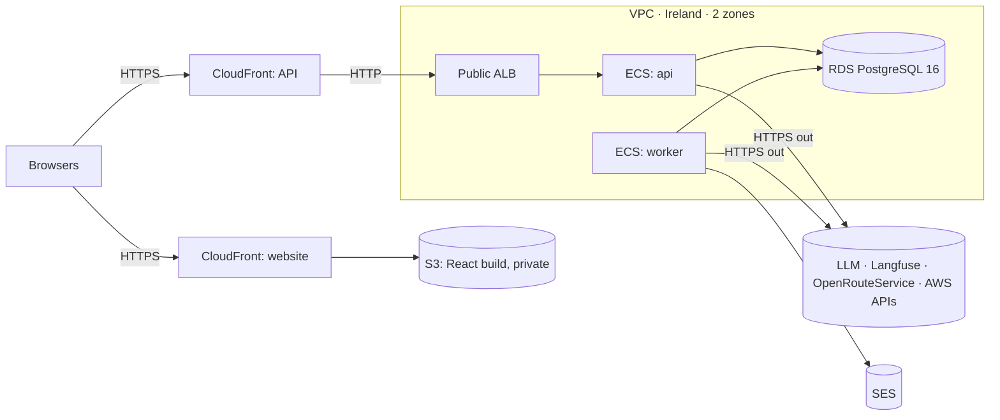

# DawaLink: Infrastructure and Deployment

**Version:** v2.8 · **Date:** 2026-11-23
**Builds on:** `02` v3.1 §7 · `05` v3.1 §7, §9 · `06` v1.2 §2, §6.1 · `09` v1.2 (FX, FO rows) · `10` v1.1 · `11` v1.1 §10, §13
**Status:** ✅ validated by the owner (2026-11-02, decision log §V). **v2.8** (2026-11-23): round A (BLD-D46 to BLD-D50) adds what "forgot my password", "delete my account" and "confirm, then log in" mean for SES and for the switch to Cognito (§9, §10), the Ministry's no-prescription list in the release's catalog check (§7, §12), CloudFront's own logs left off (§4.1), and two checks after deploying (§14); round B (BLD-D51 to BLD-D56) changed no deployment file. **v2.7** (the pre-production review, 2026-11-19): every setting of the three task definitions, and where each comes from (§8.1); `APP_ENV=aws` is the image's own default (§6); email through SES by SMTP (§9); the database secrets are full addresses, the ops task gets the retention login, and the master password is set by hand (§7, §8); the website's release keeps the previous build's files and never answers a missing file with the page (§4.1, §12); the load balancer's idle timeout, the stop times and the health checks (§5, §6); how the first admin is made before Cognito (§10.1); more checks after deploying (§14). Nothing here has been run on AWS yet. **v2.4:** the development budget setting is 20 (decision log BLD-D13), and Langfuse is proven with real keys (§2). **v2.3** (build step 5): the agent's settings, the development model (Claude, decision log BLD-D11) and the terminal chat command (§2). **v2.2** (build step 4): the mail catcher runs locally, and the worker's email settings are named (§2). **v2.1** (build step 3): §7 says where the catalog file comes from (O5 closed) and what `prepare_db` does as built. It replaces the v1.0 draft, which was never validated: the owner removed the pipelines, CDK and advanced GitHub features. Decisions INF-D1–INF-D15 are in §15.

This is the last planning step. It says **how we work, where DawaLink runs, and how it gets there**. Everything is done by hand. Nothing here has been run yet, so the first deploy is also its first test.

---

## In short

- **We build and test on the laptop, in Docker.** AWS comes once, after the project is finished.
- **Only the owner (Mohammed) touches AWS,** with a personal IAM user and an access key. Images are built on the laptop and pushed to ECR.
- **Ireland** (`eu-west-1`). AWS is set up **by hand in the console**, following the checklist in §11. There is no CDK, no CloudFormation and no pipeline.
- **Two CloudFronts, no domain, no certificate:** one for the website (S3), one for the API (ALB).
- **Two CloudFronts change the login:** the browser treats them as two different sites, so the login token travels in a header instead of a cookie, and the API uses CORS (§4.3).
- **The hop between CloudFront and the ALB is unencrypted.** This is an accepted risk (§4.4).
- **Cognito comes last:** we build the login already designed, then switch to Cognito once the project works (§10).
- **Every setting the three task definitions need is listed in §8.1,** with where it comes from. The image is safe by default (`APP_ENV=aws`), and the app refuses to start on a setting that is unsafe in AWS.
- **Rollback** means going back to the previous ECS task definition.
- **The owner and Claude check everything** and write the test datasets. There are no pull request reviews and no CI.
- **Cost:** about **$82 a month (≈ $2.70 a day)** while it runs in AWS.

---

## 1. How we work (INF-D1, INF-D14)

1. Claude writes a feature on the laptop.
2. Claude runs that feature's tests, including its Failure Matrix rows, and tries it on the local website.
3. The owner checks it and commits. The owner can explain what was committed (the course makes students responsible for AI-written code).

- **No CI, no pull request reviews, no branch protection.** GitHub only shares the files with teammates.
- **The repo stays public,** so nothing secret or personal goes into tracked files. Scan before every commit, as today.
- **The evaluation suites** (`08`) run by hand on the laptop. Their results are committed, as planned.
- **The test datasets** (the U-set and R-set, `08` §2) are written by the owner and Claude. The report says so.
  - **The held-out part is written in a separate Claude session,** and the working session never opens it, so tuning can't leak into the final results.
- **The Definition of Done changes:**
  - #3 "CI is green" becomes "the tests pass on the laptop";
  - #7 "a teammate reviewed it" becomes "the owner checked it and can explain it".

---

## 2. Local development

- **One command:** `docker compose up` starts `postgres`, `api`, `worker`, `web` and `mailpit`. Ollama runs on the laptop.
  - The worker sends email to `mailpit` through `SMTP_HOST` and `SMTP_PORT`, set in `docker-compose.yml`. Without them (the tests, a worker run by hand), an email is only written to the log. In AWS the same sender logs in to SES (§9), and the worker refuses to start without a complete mail setting.
  - **Two values in `.env` are yours to make:** `APP_SECRET_KEY` and `DEMO_ACCOUNTS_PASSWORD`. `.env.example` leaves them empty, because it is public, and gives the one-line command for each. `docker compose up` stops and says so while the key is empty. The demo accounts can't log in while the password is empty.
  - **Demo mode needs the catalog.** With `DEMO_MODE=true` (compose's default), the database step seeds demo pharmacies, and it stops with a sentence if the catalog file is missing (§7). Build the catalog first, or set `DEMO_MODE=false`.
  - Stopping takes up to 2 minutes: compose gives the API and the worker 120 s, as ECS does (§6), so a running agent turn can finish.
  - The local database is reachable at `127.0.0.1:5433`, because a locally installed PostgreSQL often holds port 5432.
- **Mailpit** catches every email and shows it at `http://localhost:8025`, the links to confirm an email (CN-1) and to set a new password (CN-19) included.
- **LLM:** set by `LLM_PROVIDER` in `.env`. `none` (the default) switches the assistant off, so nothing is spent by accident. `anthropic` uses Claude with `LLM_MODEL` and `ANTHROPIC_API_KEY`: **development uses Claude Haiku 5.5** (decision log BLD-D11). `ollama` is a free local spare. The tests always use a scripted model and can't reach a paid service.
  - `LLM_MONTHLY_BUDGET_USD` is the month's LLM budget; a day may use 10% of it (N-46). The example file says 20 for development (BLD-D13): a day can then spend $2 at most, far more than development needs, and far less than the credit.
  - **Talking to the agent without a website:** inside `backend/`, `uv run --env-file ../.env python -m dawalink.ops.chat "baddi panadol"` writes as a demo client; `--tap 1` taps a card, `--work` runs the worker's waiting turns, `--steps` prints every step of the turn.
  - The worker runs agent turns in their own loop, beside the clock check.
- **Traces:** Langfuse Cloud, with `LANGFUSE_PUBLIC_KEY`, `LANGFUSE_SECRET_KEY` and `LANGFUSE_BASE_URL` (the address Langfuse gives with the keys; the EU one by default). Without them, turns are recorded in our own tables only. Proven with real keys on 2026-11-14: one `agent_turn` trace per turn (`07` §14.6).
- **Routing:** OpenRouteService with a personal key (`ORS_API_KEY`; the service is at `api.heigit.org` since November 2026). With no key, travel times fall back to straight-line distance (R-RT1).
- **Settings:** one module, `config.py`, reads environment variables. `.env.example` lists them, with no usable secret, and the real `.env` is never committed. In AWS the same module refuses what is fine on a laptop but unsafe on the internet: a secret key shorter than 32 characters or one ever published in `.env.example`, a published demo password, an `http` website address (§8.1).
- **Local matches AWS:** the website and the API run on different ports, so they're separate origins here too. The same login and CORS code runs in both places.

---

## 3. The AWS layout (INF-D2, INF-D3)

**Region: Ireland (`eu-west-1`).** From the owner's laptop it answers in about 74 ms, and it's the region the owner chose.



| Service | Use |
|---|---|
| **ECR** | Holds the backend image |
| **ECS Fargate** | Runs `api` and `worker`, plus one-off tasks |
| **ALB** | Sends API traffic to the `api` task |
| **RDS** | PostgreSQL 16 |
| **CloudFront × 2** | The HTTPS addresses for the website and the API |
| **S3** | Holds the React build (private) |
| **SES** | Sends notification emails |
| **Cognito** | Login and sign-up, added last (§10) |
| **Secrets Manager** | Holds passwords and keys |
| **CloudWatch Logs, Budgets** | Logs and the cost alert |

---

## 4. The two CloudFronts (INF-D4, INF-D5, INF-D6)

No domain and no certificate: both use their `*.cloudfront.net` address. CloudFront fixes the minimum TLS version at 1.0 on these addresses; current browsers still connect with a modern version.

### 4.1 Website CloudFront

| Setting | Value |
|---|---|
| Origin | The private S3 bucket, with Origin Access Control |
| Viewer | Redirect HTTP to HTTPS |
| Default root object | `index.html` |
| Behaviours | Two, both to the S3 origin, with the same cache policy and headers policy: **`/assets/*`**, and the **default** (`*`) |
| Pages of the app | A **CloudFront Function** on the default behaviour's *viewer request* (below) answers a page of the app, such as `/requests/Q-4HX9TM`, with `/index.html`. The `/assets/*` behaviour has no function. |
| Error pages | **None.** A custom error response (`403`/`404` → `/index.html`) applies to the whole distribution, `/assets/` included: a missing script would then come back as the page, with status `200`, and a tab left open across a release would go blank (A#4). Without it, a missing file is S3's own error. |
| Cache policy | `Managed-CachingOptimized`, with **Compress objects automatically: Yes**. **Required for phones** (added 2026-11-17, found by Lighthouse): the website's script and styles are about 810 KB as written and about 230 KB compressed; without it a phone on a slow connection waits several seconds more (`11` §10). File names under `/assets` carry a hash of their content, so they are uploaded with a one-year cache; `index.html` is uploaded with `no-cache` (§12), so a browser always asks for the new one |
| Response headers policy | The security headers below |

**The function** (CloudFront → Functions → create, runtime `cloudfront-js-2.0`; publish it, then associate it with the default behaviour as *Viewer request*; check the exact steps in the console). A path whose last part has no dot is a page of the app; a path with one (`/favicon.svg`) is a file:

```js
function handler(event) {
  var request = event.request;
  var last = request.uri.split('/').pop();
  if (last.indexOf('.') === -1) {
    request.uri = '/index.html';
  }
  return request;
}
```

The app's own addresses never have a dot in their last part (order and request numbers, IDs, `/admin/login`). If one ever does, it must be answered here too.

**Security headers** (defenses that `10` relies on):

| Header | Value |
|---|---|
| `Content-Security-Policy` | `default-src 'self'; script-src 'self'; style-src 'self' 'unsafe-inline'; img-src 'self' data: https://tile.openstreetmap.org; font-src 'self'; connect-src 'self' https://<api-cloudfront>; frame-ancestors 'none'; base-uri 'none'; form-action 'self'; object-src 'none'` |
| `Strict-Transport-Security` | `max-age=31536000` |
| `X-Content-Type-Options` | `nosniff` |
| `X-Frame-Options` | `DENY` |
| `Referrer-Policy` | `strict-origin-when-cross-origin` (OpenStreetMap's tile policy forbids blocking the referrer) |
| `Permissions-Policy` | `geolocation=(self), camera=(), microphone=(), payment=()` |

- Scripts run only from our own site. This matters more now, because the login token is readable by scripts (§4.3).
- `'unsafe-inline'` for styles assumes Mantine needs it. We confirm this in the build.
- Readex Pro is self-hosted, so no request goes to Google Fonts.
- **Leave CloudFront's standard logs off** on the website's distribution (the default). The links to confirm an email and to set a new password carry their token in the page's address until the page reads it (`10` TH-66), and those logs would keep it.

### 4.2 API CloudFront

| Setting | Value | Why |
|---|---|---|
| Origin | The ALB, **HTTP only** | The ALB has no certificate |
| Response timeout | 60 s | The chat stream sends a heartbeat every 15 s |
| Viewer | Redirect HTTP to HTTPS | |
| Allowed methods | All | |
| Cache policy | `Managed-CachingDisabled` | Nothing from the API may be cached |
| Origin request policy | `Managed-AllViewerAndCloudFrontHeaders-2022-06` | **Required.** By default CloudFront removes `Authorization` from `GET` requests, which would log everyone out. This policy forwards it, plus `Origin` and `CloudFront-Viewer-Address` (R-AU8). |

- **The visitor's address** is read from `CloudFront-Viewer-Address` only when the API runs with `APP_ENV=aws` (§8.1). Otherwise every visitor seems to come from the load balancer, and the limits counted per address (5 sign-ups an hour, 30 failed logins in 15 minutes) count everybody together: the sixth person to sign up in an hour would be refused (A#2). The API logs `cloudfront_in_front_but_app_env_is_not_aws` once if that happens, and `visitor_address_not_stated` if the header goes missing.
- **A request body sent in pieces, without its length, is refused** as too large (`09` FS-23). Browsers send the length; §14 checks that CloudFront passes it on.

### 4.3 Login across two sites (INF-D6)

`cloudfront.net` is on the public suffix list, so the browser treats the two addresses as **two separate sites**. Safari blocks third-party cookies, so a login cookie would fail on iPhones. So:

- `POST /auth/login` returns the session token **in the response body**.
- React keeps it in `localStorage` and sends `Authorization: Bearer <token>` on every call, including the chat stream.
- **The server side doesn't change:** a random token, only its hash in `sessions`, 7 days (admins 12 h), and logout or suspension revokes it at once.
- **CORS:** the API allows only the website's address, with `Authorization`, `Content-Type` and `Idempotency-Key`, and exposes `X-Request-ID`. Preflight answers are cached for 2 hours, though each new URL still costs one small extra request.
- **The `Origin` check stays** (`06` §2.1). Without a cookie, the browser never attaches the login by itself, so CSRF no longer applies.

### 4.4 Accepted risks of this setup

| Risk | Why we accept it |
|---|---|
| **The CloudFront → ALB hop is plain HTTP.** Passwords, login tokens and medicine searches are unencrypted on that hop. | HTTPS there needs a certificate, which needs a domain. This is a course demo with synthetic data, and the report states it as a limitation. It reverses design review #2's B7. |
| **Scripts can read the login token.** An XSS bug could steal it, which the old cookie prevented. | Needed for two sites. React escaping, plain-text agent replies and the CSP remain. |
| **The ALB is public.** | Its security group accepts only CloudFront's addresses, so visitors can't call it directly. Someone could still point their own CloudFront at it and dodge the sign-up limit (TH-41); that's low risk for a course demo. |
| **Viewers can connect to CloudFront with old TLS versions.** | Fixed on `*.cloudfront.net` addresses; modern browsers don't use them. |

---

## 5. Network (INF-D7)

- **One VPC, two zones.** No NAT gateway.
- **Public subnets:** the ALB and the ECS tasks. Tasks have a public IP for outbound calls.
- **Isolated subnets:** RDS, with no route to the internet.

| Security group | Accepts | Can send to |
|---|---|---|
| `dawalink-alb` | Port 80 from the CloudFront managed prefix list only (`com.amazonaws.global.cloudfront.origin-facing`) | The tasks, port 8000 |
| `dawalink-tasks` | Port 8000 from `dawalink-alb` only | HTTPS anywhere · port 587 anywhere (SES's mail server, §9) · the database |
| `dawalink-db` | Port 5432 from `dawalink-tasks` only | Nothing |

**ALB listener:** HTTP on port 80, forwarding to the `api` target group.

**ALB idle timeout: 60 s,** AWS's default (in the load balancer's attributes; check it in the console). The API keeps an idle connection open for 75 s (`--timeout-keep-alive 75` in the image's command), longer than the ALB, so the ALB is always the one to close it. The other way round, the ALB may send a request on a connection the API is closing, and the browser gets a `502` (A#15). **If the idle timeout is ever raised, raise the API's above it** (in the task definition's command).

The CloudFront rule on `dawalink-alb` is one choice in the security group's inbound rule, in place of `0.0.0.0/0`. It isn't needed for CloudFront to connect. It stops people from skipping CloudFront and calling the ALB directly, which would let them fake the address that IP limits read (R-AU8).

---

## 6. Containers (INF-D8)

**One backend image** for everything; only the command changes. It runs as a non-root user, and the base image is pinned.

| Task definition | Command | Size (first guess) | Stop timeout | Runs |
|---|---|---|---|---|
| `dawalink-api` | the image's own (leave it empty): `uvicorn … --timeout-keep-alive 75 --timeout-graceful-shutdown 30` | 0.5 vCPU, 1 GB | 120 s | Always, **exactly 1 task**, behind the ALB |
| `dawalink-worker` | `python -m dawalink.worker` | 0.25 vCPU, 1 GB | 120 s | Always, 1 task |
| `dawalink-ops` | `python -m dawalink.ops.<command>` | 0.25 vCPU, 0.5 GB | the default | By hand, one-off |

- **Regular Fargate, no Spot.** ECS Exec is off and there is no SSH.
- **The image's settings:** `APP_ENV` is `aws` inside the image, so a task definition that forgets it is still safe (§4.2); set it anyway (§8.1). `APP_VERSION` is written into the image when it is built (§12): don't set it in the task definitions, or `/health` stops telling releases apart.
- **Exactly one API task.** The counts of failed logins, the limits per address and the four password-hashing slots live in the API process's memory. With two tasks each would count alone, and the answers could tell a known email from an unknown one (`10` TH-3). Hashing uses at most 4 × 19 MiB at a time, well inside the 1 GB.
- **Stop timeout 120 s for the API and the worker** (the container's *stop timeout* in the task definition; ECS's default is 30 s; check in the console):
  - the **API**, told to stop, lets open answers finish for 30 s, then waits for the chat turns still running to save their reply (up to 60 s, N-37);
  - the **worker** starts nothing new and waits up to 100 s for the agent turns it is running (`WORKER_STOP_WAIT_S`). With 30 s it would be killed in the middle of a turn, and the turn would run, and be paid, again (A#21).
- **API health check** (the target group's): `/api/v1/health`, with a **timeout of 6 s or more**. `/health` waits at most 1 s for the database, then says `db: "down"`. Give the service a **health check grace period of 60 s** (in the service's settings; check in the console), so a task that is still starting isn't judged.
- **`/health` always answers `200` while the process runs,** with `db: "ok"` or `"down"` in the body, and the image's `version`. If it answered `503` during a database outage, ECS would keep killing healthy API tasks instead of letting them answer "try again" (FX-10). This changes `06` §6.1.
- **Worker health check** (the container's, in the task definition): command `CMD`, `python`, `-m`, `dawalink.worker.alive`; interval 30 s; timeout 5 s; 2 retries; **start period 60 s** (the first heartbeat is written after the first pass). Each clock-check pass writes a heartbeat, and the check fails if it's older than 2 minutes. ECS then replaces the worker, so a stuck worker restarts on its own (FX-13, FX-14). (Locally, `docker-compose.yml`'s own check retries once.) **A worker whose loop died exits by itself** (code 1), and ECS starts a new one. Not checked: the agent turns' own loop, if it hangs without dying.
- **The worker runs up to 4 agent turns at once,** so it uses up to about 6 database connections.
- **Two workers overlapping** during an update is safe (`SKIP LOCKED`, `05` §10).

---

## 7. Database (INF-D9)

| Setting | Value |
|---|---|
| Engine and size | PostgreSQL 16, `db.t4g.micro`, 20 GB gp3, one zone |
| Access | Isolated subnets, not publicly accessible |
| Encryption | At rest on; TLS required (`rds.force_ssl = 1`) |
| Initial database name | `dawalink` (set when the database is created; RDS makes none by default; check in the console) |
| Master password | **Set by hand** ("self managed" credentials; check the console's wording), and kept as a full address in `dawalink/db/master` (§8) |

**Why the master password is set by hand.** When RDS manages it, Secrets Manager holds it as a JSON value (user name, password), not as the address `prepare_db` reads, and RDS changes the password on a schedule of its own. A hand-made address would then stop working, unnoticed until the next release. If you do let RDS manage it, copy its current password into `dawalink/db/master` before every `prepare_db`.

**Migrations run by hand, before the services update** (the validated one-off task, `05` §9). `python -m dawalink.ops.prepare_db` does the following, and running it twice is safe:
1. Creates or updates the three database roles (DB-D10), and sets the app role's 5 s statement timeout (N-40).
2. Runs `alembic upgrade head`.
3. Gives the app and retention logins exactly their privileges, and writes the reference data (discount tiers, districts, areas).
4. If the catalog is empty, imports it from the catalog files inside the image (`data/moph/catalog.csv` and `catalog.json`). They are built on the laptop from the Ministry's downloads and are **never committed** (decision log BLD-D3, O5 closed): **build them before building the image** (`fetch_moph`, then `fetch_otc_list` for the Ministry's no-prescription list, then `build_catalog`; `05` §9), and check that both are there (§12). Without them the app runs, with nothing to search. Without `fetch_otc_list` every product keeps the prescription notice (`build_catalog` says so).
   **If the catalog is already there,** it is not imported again; only each product's prescription mark is set from the file, both ways (the notice taken away for a product the Ministry's list names, put back for one it no longer names; the team's corrections still win). Nothing else about a product changes, and the log says how many marks changed (`prescription_marks_refreshed`).
5. If demo mode is on and there are no pharmacies, seeds the demo data. **Without a catalog it stops instead, with a failed exit:** demo pharmacies seeded then would stay without stock for good, because every later run sees pharmacies and skips the seed (A#19). Demo account passwords come from the secret, never from the repo, and are set only in demo mode.

- **It needs all four database addresses** (`DATABASE_ADMIN_URL`, `DATABASE_MIGRATOR_URL`, `DATABASE_URL`, `DATABASE_RETENTION_URL`). **Each is a full address with its own fixed login name:**
  `postgresql+psycopg://<login>:<password>@<RDS endpoint>:5432/dawalink?sslmode=require`
  - the logins are the master user you chose, `dawalink_migrator`, `dawalink_app` and `dawalink_retention`. The last three are fixed: a trigger and the grants name them, and `prepare_db` refuses another name. It creates them, with the passwords written in their addresses;
  - make each password with `python -c "import secrets;print(secrets.token_urlsafe(32))"`: letters, digits, `-` and `_` only, so nothing in it needs escaping in an address;
  - `sslmode=require` makes every connection encrypted (RDS refuses one that isn't, too). **Left open on purpose:** the server's certificate is not checked against AWS's own authority. That would need AWS's certificate bundle inside the image and `sslmode=verify-full&sslrootcert=<its path>` in each address (the code already passes both on). So something inside our isolated subnets that posed as the database would not be noticed: the owner accepted this for the demo on 2026-11-23 (`10` RR-28).
- The API gets only `DATABASE_URL`; the worker also gets the retention one; the ops task gets all four (§8).
- **A refused login fails at once,** naming the setting and the login, never the password (a wrong password, user or database name). Before, it waited 60 s and then blamed the database.
- **If it fails, don't update the services.** The old version keeps running (FO-1).
- **A rollback restores code, not the database.** So a migration must keep the previous version working: add first, remove later. Renaming or dropping a column takes two releases.
- **Local:** Claude runs `upgrade` and `downgrade` before any commit that changes the schema.

---

## 8. Secrets and permissions (INF-D10)

| Secret | Holds | Used by |
|---|---|---|
| `dawalink/keys` | Key/value pairs named like the settings: `ANTHROPIC_API_KEY`, `LANGFUSE_PUBLIC_KEY`, `LANGFUSE_SECRET_KEY`, `ORS_API_KEY`; the app's secret key (`APP_SECRET_KEY`: it encrypts the admins' two-factor secrets and hashes the network address of a sign-up); the demo accounts' password (`DEMO_ACCOUNTS_PASSWORD`) | `api`, `worker`, `ops` |
| `dawalink/smtp` | SES's SMTP credentials: `SMTP_USER`, `SMTP_PASSWORD` (§9) | `worker` |
| `dawalink/db/master` | The master login, as a full address (§7) | `ops` |
| `dawalink/db/migrator` | The migrations login, as a full address | `ops` |
| `dawalink/db/app` | The app login, as a full address | `api`, `worker`, `ops` |
| `dawalink/db/retention` | The retention login, as a full address | `worker`, `ops` |
| `dawalink/admin-setup` | `ADMIN_PASSWORD`, only while the first admin is made (§10.1), then deleted | the admin task (§10.1) |

- **A database secret is one plain-text value,** the whole address of §7 (not key/value pairs). ECS gives it to the container as it is.
- **ECS passes each secret to a container as an environment variable** at start. For a key of `dawalink/keys`, the variable takes the secret's ARN followed by `:<key>::` (check in the console when adding it). If one is missing, the app refuses to start and logs its name, never its value (FX-17).
- **Make `APP_SECRET_KEY` and `DEMO_ACCOUNTS_PASSWORD` new,** never the values of `.env.example` or of your own `.env`: in AWS the app refuses a key shorter than 32 characters and any value `.env.example` ever published. The commands are in `.env.example`.
- **IAM roles:**
  - the API task role has no AWS permissions;
  - the worker task role has none either: email goes to SES's mail server with the SMTP credentials of `dawalink/smtp` (§9), whose own IAM user may only send email;
  - each execution role reads only the secrets its task definition uses.

### 8.1 The settings of the three task definitions

Every setting the code reads (`config.py`), and where it comes from. **Plain** means typed into the task definition as an environment variable; **secret** means taken from Secrets Manager. A setting left out keeps its default, so leave out only those marked "leave out".

| Setting | api | worker | ops | Value in AWS | From |
|---|:-:|:-:|:-:|---|---|
| `APP_ENV` | ✔ | ✔ | ✔ | `aws` (the image's default too, §6) | plain |
| `APP_VERSION` | | | | **leave out:** the image carries it (§12) | the build |
| `WEBSITE_URL` | ✔ | ✔ | ✔ | `https://<website-cloudfront>.cloudfront.net` (https is required) | plain |
| `DEMO_MODE` | ✔ | ✔ | ✔ | `true`: our AWS stack is the demo system (INF-D15) | plain |
| `LOG_LEVEL` | ✔ | ✔ | ✔ | `INFO` (the default) | plain |
| `APP_SECRET_KEY` | ✔ | ✔ | ✔ | 32 characters or more, new (§8). Every process checks the settings, so all three need it | secret `dawalink/keys` |
| `DEMO_ACCOUNTS_PASSWORD` | ✔ | ✔ | ✔ | new; required in all three while `DEMO_MODE` is on | secret `dawalink/keys` |
| `DATABASE_URL` | ✔ | ✔ | ✔ | the app login's address (§7) | secret `dawalink/db/app` |
| `DATABASE_RETENTION_URL` | | ✔ | ✔ | the retention login's address | secret `dawalink/db/retention` |
| `DATABASE_ADMIN_URL` | | | ✔ | the master login's address | secret `dawalink/db/master` |
| `DATABASE_MIGRATOR_URL` | | | ✔ | the migrator login's address | secret `dawalink/db/migrator` |
| `LLM_PROVIDER` | ✔ | ✔ | | `anthropic`. Left out, the assistant is off | plain |
| `LLM_MODEL` | ✔ | ✔ | | the model chosen by measurement (O1) | plain |
| `LLM_EFFORT` | ✔ | ✔ | | `medium` (the default) unless the evaluation says otherwise | plain |
| `LLM_MONTHLY_BUDGET_USD` | ✔ | ✔ | | the owner's budget for the demo month; the default is 20 (BLD-D13). A day may use 10% (N-46) | plain |
| `ANTHROPIC_API_KEY` | ✔ | ✔ | | the key, with the provider's own spend limit set | secret `dawalink/keys` |
| `ORS_API_KEY` | ✔ | ✔ | | the OpenRouteService key. Without it, travel times are estimates | secret `dawalink/keys` |
| `ORS_URL` | | | | **leave out** (the default is the service's address) | — |
| `LANGFUSE_PUBLIC_KEY`, `LANGFUSE_SECRET_KEY` | ✔ | ✔ | | Langfuse's keys. Without them, turns are kept in our own tables only | secret `dawalink/keys` |
| `LANGFUSE_BASE_URL` | ✔ | ✔ | | the address Langfuse gives with the keys (the EU one is the default) | plain |
| `SMTP_HOST` | | ✔ | | `email-smtp.eu-west-1.amazonaws.com` (check it on SES's SMTP settings page) | plain |
| `SMTP_PORT` | | ✔ | | `587` (or `2587`); never `465` or `2465`, which this sender doesn't speak | plain |
| `SMTP_USER`, `SMTP_PASSWORD` | | ✔ | | SES's SMTP credentials (§9) | secret `dawalink/smtp` |
| `SMTP_STARTTLS` | | | | **leave out:** on by itself whenever `SMTP_USER` is set; it may be set false only locally | — |
| `EMAIL_FROM` | | ✔ | | `DawaLink <the address SES has verified>` | plain |
| `OLLAMA_URL` | | | | **leave out:** the local model is never used in AWS | — |
| `WORKER_HEARTBEAT_FILE` | | | | **leave out:** the default is the one the health check reads | — |
| `ADMIN_PASSWORD` | | | | only in the admin task, for one run (§10.1) | secret `dawalink/admin-setup` |

- **The worker refuses to start in AWS without a complete mail setting** (`SMTP_HOST`, a port of 587 or 2587, `SMTP_USER`, `SMTP_PASSWORD`, a real `EMAIL_FROM`), naming what is missing. An email only written to the log would be recorded as sent, and a new client would never get their link (A#1). The API needs none of these.
- **Every process refuses unsafe settings in AWS** (the key, the demo password, an `http` website address), naming them, never their values. A task that stops at once with `ConfigError` in its log is this check.
- **The owner's AWS access:**
  - MFA on the root account, and root isn't used day to day;
  - a personal IAM user with MFA;
  - the access key lives in `~/.aws/credentials`, outside the project folder, so it can't be committed.

---

## 9. Email (INF-D11)

- **SES in Ireland,** sending from one address verified by hand. No domain.
- **How the worker sends: SMTP, with SES's SMTP credentials.** On SES's *SMTP settings* page, create SMTP credentials: AWS makes an IAM user that may only send email, and shows its SMTP user name and password once (check the steps in the console). Put them in `dawalink/smtp` (§8). The worker connects to `SMTP_HOST` on port 587, asks for TLS (STARTTLS) and checks the server's certificate, then logs in. The settings are in §8.1.
  - The password never appears in a log or an error. A refused login is logged as `email_login_refused`, with the host and the code.
  - An email is sent **at least once**: if the database fails just after SES accepted it, it goes again on the next pass.
  - Locally, `mailpit` takes the same emails with no login and no TLS (§2).
- **We stay in the SES sandbox by default.** It sends only to addresses verified one by one (each person clicks a link from AWS), up to 200 emails a day. That's enough for the demo accounts.
- **Everyone else still sees every notification in the app** (FX-7). **Until the switch to Cognito (§10), the sign-up confirmation (CN-1) goes through SES too:** in the sandbox, only a verified address can confirm its account, and so reserve or chat. So do the link to set a new password (CN-19) and the notice that it was changed (CN-20): in the sandbox only a verified address can reset its password. After the switch, Cognito sends them. An email queued for a client who deleted their account is dropped, never sent. In demo mode someone may ask for a new password for a demo address (`…@demo.dawalink.test`): that email can't be delivered, ends as DEAD and raises the email alert; the account's caps bound how often (N-56).
- **Production access is optional, if there's time.** It lifts that limit. The owner requests it once the site is live, because AWS asks for its URL. AWS answers within 96 hours, may take longer, and may refuse.
- **Spam:** mail from a personal address may land in spam. We test it before the demo.
- **Bounces:** SES's suppression list handles them; no bounce webhook (it would be a new public endpoint). AWS's request form asks you to confirm a bounce process, so we'll see if this satisfies it.

---

## 10. Cognito comes last (INF-D12)

**Order: finish the project locally, switch to Cognito, then deploy.**

- **Until then,** we build the validated login: `03`, `04`, `05`, `06` and `10` don't change for it now.
- **To keep the switch small,** all login logic stays in one `auth` module with a clear interface. Nothing else calls it directly.
- **After the switch:**
  - React calls FastAPI, and FastAPI calls Cognito;
  - Cognito holds passwords, email verification and admin two-factor login;
  - **what our own login does today and Cognito replaces** (built 2026-11-20 to 2026-11-22): the confirmation of an email, which confirms and logs nobody in (BLD-D49), and "Forgot my password" (R-AU9: `POST /auth/password/forgot` and `/auth/password/reset`, the reset functions of `services/auth.py`, the emails CN-19 and CN-20). The switch moves the reset to Cognito's own flow behind the same two routes, and the table `password_reset_tokens` can then be dropped. The rules stay: the same answer whoever asks, no link for an admin, every session ended after a reset;
  - **deleting an account** (R-AU10) must then also delete the client's Cognito user;
  - our API still issues its own session token, so §4.3 stays the same.
- **Sign-up email:** Cognito's built-in sender reaches any address with no SES review, up to a small daily limit. So a grader can sign up live.
- **Registration must still never reveal an account:** Cognito reports existing emails, so our API hides that and always says "check your email".
- **Cost:** free up to 10,000 monthly users.
- **Local tests** use a fake. Cognito itself runs in AWS, so development needs a real user pool from this step on.
- **The docs change in that step,** including how admins are created, which replaces the `create_admin` command.
- **If we deploy before switching:** verification emails reach only SES-verified addresses unless production access is granted, and creating an admin needs a one-off task (§10.1).

### 10.1 Making an admin before the switch

**Which applies when:** today the login is our own, so an admin is made with the `create_admin` command, on AWS as on the laptop. After the switch to Cognito, Cognito holds the admins' passwords and two-factor login, and this section is replaced in that step. If Cognito is built before the deploy (the plan, INF-D12), skip this section.

On AWS there is no terminal: ECS Exec is off, so nobody can type the password, and the authenticator key can only be read from the task's log. The command therefore refuses to run without a terminal unless it is told, and the key's log is deleted at once:

1. **The password:** create the secret `dawalink/admin-setup` with one key, `ADMIN_PASSWORD`: 10 characters or more, with a capital, a small letter, a number and a symbol. Never type it as a command override: those stay visible in the task's details.
2. **The task:** copy `dawalink-ops` into a task definition `dawalink-admin` that also takes `ADMIN_PASSWORD` from that secret (`DATABASE_URL`, `APP_SECRET_KEY`, `APP_ENV`, `WEBSITE_URL`, `DEMO_MODE` and `DEMO_ACCOUNTS_PASSWORD` as in §8.1). Its execution role may read `dawalink/admin-setup`.
3. **Run it once,** in a public subnet with a public IP, with the command `python -m dawalink.ops.create_admin --email <the admin's email> --name "<the admin's name>" --print-key-without-terminal` (check in the console how a command override takes its words).
4. **Read the key** in the task's log (CloudWatch, the `dawalink-admin` log group, this task's stream), type it into the authenticator app, and log in once at `https://<website-cloudfront>/admin/login` to prove it.
5. **At once, delete what holds it:** the task's log stream (anyone who reads it could make the admin's codes, and logs are otherwise kept 30 days), the secret `dawalink/admin-setup` (Secrets Manager may keep a deleted secret for a recovery window; check in the console), and the task definition `dawalink-admin` (deregister it).

What stays: the key was in CloudWatch between steps 3 and 5 (a row for `10` §8). The admin's console has no "change password" screen, and an admin gets no reset link (R-AU9), so the password of step 1 stays the admin's: keep it in a password manager. A lost one means running the command again.

---

## 11. First setup checklist (once, by the owner)

1. **Account:** MFA on root; create the IAM user; run `aws configure`.
2. **Budget:** $50 and $80 alerts, **excluding credits**. By default AWS counts credits, so spending covered by credit would show near $0.
3. **ECR:** create the `dawalink-backend` repository.
4. **Network:** the VPC, subnets and three security groups (§5), with port 587 out for email.
5. **RDS:** the database, with the initial database `dawalink` and a master password you set (§7).
6. **Secrets** (§8): fill in `dawalink/keys` with a new `APP_SECRET_KEY` and `DEMO_ACCOUNTS_PASSWORD`; write the four database secrets as full addresses (§7), with a new password for each of the three logins `prepare_db` creates.
7. **ALB:** the target group (health check §6), the ALB (idle timeout 60 s, §5), and a listener that forwards to the target group.
8. **API CloudFront** (§4.2). Note its address.
9. **S3 and website CloudFront** (§4.1): the two behaviours, the function, no error pages. Note its address.
10. **SES:** verify the sender address; create the SMTP credentials and put them in `dawalink/smtp` (§9).
11. **Cognito:** the user pool (§10).
12. **ECS:** the cluster and three task definitions, **with every setting of §8.1** (`APP_ENV=aws` in all three; `DEMO_MODE=true`: our AWS stack is the demo system, so the demo clock stays on there), and the stop timeouts and the worker's health check of §6.
13. **First release:** follow §12, creating the two services after the database step (the API's with the health check grace period of §6).
14. **Headers:** put the API address into the CSP (§4.1).
15. **Admins:** create the admin accounts (§10.1 until the switch to Cognito).
16. **Test:** run §14.

---

## 12. Releasing a new version (INF-D13)

The commands are for **PowerShell**, from the repo's root folder. (Git Bash would turn `/index.html` into a Windows path.) Replace `<account>` and the other placeholders with your own values.

**The backend image**

1. **Check that the catalog is there.** The image carries the catalog files, which git doesn't hold (§7). Built without them, a new database gets no medicines, and in demo mode `prepare_db` stops. Both lines must say `True`:

```powershell
Test-Path backend/data/moph/catalog.csv, backend/data/moph/catalog.json
```

   **And that it carries the Ministry's no-prescription list:** when the catalog was built, `fetch_otc_list` ran before `build_catalog`, and `build_catalog` said how many products the list marked (119 on the local catalog of 2026-11-22; never 0). A catalog built without it would put the prescription notice back on every product at `prepare_db` (§7, `09` FO-12).

2. **Build it with its version** (the commit), and check that the catalog went in:

```powershell
$sha = git rev-parse --short HEAD
$image = "<account>.dkr.ecr.eu-west-1.amazonaws.com/dawalink-backend:$sha"
docker build --platform linux/amd64 --build-arg APP_VERSION=$sha -t $image backend
docker run --rm $image ls data/moph
```

The last line must list `catalog.csv` and `catalog.json`.

3. **Push it:**

```powershell
aws ecr get-login-password --region eu-west-1 | docker login --username AWS --password-stdin <account>.dkr.ecr.eu-west-1.amazonaws.com
docker push $image
```

**Then, in the console:**

4. Register a new revision of all three task definitions with the new image (every setting of §8.1 carries over).
5. Run `dawalink-ops` once with the `prepare_db` command, in a public subnet with a public IP. **It must succeed** (the task stops with exit code 0). If it fails, its log says why; don't go on.
6. Update the `api` and `worker` services to the new revisions.

**The website**

7. **Build it with the API's address.** The build stops if the address is missing or not `https` (A#17):

```powershell
cd frontend
npm ci
$env:VITE_API_URL = "https://<api-cloudfront>.cloudfront.net"
npm run build
Remove-Item Env:VITE_API_URL
cd ..
```

8. **Look at what was built.** The upload below names a content type for each kind of file, because Windows may guess `.js` as plain text, which browsers then refuse to run (the site sends `nosniff`). Today the build holds `.js`, `.css` and `.woff2` files under `assets/`, plus `index.html` and `favicon.svg`. If this lists another kind, add a line for it in step 9:

```powershell
Get-ChildItem frontend/dist -Recurse -File | Group-Object Extension | Select-Object Name, Count
```

9. **Upload the new files, keeping the old ones.** Nothing is deleted: a tab opened before the release still asks for the previous build's files, and finds them. Their names carry a hash of their content, so they are kept a year:

```powershell
$bucket = "s3://<website-bucket>"
$year = "public,max-age=31536000,immutable"
aws s3 cp frontend/dist/assets "$bucket/assets" --recursive --exclude "*" --include "*.js" --content-type "text/javascript" --cache-control $year
aws s3 cp frontend/dist/assets "$bucket/assets" --recursive --exclude "*" --include "*.css" --content-type "text/css" --cache-control $year
aws s3 cp frontend/dist/assets "$bucket/assets" --recursive --exclude "*" --include "*.woff2" --content-type "font/woff2" --cache-control $year
aws s3 cp frontend/dist/favicon.svg "$bucket/favicon.svg" --content-type "image/svg+xml" --cache-control "public,max-age=86400"
```

10. **Then `index.html`, last,** never cached without asking. Uploaded before the files it names, it could send a browser to files that aren't there yet:

```powershell
aws s3 cp frontend/dist/index.html "$bucket/index.html" --content-type "text/html; charset=utf-8" --cache-control "no-cache"
aws cloudfront create-invalidation --distribution-id <website-distribution-id> --paths "/" "/index.html"
```

The old files under `assets/` are small and can stay. To tidy them, delete in the S3 console the files of `assets/` older than the release before last.

**Check**

11. Open `https://<api-cloudfront>/api/v1/health`: it should show `db: "ok"` and the new `version` (the commit of step 2). Then open the website, and run the checks of §14 that the release touched.

**Rollback (FO-2):** update the service to the previous task definition revision. For the website, build the previous commit and upload its `index.html` as in step 10: its other files are still in the bucket. The database stays as it is (§7).

---

## 13. Logs, alerts, cost (INF-D15)

- **Logs:** JSON to CloudWatch, one group per service, kept 30 days (a new row in `04` R-RET). Never any personal data. The one secret ever written to a log is an admin's authenticator key, when an admin is made on AWS: that log stream is deleted at once (§10.1).
- **Alerts:** the app's own alerts (`04` R-AL) in the admin console, plus the AWS budget. No CloudWatch alarms, dashboards or Sentry.
- **Agent metrics:** `agent_runs` and Langfuse, as designed.

**Monthly cost, Ireland** (AWS's list prices, except the last line):

| Item | ≈ per month |
|---|---|
| API task | $18 |
| Worker task | $11 |
| Load balancer | $18 |
| Database with 20 GB | $15 |
| Four public IPs (two tasks + the ALB in two zones) | $15 |
| Secrets, logs and small items (my estimate) | $5 |
| CloudFront, S3, ECR, SES, Cognito | ≈ $0 at this scale (free tiers, to confirm) |
| **Total while running** | **≈ $82 ≈ $2.70 a day** |

The $100 AWS credit covers about five weeks of this. The LLM isn't included: it's paid by the API credits from the owner's Claude Max plan (decision log T15), and capped by N-46 and the provider's own spend limit.

---

## 14. Before the demo

- [ ] The real LLM key is in `dawalink/keys`, with the provider's spend limit set.
- [ ] Enough API credit is left for the demo. When it runs out, API calls stop and the agent falls back to "Use Search".
- [ ] Sign up from scratch with a non-team email, and the verification email arrives. Before the switch to Cognito and while SES is in the sandbox, that email must first be verified in SES (§9); after the switch, any address.
- [ ] A reservation email reaches a verified demo address, and the in-app notification shows for everyone.
- [ ] "Forgot your password?" for a verified address brings the link (CN-19), the link sets a new password once, and the notice (CN-20) follows. Before the switch to Cognito and while SES is in the sandbox, only a verified address gets it (§9).
- [ ] A confirmation link confirms the email and logs nobody in: the login page follows (BLD-D49).
- [ ] Log in on an **iPhone and an Android phone**.
- [ ] Chat works through CloudFront, including the streamed reply.
- [ ] The browser console shows no CSP errors, and maps load.
- [ ] A direct request to the ALB's own address fails (it times out).
- [ ] **Visitors are counted apart** (A#2): within one hour, sign up three test accounts from the laptop's network and three from a phone on mobile data. All six are accepted; counted as one address, the sixth would be refused (5 an hour, R-AU5). The API's log has no `visitor_address_not_stated` and no `cloudfront_in_front_but_app_env_is_not_aws`.
- [ ] `https://<api-cloudfront>/api/v1/docs` answers `404` (the interactive docs exist only on the laptop).
- [ ] **A request with a body goes through CloudFront:** log in on the website, and upload a small stock file as a demo pharmacy. Neither is refused as too large (`BODY_TOO_LARGE`, `FILE_TOO_LARGE`: what the API answers to a body sent in pieces, without its length) or as coming from another site (`ORIGIN_REJECTED`: the `Origin` header was not passed on).
- [ ] `/api/v1/health` shows the commit that was built (§12), not `dev`.
- [ ] The worker's log has `worker_started` and no `ConfigError`.
- [ ] After a release, a tab left open on the pharmacy portal still opens Settings (its map loads from the previous build's files, §12).
- [ ] Admins log in with two-factor.
- [ ] A rehearsal on the deployed version: the demo scenarios, degraded mode, and the security challenges (`10` §9.3).
- [ ] The recorded backup video exists (D-1).

---

## 15. Decisions

**Status:** ✅ validated 2026-11-02. Those marked *owner* were chosen by the owner. Server sizes, log retention and the alert choices are starting values that can change during the build.

| ID | Decision | Why |
|---|---|---|
| INF-D1 | **Local first** in Docker; one AWS deployment after the project is finished; no staging. *(owner)* | Simple; the graded core is the agent |
| INF-D2 | **Ireland** (`eu-west-1`). *(owner)* | Owner's choice; as fast as Frankfurt from the laptop, and cheaper |
| INF-D3 | **AWS by hand in the console;** only the owner has access; images pushed from the laptop; no CDK, CloudFormation or pipelines. Replaces T9's CDK and T10. *(owner)* | Simple; loses the infrastructure-as-code bonus |
| INF-D4 | **No domain:** `*.cloudfront.net` addresses. *(owner)* | No cost or DNS work; cross-site login and old TLS accepted (§4.4) |
| INF-D5 | **Two CloudFronts and a public ALB** that accepts only CloudFront's addresses (one security group rule). Reverses DR2-B7. *(owner)* | Owner's design; no certificate needed, and visitors can't skip CloudFront |
| INF-D6 | **The login token travels in the `Authorization` header,** kept in `localStorage`; CORS for the website only. The server-side session is unchanged. Changes API-D12 and R-AU3. | Forced by INF-D5: Safari blocks third-party cookies |
| INF-D7 | **Network:** public subnets for the ALB and tasks, isolated for RDS, no NAT | The cheapest safe option |
| INF-D8 | **One image, two services, one ops task;** sizes in §6; worker heartbeat check; `/health` always `200` with the database's status | A stuck worker restarts; a database outage doesn't kill the API |
| INF-D9 | **`prepare_db` run by hand before each service update;** migrations keep the previous version working | A failed migration changes nothing |
| INF-D10 | **Secrets in Secrets Manager;** the API has no AWS permissions; the access key stays outside the project folder | Least privilege in a public repo |
| INF-D11 | **SES from one verified address, staying in the sandbox;** production access only if there's time; no bounce webhook. *(owner)* | Demo accounts get email; everyone else uses in-app notifications |
| INF-D12 | **Cognito after the project works, before deploying,** behind our API. *(owner)* | Local work stays AWS-free; login stays in one module |
| INF-D13 | **Release and rollback by hand;** rollback = the previous task definition. *(owner)* | Matches FO-2 |
| INF-D14 | **The owner and Claude check everything and write the datasets;** no CI, no PR reviews; the repo stays public. Replaces T10, T11 and Definition of Done #3 and #7. *(owner)* | Simple; loses most of bonus B-1, B-2, B-3, B-4 and B-6 |
| INF-D15 | **Logs kept 30 days;** app alerts + the AWS budget (excluding credits); no CloudWatch alarms. Demo mode on in AWS. | Enough for a short deployment; the demo clock is needed |

---

## 16. Changes to other documents (applied 2026-11-02)

| Doc | Change |
|---|---|
| `00` | New section **§V** (INF-D1–INF-D15); new open item **O5** (where the Ministry price file lives); T9, T10, T11, DR2-B7, DR2-B8, API-D12, API-D13, EV-D2 and EV-D11 marked updated or superseded |
| `02` | §1 (auth, CI/CD, hosting, quality rows), §2 diagram, §6 (no `infra/`, no `.github/workflows/`), §7 (points here), §8 (removed or reduced), §9 |
| `04` | R-AU3 (token in a header); R-DEMO wording (on in our AWS stack); R-RET (logs, 30 days) |
| `05` | §7 and §9: the roles and migrations run by `prepare_db` by hand; no CI; add first, remove later |
| `06` | Base URLs; CORS; §2.1 (login token, no cookie); `/health`; §9 (no CI) |
| `07` | The CI wording is removed |
| `08` | §7 (run by hand); §8 (who does what); datasets written by the owner and Claude, stated as a limitation |
| `09` | FX-8, FX-9, FX-13, FO-1, FO-2, FO-5, FO-9; tests described as run in CI |
| `10` | TB-3, TB-8; TH-2, TH-37, TH-41, TH-43–TH-47; §9.1; new accepted risks RR-12–RR-16; TH-45 now covers the access key on the laptop |
| `11` | §13 (the API client sends the token; no PR screenshots); §10 (fonts self-hosted) |
| Checklist | Definition of Done #3 and #7; B-1–B-9; G-9; T-14; phases |
| `README.md`, `CLAUDE.md` | Row 12; team, working rules and tech sections |
