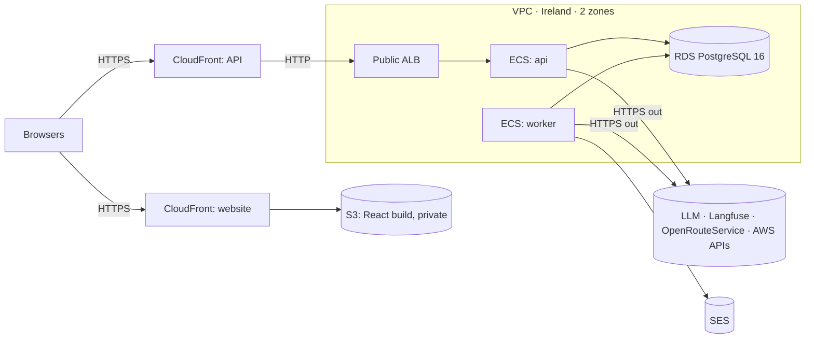

# DawaLink: Infrastructure and Deployment

**Version:** v2.0 · **Date:** 2026-11-02
**Builds on:** `02` v3.1 §7 · `05` v3.1 §7, §9 · `06` v1.2 §2, §6.1 · `09` v1.2 (FX, FO rows) · `10` v1.1 · `11` v1.1 §10, §13
**Status:** ✅ validated by the owner (2026-11-02, decision log §V). It replaces the v1.0 draft, which was never validated: the owner removed the pipelines, CDK and advanced GitHub features. Decisions INF-D1–INF-D15 are in §15.

This is the last planning step. It says **how we work, where DawaLink runs, and how it gets there**. Everything is done by hand. Nothing here has been run yet, so the first deploy is also its first test.

---

## In short

- **We build and test on the laptop, in Docker.** AWS comes once, after the project is finished.
- **Only the owner (Mohammed) touches AWS,** with a personal IAM user and an access key. Images are built on the laptop and pushed to ECR.
- **Ireland** (`eu-west-1`). AWS is set up **by hand in the console**, following the checklist in §11. There is no CDK, no CloudFormation and no pipeline.
- **Two CloudFronts, no domain, no certificate:** one for the website (S3), one for the API (ALB).
- **Two CloudFronts change the login:** the browser treats them as two different sites, so the login token travels in a header instead of a cookie, and the API uses CORS (§4.3).
- **The hop between CloudFront and the ALB is unencrypted.** This is an accepted risk (§4.4).
- **Cognito comes last:** we build the login already designed, then switch to Cognito once the project works (§10).
- **Rollback** means going back to the previous ECS task definition.
- **The owner and Claude check everything** and write the test datasets. There are no pull request reviews and no CI.
- **Cost:** about **$82 a month (≈ $2.70 a day)** while it runs in AWS.

---

## 1. How we work (INF-D1, INF-D14)

1. Claude writes a feature on the laptop.
2. Claude runs that feature's tests, including its Failure Matrix rows, and tries it on the local website.
3. The owner checks it and commits. The owner can explain what was committed (the course makes students responsible for AI-written code).

- **No CI, no pull request reviews, no branch protection.** GitHub only shares the files with teammates.
- **The repo stays public,** so nothing secret or personal goes into tracked files. Scan before every commit, as today.
- **The evaluation suites** (`08`) run by hand on the laptop. Their results are committed, as planned.
- **The test datasets** (the U-set and R-set, `08` §2) are written by the owner and Claude. The report says so.
  - **The held-out part is written in a separate Claude session,** and the working session never opens it, so tuning can't leak into the final results.
- **The Definition of Done changes:**
  - #3 "CI is green" becomes "the tests pass on the laptop";
  - #7 "a teammate reviewed it" becomes "the owner checked it and can explain it".

---

## 2. Local development

- **One command:** `docker compose up` starts `postgres`, `api`, `worker`, `web` and `mailpit`. Ollama runs on the laptop.
- **Mailpit** catches every email and shows it at `http://localhost:8025`.
- **LLM:** Ollama `qwen2.5:7b`, or the fake scripted model in tests.
- **Routing:** OpenRouteService with a personal key. With no key, travel times fall back to straight-line distance (R-RT1).
- **Settings:** one module, `config.py`, reads environment variables. `.env.example` lists them with placeholders, and the real `.env` is never committed.
- **Local matches AWS:** the website and the API run on different ports, so they're separate origins here too. The same login and CORS code runs in both places.

---

## 3. The AWS layout (INF-D2, INF-D3)

**Region: Ireland (`eu-west-1`).** From the owner's laptop it answers in about 74 ms, and it's the region the owner chose.



| Service | Use |
|---|---|
| **ECR** | Holds the backend image |
| **ECS Fargate** | Runs `api` and `worker`, plus one-off tasks |
| **ALB** | Sends API traffic to the `api` task |
| **RDS** | PostgreSQL 16 |
| **CloudFront × 2** | The HTTPS addresses for the website and the API |
| **S3** | Holds the React build (private) |
| **SES** | Sends notification emails |
| **Cognito** | Login and sign-up, added last (§10) |
| **Secrets Manager** | Holds passwords and keys |
| **CloudWatch Logs, Budgets** | Logs and the cost alert |

---

## 4. The two CloudFronts (INF-D4, INF-D5, INF-D6)

No domain and no certificate: both use their `*.cloudfront.net` address. CloudFront fixes the minimum TLS version at 1.0 on these addresses; current browsers still connect with a modern version.

### 4.1 Website CloudFront

| Setting | Value |
|---|---|
| Origin | The private S3 bucket, with Origin Access Control |
| Viewer | Redirect HTTP to HTTPS |
| Default root object | `index.html` |
| Error pages | `403` and `404` → `/index.html` with status `200`, so React routes like `/requests/Q-4HX9TM` work. This is safe here because this CloudFront serves no API. |
| Response headers policy | The security headers below |

**Security headers** (defenses that `10` relies on):

| Header | Value |
|---|---|
| `Content-Security-Policy` | `default-src 'self'; script-src 'self'; style-src 'self' 'unsafe-inline'; img-src 'self' data: https://tile.openstreetmap.org; font-src 'self'; connect-src 'self' https://<api-cloudfront>; frame-ancestors 'none'; base-uri 'none'; form-action 'self'; object-src 'none'` |
| `Strict-Transport-Security` | `max-age=31536000` |
| `X-Content-Type-Options` | `nosniff` |
| `X-Frame-Options` | `DENY` |
| `Referrer-Policy` | `strict-origin-when-cross-origin` (OpenStreetMap's tile policy forbids blocking the referrer) |
| `Permissions-Policy` | `geolocation=(self), camera=(), microphone=(), payment=()` |

- Scripts run only from our own site. This matters more now, because the login token is readable by scripts (§4.3).
- `'unsafe-inline'` for styles assumes Mantine needs it. We confirm this in the build.
- Readex Pro is self-hosted, so no request goes to Google Fonts.

### 4.2 API CloudFront

| Setting | Value | Why |
|---|---|---|
| Origin | The ALB, **HTTP only** | The ALB has no certificate |
| Response timeout | 60 s | The chat stream sends a heartbeat every 15 s |
| Viewer | Redirect HTTP to HTTPS | |
| Allowed methods | All | |
| Cache policy | `Managed-CachingDisabled` | Nothing from the API may be cached |
| Origin request policy | `Managed-AllViewerAndCloudFrontHeaders-2022-06` | **Required.** By default CloudFront removes `Authorization` from `GET` requests, which would log everyone out. This policy forwards it, plus `Origin` and `CloudFront-Viewer-Address` (R-AU8). |

### 4.3 Login across two sites (INF-D6)

`cloudfront.net` is on the public suffix list, so the browser treats the two addresses as **two separate sites**. Safari blocks third-party cookies, so a login cookie would fail on iPhones. So:

- `POST /auth/login` returns the session token **in the response body**.
- React keeps it in `localStorage` and sends `Authorization: Bearer <token>` on every call, including the chat stream.
- **The server side doesn't change:** a random token, only its hash in `sessions`, 7 days (admins 12 h), and logout or suspension revokes it at once.
- **CORS:** the API allows only the website's address, with `Authorization`, `Content-Type` and `Idempotency-Key`, and exposes `X-Request-ID`. Preflight answers are cached for 2 hours, though each new URL still costs one small extra request.
- **The `Origin` check stays** (`06` §2.1). Without a cookie, the browser never attaches the login by itself, so CSRF no longer applies.

### 4.4 Accepted risks of this setup

| Risk | Why we accept it |
|---|---|
| **The CloudFront → ALB hop is plain HTTP.** Passwords, login tokens and medicine searches are unencrypted on that hop. | HTTPS there needs a certificate, which needs a domain. This is a course demo with synthetic data, and the report states it as a limitation. It reverses design review #2's B7. |
| **Scripts can read the login token.** An XSS bug could steal it, which the old cookie prevented. | Needed for two sites. React escaping, plain-text agent replies and the CSP remain. |
| **The ALB is public.** | Its security group accepts only CloudFront's addresses, so visitors can't call it directly. Someone could still point their own CloudFront at it and dodge the sign-up limit (TH-41); that's low risk for a course demo. |
| **Viewers can connect to CloudFront with old TLS versions.** | Fixed on `*.cloudfront.net` addresses; modern browsers don't use them. |

---

## 5. Network (INF-D7)

- **One VPC, two zones.** No NAT gateway.
- **Public subnets:** the ALB and the ECS tasks. Tasks have a public IP for outbound calls.
- **Isolated subnets:** RDS, with no route to the internet.

| Security group | Accepts | Can send to |
|---|---|---|
| `dawalink-alb` | Port 80 from the CloudFront managed prefix list only (`com.amazonaws.global.cloudfront.origin-facing`) | The tasks, port 8000 |
| `dawalink-tasks` | Port 8000 from `dawalink-alb` only | HTTPS anywhere · the database |
| `dawalink-db` | Port 5432 from `dawalink-tasks` only | Nothing |

**ALB listener:** HTTP on port 80, forwarding to the `api` target group.

The CloudFront rule on `dawalink-alb` is one choice in the security group's inbound rule, in place of `0.0.0.0/0`. It isn't needed for CloudFront to connect. It stops people from skipping CloudFront and calling the ALB directly, which would let them fake the address that IP limits read (R-AU8).

---

## 6. Containers (INF-D8)

**One backend image** for everything; only the command changes. It runs as a non-root user, and the base image is pinned.

| Task definition | Command | Size (first guess) | Runs |
|---|---|---|---|
| `dawalink-api` | `uvicorn …` | 0.5 vCPU, 1 GB | Always, 1 task, behind the ALB |
| `dawalink-worker` | `python -m dawalink.worker` | 0.25 vCPU, 1 GB | Always, 1 task |
| `dawalink-ops` | `python -m dawalink.ops.<command>` | 0.25 vCPU, 0.5 GB | By hand, one-off |

- **Regular Fargate, no Spot.** ECS Exec is off and there is no SSH.
- **API health check:** the ALB calls `/api/v1/health`.
- **`/health` always answers `200` while the process runs,** with `db: "ok"` or `"down"` in the body. If it answered `503` during a database outage, ECS would keep killing healthy API tasks instead of letting them answer "try again" (FX-10). This changes `06` §6.1.
- **Worker health check:** each clock-check pass writes a heartbeat, and the task definition's health check fails if it's older than 2 minutes. ECS then replaces the worker, so a stuck worker restarts on its own (FX-13, FX-14).
- **Two workers overlapping** during an update is safe (`SKIP LOCKED`, `05` §10).

---

## 7. Database (INF-D9)

| Setting | Value |
|---|---|
| Engine and size | PostgreSQL 16, `db.t4g.micro`, 20 GB gp3, one zone |
| Access | Isolated subnets, not publicly accessible |
| Encryption | At rest on; TLS required (`rds.force_ssl = 1`) |
| Master password | Managed by RDS in Secrets Manager |

**Migrations run by hand, before the services update** (the validated one-off task, `05` §9). `python -m dawalink.ops.prepare_db` does the following, and running it twice is safe:
1. Creates or updates the three database roles (DB-D10), and sets the app role's 5 s statement timeout (N-40).
2. Runs `alembic upgrade head`.
3. If the catalog is empty, imports it. Where the Ministry price file lives is decided later (O5).
4. If demo mode is on and there are no pharmacies, seeds the demo data. Demo account passwords come from the secret, never from the repo.

- **If it fails, don't update the services.** The old version keeps running (FO-1).
- **A rollback restores code, not the database.** So a migration must keep the previous version working: add first, remove later. Renaming or dropping a column takes two releases.
- **Local:** Claude runs `upgrade` and `downgrade` before any commit that changes the schema.

---

## 8. Secrets and permissions (INF-D10)

| Secret | Holds | Used by |
|---|---|---|
| `dawalink/keys` | LLM, Langfuse and OpenRouteService keys; the TOTP encryption key; demo account details | `api`, `worker`, `ops` |
| `dawalink/db/master` | RDS master login | `ops` |
| `dawalink/db/migrator` | Migrations login | `ops` |
| `dawalink/db/app` | App login | `api`, `worker`, `ops` |
| `dawalink/db/retention` | Retention login | `worker` |

- **ECS passes each secret to a container as an environment variable** at start. If one is missing, the app refuses to start and logs its name, never its value (FX-17).
- **IAM roles:**
  - the API task role has no AWS permissions;
  - the worker task role may only send email through SES;
  - each execution role reads only the secrets its task definition uses.
- **The owner's AWS access:**
  - MFA on the root account, and root isn't used day to day;
  - a personal IAM user with MFA;
  - the access key lives in `~/.aws/credentials`, outside the project folder, so it can't be committed.

---

## 9. Email (INF-D11)

- **SES in Ireland,** sending from one address verified by hand. No domain.
- **We stay in the SES sandbox by default.** It sends only to addresses verified one by one (each person clicks a link from AWS), up to 200 emails a day. That's enough for the demo accounts.
- **Everyone else still sees every notification in the app** (FX-7). Sign-up email isn't affected, because Cognito sends it (§10).
- **Production access is optional, if there's time.** It lifts that limit. The owner requests it once the site is live, because AWS asks for its URL. AWS answers within 96 hours, may take longer, and may refuse.
- **Spam:** mail from a personal address may land in spam. We test it before the demo.
- **Bounces:** SES's suppression list handles them; no bounce webhook (it would be a new public endpoint). AWS's request form asks you to confirm a bounce process, so we'll see if this satisfies it.

---

## 10. Cognito comes last (INF-D12)

**Order: finish the project locally, switch to Cognito, then deploy.**

- **Until then,** we build the validated login: `03`, `04`, `05`, `06` and `10` don't change for it now.
- **To keep the switch small,** all login logic stays in one `auth` module with a clear interface. Nothing else calls it directly.
- **After the switch:**
  - React calls FastAPI, and FastAPI calls Cognito;
  - Cognito holds passwords, email verification and admin two-factor login;
  - our API still issues its own session token, so §4.3 stays the same.
- **Sign-up email:** Cognito's built-in sender reaches any address with no SES review, up to a small daily limit. So a grader can sign up live.
- **Registration must still never reveal an account:** Cognito reports existing emails, so our API hides that and always says "check your email".
- **Cost:** free up to 10,000 monthly users.
- **Local tests** use a fake. Cognito itself runs in AWS, so development needs a real user pool from this step on.
- **The docs change in that step,** including how admins are created, which replaces `create_admin.py`.
- **If we deploy before switching:** verification emails reach only SES-verified addresses unless production access is granted, and creating an admin needs a one-off task.

---

## 11. First setup checklist (once, by the owner)

1. **Account:** MFA on root; create the IAM user; run `aws configure`.
2. **Budget:** $50 and $80 alerts, **excluding credits**. By default AWS counts credits, so spending covered by credit would show near $0.
3. **ECR:** create the `dawalink-backend` repository.
4. **Network:** the VPC, subnets and three security groups (§5).
5. **RDS:** the database (§7).
6. **Secrets:** fill in `dawalink/keys`; create the three database logins.
7. **ALB:** the target group, the ALB, and a listener that forwards to the target group.
8. **API CloudFront** (§4.2). Note its address.
9. **S3 and website CloudFront** (§4.1). Note its address.
10. **SES:** verify the sender address.
11. **Cognito:** the user pool (§10).
12. **ECS:** the cluster and three task definitions. Set `WEBSITE_URL` and `DEMO_MODE=true`. Our AWS stack is the demo system, so the demo clock stays on there.
13. **First release:** follow §12, creating the two services after the database step.
14. **Headers:** put the API address into the CSP (§4.1).
15. **Admins:** create the admin accounts (§10).
16. **Test:** run §14.

---

## 12. Releasing a new version (INF-D13)

Replace `<account>` and the other placeholders with your own values.

```bash
aws ecr get-login-password --region eu-west-1 | docker login --username AWS --password-stdin <account>.dkr.ecr.eu-west-1.amazonaws.com
```
```bash
docker build --platform linux/amd64 -t <account>.dkr.ecr.eu-west-1.amazonaws.com/dawalink-backend:<git-sha> backend
```
```bash
docker push <account>.dkr.ecr.eu-west-1.amazonaws.com/dawalink-backend:<git-sha>
```

Then:
1. Register a new revision of all three task definitions with the new image.
2. Run `dawalink-ops` once with the `prepare_db` command, in a public subnet with a public IP. **It must succeed.**
3. Update the `api` and `worker` services to the new revisions.
4. Build the website with `VITE_API_URL` set to the API CloudFront address, and upload it:

```bash
aws s3 sync frontend/dist s3://<website-bucket> --delete
```
```bash
aws cloudfront create-invalidation --distribution-id <website-distribution-id> --paths "/index.html"
```

5. Check `https://<api-cloudfront>/api/v1/health`: it should show `db: "ok"` and the new version. Then open the website.

**Rollback (FO-2):** update the service to the previous task definition revision. For the website, upload the previous build. The database stays as it is (§7).

---

## 13. Logs, alerts, cost (INF-D15)

- **Logs:** JSON to CloudWatch, one group per service, kept 30 days (a new row in `04` R-RET). Never any personal data.
- **Alerts:** the app's own alerts (`04` R-AL) in the admin console, plus the AWS budget. No CloudWatch alarms, dashboards or Sentry.
- **Agent metrics:** `agent_runs` and Langfuse, as designed.

**Monthly cost, Ireland** (AWS's list prices, except the last line):

| Item | ≈ per month |
|---|---|
| API task | $18 |
| Worker task | $11 |
| Load balancer | $18 |
| Database with 20 GB | $15 |
| Four public IPs (two tasks + the ALB in two zones) | $15 |
| Secrets, logs and small items (my estimate) | $5 |
| CloudFront, S3, ECR, SES, Cognito | ≈ $0 at this scale (free tiers, to confirm) |
| **Total while running** | **≈ $82 ≈ $2.70 a day** |

The $100 credit covers about five weeks of this. The LLM isn't included (O2): it's capped by N-46 and the provider's own spend limit.

---

## 14. Before the demo

- [ ] The real LLM key is in `dawalink/keys`, with the provider's spend limit set (O2).
- [ ] Sign up from scratch with a non-team email, and the verification email arrives.
- [ ] A reservation email reaches a verified demo address, and the in-app notification shows for everyone.
- [ ] Log in on an **iPhone and an Android phone**.
- [ ] Chat works through CloudFront, including the streamed reply.
- [ ] The browser console shows no CSP errors, and maps load.
- [ ] A direct request to the ALB's own address fails (it times out).
- [ ] Admins log in with two-factor.
- [ ] A rehearsal on the deployed version: the demo scenarios, degraded mode, and the security challenges (`10` §9.3).
- [ ] The recorded backup video exists (D-1).

---

## 15. Decisions

**Status:** ✅ validated 2026-11-02. Those marked *owner* were chosen by the owner. Server sizes, log retention and the alert choices are starting values that can change during the build.

| ID | Decision | Why |
|---|---|---|
| INF-D1 | **Local first** in Docker; one AWS deployment after the project is finished; no staging. *(owner)* | Simple; the graded core is the agent |
| INF-D2 | **Ireland** (`eu-west-1`). *(owner)* | Owner's choice; as fast as Frankfurt from the laptop, and cheaper |
| INF-D3 | **AWS by hand in the console;** only the owner has access; images pushed from the laptop; no CDK, CloudFormation or pipelines. Replaces T9's CDK and T10. *(owner)* | Simple; loses the infrastructure-as-code bonus |
| INF-D4 | **No domain:** `*.cloudfront.net` addresses. *(owner)* | No cost or DNS work; cross-site login and old TLS accepted (§4.4) |
| INF-D5 | **Two CloudFronts and a public ALB** that accepts only CloudFront's addresses (one security group rule). Reverses DR2-B7. *(owner)* | Owner's design; no certificate needed, and visitors can't skip CloudFront |
| INF-D6 | **The login token travels in the `Authorization` header,** kept in `localStorage`; CORS for the website only. The server-side session is unchanged. Changes API-D12 and R-AU3. | Forced by INF-D5: Safari blocks third-party cookies |
| INF-D7 | **Network:** public subnets for the ALB and tasks, isolated for RDS, no NAT | The cheapest safe option |
| INF-D8 | **One image, two services, one ops task;** sizes in §6; worker heartbeat check; `/health` always `200` with the database's status | A stuck worker restarts; a database outage doesn't kill the API |
| INF-D9 | **`prepare_db` run by hand before each service update;** migrations keep the previous version working | A failed migration changes nothing |
| INF-D10 | **Secrets in Secrets Manager;** the API has no AWS permissions; the access key stays outside the project folder | Least privilege in a public repo |
| INF-D11 | **SES from one verified address, staying in the sandbox;** production access only if there's time; no bounce webhook. *(owner)* | Demo accounts get email; everyone else uses in-app notifications |
| INF-D12 | **Cognito after the project works, before deploying,** behind our API. *(owner)* | Local work stays AWS-free; login stays in one module |
| INF-D13 | **Release and rollback by hand;** rollback = the previous task definition. *(owner)* | Matches FO-2 |
| INF-D14 | **The owner and Claude check everything and write the datasets;** no CI, no PR reviews; the repo stays public. Replaces T10, T11 and Definition of Done #3 and #7. *(owner)* | Simple; loses most of bonus B-1, B-2, B-3, B-4 and B-6 |
| INF-D15 | **Logs kept 30 days;** app alerts + the AWS budget (excluding credits); no CloudWatch alarms. Demo mode on in AWS. | Enough for a short deployment; the demo clock is needed |

---

## 16. Changes to other documents (applied 2026-11-02)

| Doc | Change |
|---|---|
| `00` | New section **§V** (INF-D1–INF-D15); new open item **O5** (where the Ministry price file lives); T9, T10, T11, DR2-B7, DR2-B8, API-D12, API-D13, EV-D2 and EV-D11 marked updated or superseded |
| `02` | §1 (auth, CI/CD, hosting, quality rows), §2 diagram, §6 (no `infra/`, no `.github/workflows/`), §7 (points here), §8 (removed or reduced), §9 |
| `04` | R-AU3 (token in a header); R-DEMO wording (on in our AWS stack); R-RET (logs, 30 days) |
| `05` | §7 and §9: the roles and migrations run by `prepare_db` by hand; no CI; add first, remove later |
| `06` | Base URLs; CORS; §2.1 (login token, no cookie); `/health`; §9 (no CI) |
| `07` | The CI wording is removed |
| `08` | §7 (run by hand); §8 (who does what); datasets written by the owner and Claude, stated as a limitation |
| `09` | FX-8, FX-9, FX-13, FO-1, FO-2, FO-5, FO-9; tests described as run in CI |
| `10` | TB-3, TB-8; TH-2, TH-37, TH-41, TH-43–TH-47; §9.1; new accepted risks RR-12–RR-16; TH-45 now covers the access key on the laptop |
| `11` | §13 (the API client sends the token; no PR screenshots); §10 (fonts self-hosted) |
| Checklist | Definition of Done #3 and #7; B-1–B-9; G-9; T-14; phases |
| `README.md`, `CLAUDE.md` | Row 12; team, working rules and tech sections |
